# shoota 游戏平台 设计文档

## 1. 元信息 / 变更记录

| 字段 | 值 |
| --- | --- |
| 状态 | 评审中 |
| 项目画像 | 生产产品 |
| Owner | Bearisbug |
| 评审人 | 老板、leizhang |
| 最后更新 | 2026-10-22 |
| 关联 | 仓库 https://github.com/Bearisbug/changju · 部署手册 `docs/DEPLOY.md` · 上线清单 `docs/LAUNCH.md` · 共享类型 `src/shared/` · 游戏目录 `src/catalog/` |

变更记录：

| 日期 | 版本 | 涉及 ID | 一句话 | 类型 |
| --- | --- | --- | --- | --- |
| 2026-10-22 | v0.8 | FLOW-CLOUD-SYNC、FLOW-ROTATE、API-CLOUD-003、PAGE-PLAYER、PAGE-BACKUP | 只多了游玩秒数也推上云端，旋转提示改成游戏区顶部一条、5 秒后收起，存档页云存档卡副标题跟着云存档状态 | 功能、缺陷修复、界面 |
| 2026-10-22 | v0.8 | ADR-006、ADR-008、API-SDK-001、API-SDK-002、API-SDK-003 | 两种运行层、游戏页铺满与全屏、游戏与平台之间的三组消息由产品签字 | 拍板 |
| 2026-10-22 | v0.8 | Q-CLOUD-FIRST-1、Q-CLOUD-SYNC-1、FLOW-CLOUD-FIRST、FLOW-CLOUD-SYNC、REQ-CLOUD-001、REQ-CLOUD-006 | 产品拍板：玩过就自动开通云存档，365 天没同步的云存档自动删除 | 拍板 |
| 2026-10-22 | v0.8 | FLOW-LAUNCH、FLOW-KANBAN-LAUNCH、REQ-LAUNCH-001、REQ-LAUNCH-002、REQ-LAUNCH-003、REQ-LAUNCH-004、REQ-LAUNCH-005、REQ-LAUNCH-006、INV-LAUNCH-001、RULE-LAUNCH-001、API-004、API-LAUNCH-001、ADR-009 | 启动加分段超时、自动重试与失败页，看板加启动成功率 | 功能 |
| 2026-10-22 | v0.8 | FLOW-IMMERSIVE、FLOW-ROTATE、REQ-PLAY-001、REQ-PLAY-002、REQ-PLAY-003、REQ-PLAY-004、REQ-PLAY-005、REQ-PLAY-006、REQ-SDK-002、API-SDK-003、ADR-008 | 游戏页铺满屏幕，只留悬浮按钮，能全屏的手机开局即全屏 | 功能、界面 |
| 2026-10-22 | v0.8 | FLOW-CLOUD-FIRST、FLOW-CLOUD-SYNC、FLOW-CLOUD-CONFLICT、FLOW-RECOVER、REQ-CLOUD-001、REQ-CLOUD-002、REQ-CLOUD-003、REQ-CLOUD-004、REQ-CLOUD-005、REQ-CLOUD-006、INV-CLOUD-001、INV-CLOUD-002、INV-CLOUD-003、INV-CLOUD-004、RULE-CLOUD-001、RULE-CLOUD-002、API-CLOUD-001、API-CLOUD-002、API-CLOUD-003、ADR-007 | 新增云存档与恢复码，换设备输入恢复码接着玩 | 功能 |
| 2026-10-22 | v0.8 | FLOW-BROWSE、FLOW-BACKUP、FLOW-PLAY、FLOW-SAVE-MOVE、REQ-011、REQ-016、REQ-017、REQ-018、REQ-019、REQ-020、REQ-021、REQ-022、REQ-023、REQ-SDK-001、REQ-SDK-003、INV-002、API-002、API-003、API-SDK-001、API-SDK-002、API-SDK-004、ADR-005、ADR-006、ADR-010 | 平台按新架构重写，旧版功能逐项对齐 | 功能、文档 |
| 2026-10-21 | v0.7 | FLOW-SAVE-MOVE、FLOW-COLLECT、REQ-014、REQ-015、REQ-006、API-001、API-005、ENT-Visitor、PAGE-MOVE、INV-005、ADR-004 | http 下玩过的浏览器在 https 下自动搬回存档与旅客编号，统计前的老玩家不算新旅客，留存表注明统计首日 | 功能、缺陷修复 |
| 2026-10-21 | v0.6 | REQ-005、PAGE-KANBAN | 看板趋势图的峰值标注不再越出图表卡片 | 缺陷修复 |
| 2026-10-21 | v0.5 | REQ-010、REQ-011、REQ-012、REQ-013、FLOW-PLAY、PAGE-PLAYER、PAGE-STORE、PAGE-KANBAN-LOGIN、PAGE-KANBAN | 修正存档提示与外部链接，游戏字体不再阻塞显示，看板换品牌视觉，详情页去掉授权备注，术语表补人均游玩时长 | 缺陷修复、界面、文档 |
| 2026-10-21 | v0.4 | PAGE-STORE、PAGE-PLAYER、PAGE-BACKUP、FLOW-GAME-CATALOG、REQ-010 | 平台页面换成按 logo 新建的品牌视觉；新游戏链路已上线，状态改为已实现 | 界面、文档 |
| 2026-10-21 | v0.3 | REQ-010、FLOW-GAME-CATALOG | 上架三款独立生涯游戏，提供专属封面、准确简介和原平台存档接入 | 功能 |
| 2026-10-20 | v0.2 | FLOW-COLLECT、FLOW-KANBAN-LOGIN、FLOW-KANBAN-VIEW | 统计与看板上线，留存表改看近 60 天，设计仍待老板确认 | 功能 |
| 2026-10-20 | v0.1 | REQ-001、REQ-002、REQ-003、REQ-004、REQ-005、REQ-006、REQ-007、REQ-008、REQ-009、FLOW-COLLECT、FLOW-KANBAN-LOGIN、FLOW-KANBAN-VIEW | 新增匿名旅客统计和带密码的数据看板，初稿 | 功能 |

待签字（上线前逐项点名签字；签字前不写入真实玩家数据、不对外发布新接口）：

- 决策：ADR-005、ADR-007、ADR-009、ADR-010
- 表结构：§7 第 3 号迁移新增的五张表，以及把它们放进现有统计库
- 接口：API-LAUNCH-001、API-CLOUD-001、API-CLOUD-002、API-CLOUD-003，以及 API-004 新增的启动块
- 格式：§9 恢复码的格式与摘要方式，本机键 `changju.cloud.v1` 与撤销槽键 `undo:<游戏>`
- 规则：RULE-CLOUD-001 的冲突口径

## L1. 链路总览

领域顺序：采集 → 游戏商店 → 游玩 → 云存档 → 看板

### 角色：玩家

| 链路 | 名称 | 领域 | 状态 | 涉及需求 |
| --- | --- | --- | --- | --- |
| FLOW-COLLECT | 匿名采集 | 采集 | 已实现 | REQ-001、REQ-002、REQ-003、REQ-009、REQ-015 |
| FLOW-BROWSE | 逛商店与游戏库 | 游戏商店 | 已实现 | REQ-016、REQ-017、REQ-018、REQ-019、REQ-021、REQ-023 |
| FLOW-GAME-CATALOG | 发现并游玩新游戏 | 游戏商店 | 已实现 | REQ-010 |
| FLOW-BACKUP | 存档码备份与恢复 | 游戏商店 | 已实现 | REQ-020 |
| FLOW-SAVE-MOVE | 存档搬到 https | 游戏商店 | 已实现 | REQ-014 |
| FLOW-LAUNCH | 启动游戏 | 游玩 | 设计中 | REQ-LAUNCH-001、REQ-LAUNCH-002、REQ-LAUNCH-003、REQ-LAUNCH-004、REQ-LAUNCH-005 |
| FLOW-PLAY | 游玩与存档 | 游玩 | 已实现 | REQ-011、REQ-012、REQ-013、REQ-022、REQ-SDK-001、REQ-SDK-003 |
| FLOW-IMMERSIVE | 沉浸与全屏 | 游玩 | 设计中 | REQ-PLAY-001、REQ-PLAY-002、REQ-PLAY-003、REQ-PLAY-004、REQ-PLAY-005 |
| FLOW-ROTATE | 横竖屏切换 | 游玩 | 设计中 | REQ-PLAY-006、REQ-SDK-002 |
| FLOW-CLOUD-FIRST | 首次上云 | 云存档 | 设计中 | REQ-CLOUD-001 |
| FLOW-CLOUD-SYNC | 云同步 | 云存档 | 设计中 | REQ-CLOUD-002、REQ-CLOUD-005、REQ-CLOUD-006 |
| FLOW-CLOUD-CONFLICT | 冲突处理 | 云存档 | 设计中 | REQ-CLOUD-004 |
| FLOW-RECOVER | 恢复码绑定 | 云存档 | 设计中 | REQ-CLOUD-003 |

### 角色：看板查看人

| 链路 | 名称 | 领域 | 状态 | 涉及需求 |
| --- | --- | --- | --- | --- |
| FLOW-KANBAN-LOGIN | 看板登录 | 看板 | 已实现 | REQ-004、REQ-009 |
| FLOW-KANBAN-VIEW | 查看指标 | 看板 | 已实现 | REQ-005、REQ-006、REQ-007、REQ-008 |
| FLOW-KANBAN-LAUNCH | 查看启动成功率 | 看板 | 设计中 | REQ-LAUNCH-006 |

界面外壳：Web｜index.html、src/app/App.tsx、src/ui/AppShell.tsx、kanban/index.html、src/kanban/KanbanApp.tsx

## L2. 链路卡

> 图例：现状待确认 = 实现已定、文档未写，等你确认是否定稿；无用例 = 这一行还没有测试用例；分支未与用户逐类核对 = 所列步骤的分支由 Agent 按文档与代码预填，还没和你逐类问过

### FLOW-SAVE-MOVE · 存档搬到 https

#### 概要

- **执行者**：玩家（ROLE-Visitor）
- **触发**：在 https 下打开平台的任意页面（PAGE-STORE）
- **进入条件**：这个浏览器在 https 下还没查过 http 下的旧数据
- **结果**：http 下的旧存档和旅客编号搬到 https，玩家接着玩，统计不多算一个旅客
- **不管**：换浏览器、换设备与无痕模式下的进度

#### 主流程

1. S1 平台页面发现还没查过，记下这是第几次去查，然后跳到 http 下的搬家页 〔无界面〕
2. S2 搬家页读出本机存档和旅客编号，打包后跳回 https 〔无界面〕
3. S3 平台页面导入存档，每款游戏留累计游玩时长更长的那份 〔无界面〕
4. S4 改用旧旅客编号，并请统计把 https 下的编号并进来（API-005） 〔无界面〕
5. S5 平台打开原来要去的页面，记一次访问（API-001） 〔界面：Web 商店｜src/app/pages/StorePage.tsx〕

#### 分支

##### S1 发现还没查过

| 类型 | 分支 | 结果 | 依据 | 测试 |
| --- | --- | --- | --- | --- |
| 边界 | 这个浏览器已经查过 | 不跳，直接打开平台 | 场景「全新浏览器只跳一次」 | TC-028 |
| 边界 | 浏览器写不了本地存储 | 不跳，直接打开平台 | 场景「全新浏览器只跳一次」 | 不测：各浏览器无痕模式表现不一 |

##### S2 搬家页打包

| 类型 | 分支 | 结果 | 依据 | 测试 |
| --- | --- | --- | --- | --- |
| 边界 | http 下没有存档也没有编号 | 带回「无数据」 | 场景「全新浏览器只跳一次」 | TC-028 |
| 边界 | 浏览器把搬家页升级成 https 打开 | 带回「无数据」 | 场景「搬家页在 https 下打开」 | TC-031 |
| 边界 | 打包后超过 190 万字符 | 只带回旅客编号，存档留在 http 那份 | ADR-004 | 不测：实测存档码最长 12.6 万字符 |
| 失败 | 搬家页打不开 | 这一次停在浏览器的错误页，下次打开 https 再试，最多 3 次 | §15 搬家页打不开；ADR-004 | 不测：http 不通时 https 也不通 |
| 失败 | 浏览器读本机存档 5 秒没回应 | 只带回编号，存档留在 http 那份 | §15 搬家页读存档没回应；ADR-004 | 不测：本地浏览器复现不了 |

##### S3 导入存档

| 类型 | 分支 | 结果 | 依据 | 测试 |
| --- | --- | --- | --- | --- |
| 边界 | 两边都有同一款游戏 | 留累计游玩时长更长的那份，另一份被替换 | 场景「两边都有同一款游戏的进度」 | TC-029 |
| 失败 | 带回的数据读不出来 | 不导入，平台照常打开 | §15 搬家数据读不出来；ADR-004 | 无用例 |
| 边界 | 本机没有发起搬家时地址带着搬家数据（如别人转发的链接） | 不导入，只去掉地址里的数据，下次打开照常去查 | ADR-004 | TC-031 |

##### S4 改用旧编号

| 类型 | 分支 | 结果 | 依据 | 测试 |
| --- | --- | --- | --- | --- |
| 边界 | https 下还没有编号 | 直接用旧编号，不请求合并 | API-005 | TC-027 |
| 边界 | http 下有存档但没有编号 | 新领的编号标为老玩家 | 场景「统计前就玩过的浏览器」；字段 visitors.prior | 无用例 |
| 失败 | 合并请求格式不对 | 400 `/errors/bad-merge` | `/errors/bad-merge`；API-005 | TC-029 |
| 失败 | 合并请求没送到 | 两个编号都留在统计里，之后只用旧编号 | §16 网络失败的批次直接丢弃；API-005 | 无用例 |
| 并发 | 两个标签页同时搬家 | 只并一次，第二次什么都不做 | 竞态「两个标签页同时搬家」；INV-005 | 无用例 |

##### S5 打开平台

| 类型 | 分支 | 结果 | 依据 | 测试 |
| --- | --- | --- | --- | --- |
| 失败 | 访问上报格式不对 | 400 `/errors/bad-event`，这次访问没记上 | `/errors/bad-event`；API-001 | 不测：本链路只发平台自己拼的上报 |

#### 待决策

无。

另见：API-005；字段 visitors.prior；§23 强制 https 换成放行搬家页的跳转规则；§28 搬家跳转保留到 2026-11-21

#### 关联

- **契约锚点**：API-005；API-001；ADR-004；PAGE-MOVE
- **上游**：—
- **下游**：FLOW-PLAY
- **守住的不变量**：INV-003、INV-005

| 步骤 | 位置 |
| --- | --- |
| S1 | `index.html#moveCheck` |
| S2 | `public/move.html#pack` |
| S3、S5 | `src/platform/move.ts#moveIn` |
| S4 | `src/platform/move.ts#moveIn`；`src/worker/routes/collect.ts#merge` |

### FLOW-LAUNCH · 启动游戏

#### 概要

- **执行者**：玩家（ROLE-Visitor）
- **触发**：在商店、详情或游戏库点开始游戏（PAGE-GAME）
- **进入条件**：这个标签页里同一款游戏没有在启动或在玩
- **结果**：游戏画面出现并可操作，或停在写明原因的失败页
- **不管**：游戏内部的读档错误与玩法故障

#### 主流程

1. S1 玩家点开始游戏，载入页出现并上报开始（API-LAUNCH-001） 〔界面：Web 载入页｜src/app/player-ui/LaunchScreen.tsx〕
2. S2a 下载游戏文件，载入页显示进度 〔界面：Web 载入页｜src/app/player-ui/LaunchScreen.tsx〕
3. S2b 读出这款游戏的本机存档 〔无界面〕
4. S3 把游戏装进页面，等它发出就绪信号（API-SDK-001） 〔无界面〕
5. S4 载入页消失，开始计时并上报就绪（API-LAUNCH-001） 〔界面：Web 游戏页｜src/app/player-ui/PlayerPage.tsx〕

#### 分支

> 分支未与用户逐类核对：S1–S4

##### S1 点开始游戏

| 类型 | 分支 | 结果 | 依据 | 测试 |
| --- | --- | --- | --- | --- |
| 边界 | 另一款游戏正在启动 | 取消那一次，再启动这一款 | 迁移 ENT-LaunchSession loading→cancelled「玩家退出」 | 无用例 |
| 边界 | 另一款游戏正在玩 | 先存档退出那一款，再启动这一款 | 迁移 ENT-LaunchSession ready→closed「退出游戏」 | 无用例 |
| 边界 | 同一款已经在启动或在玩 | 不重开，停在当前进度 | 场景「同一款游戏不重开」 | 无用例 |
| 边界 | 安卓手机支持全屏 | 同一次点击里进入全屏，转入沉浸与全屏 | ADR-008 | 无用例 |
| 边界 | 地址里的游戏不在目录 | 回商店 | 场景「旧分享链接」 | 无用例 |
| 失败 | 开始上报没送到 | 照常启动，这一次不计入成功率 | 竞态「启动上报没送到」；API-LAUNCH-001 | 无用例 |

##### S2a 下载游戏文件

| 类型 | 分支 | 结果 | 依据 | 测试 |
| --- | --- | --- | --- | --- |
| 边界 | 文件在本机缓存里且没变 | 不下载，直接读缓存 | ADR-009；场景「第二次打开不重新下载」 | 无用例 |
| 失败 | 15 秒没收到第一个字节 | 自动重试一次 | 迁移 ENT-LaunchSession loading→loading「自动重试」；§15 启动各段超时 | 无用例 |
| 失败 | 下载中途 10 秒没有新字节 | 自动重试一次 | 迁移 ENT-LaunchSession loading→loading「自动重试」；场景「下载中途卡住后自动重试」；§15 启动各段超时 | 无用例 |
| 失败 | 重试后仍超时或卡住 | 失败页〔提示：网络不太稳，游戏没下载完，可以重试〕 | 迁移 ENT-LaunchSession loading→failed「启动失败」；场景「重试后仍失败显示失败页」；§15 启动各段超时 | 无用例 |
| 失败 | 整个下载超过 120 秒 | 失败页，不自动重试〔提示：网络太慢，游戏两分钟还没下载完〕 | 迁移 ENT-LaunchSession loading→failed「启动失败」；§15 启动各段超时 | 无用例 |
| 失败 | 浏览器离线且缓存里没有 | 失败页〔提示：网络断开了，连上网再试〕 | 迁移 ENT-LaunchSession loading→failed「启动失败」；§15 离线且缓存里没有这款游戏 | 无用例 |
| 失败 | 带摘要的地址找不到 | 改用固定地址再下一次 | 竞态「发布时开着旧页面」 | 无用例 |
| 失败 | 固定地址也找不到或服务器出错 | 失败页〔提示：游戏文件暂时取不到，稍后再试〕 | 迁移 ENT-LaunchSession loading→failed「启动失败」；§15 固定地址也取不到游戏文件 | 无用例 |

##### S2b 读本机存档

| 类型 | 分支 | 结果 | 依据 | 测试 |
| --- | --- | --- | --- | --- |
| 边界 | 这款游戏还没有存档 | 用空存档开局 | 场景「新游戏刷新后接着玩」 | 无用例 |
| 失败 | 存档库 4 秒打不开或读不出 | 重新打开一次 | 迁移 ENT-LaunchSession loading→loading「自动重试」；§15 启动各段超时 | 无用例 |
| 失败 | 重开后仍超时或存档库报错 | 失败页，不开局、不写回〔提示：这台设备的存档读不出来，刷新页面后再试，存档不会丢〕 | RULE-LAUNCH-001；场景「本机存档读不出来」；§15 启动各段超时 | 无用例 |
| 并发 | 云同步正在改写这款游戏的存档 | 等它写完再读 | 竞态「启动时云同步正在写同一款」 | 无用例 |

##### S3 装进页面

| 类型 | 分支 | 结果 | 依据 | 测试 |
| --- | --- | --- | --- | --- |
| 边界 | 旧单文件游戏 | 页面解析完时由注入脚本代发就绪 | API-SDK-004 | 无用例 |
| 边界 | 改写后的游戏 | 握手后才收到存档，画出首帧再报就绪 | API-SDK-001 | 无用例 |
| 失败 | 15 秒没有就绪信号 | 失败页，不自动重试〔提示：游戏没能启动，可以重试一次〕 | 迁移 ENT-LaunchSession mounting→failed「就绪超时」；场景「游戏迟迟不就绪」；§15 启动各段超时 | 无用例 |
| 失败 | 就绪前游戏报错 | 到 15 秒时失败页，原因记为游戏报错 | 迁移 ENT-LaunchSession mounting→failed「就绪超时」；§15 启动各段超时 | 无用例 |
| 边界 | 载入中页面切到后台 | 计时暂停，回到前台接着等 | §15 启动各段超时 | 无用例 |
| 边界 | 载入中玩家点退出 | 停止下载，回详情页，上报取消 | 迁移 ENT-LaunchSession mounting→cancelled「玩家退出」 | 无用例 |
| 边界 | 失败页点重试 | 从头再启动一次，算一次新的开始 | 迁移 ENT-LaunchSession failed→loading「点重试」 | 无用例 |
| 边界 | 失败页点退出 | 回详情页 | 迁移 ENT-LaunchSession failed→closed「点退出」 | 无用例 |

##### S4 开始计时

| 类型 | 分支 | 结果 | 依据 | 测试 |
| --- | --- | --- | --- | --- |
| 失败 | 就绪上报没送到 | 游戏照常，看板少记一次就绪 | 竞态「启动上报没送到」；API-LAUNCH-001 | 无用例 |
| 失败 | 启动上报格式不对 | 400 `/errors/bad-launch`，这一批没记上 | `/errors/bad-launch`；API-LAUNCH-001 | 不测：只发平台自己拼的上报 |

#### 待决策

- **Q-LAUNCH-1 · 本机存档读不出来时，要不要让玩家选择不读存档先玩？**
  - 现状：未实现；旧版读不出时当作新存档开局，之后覆盖旧档
  - 建议：不提供，只给重试与退出
  - 何时换：存档读取失败占启动失败超过 5%
  - 代价：这类玩家这次玩不了，要刷新页面或换浏览器
  - 不可逆：否
  - 何时定：重写版上线前
  - 谁定：产品
  - 卡住：不卡
- **Q-LAUNCH-2 · 各段超时先用文中数值，还是上线前再压测调整？**
  - 现状：未实现；旧版下载与读档都没有超时
  - 建议：先用文中数值，上线 7 天后按启动遥测调
  - 何时换：某一段超时的失败占启动的 1% 以上
  - 代价：慢网玩家可能被提前判为失败
  - 不可逆：否
  - 何时定：重写版上线后 7 天
  - 谁定：技术
  - 卡住：不卡

另见：§28 免费版 Worker 每天 10 万次请求

#### 关联

- **契约锚点**：API-LAUNCH-001；API-SDK-001；API-SDK-004；ADR-009；RULE-LAUNCH-001
- **上游**：FLOW-BROWSE
- **下游**：FLOW-PLAY、FLOW-IMMERSIVE
- **守住的不变量**：INV-LAUNCH-001

| 步骤 | 位置 |
| --- | --- |
| S1 | `src/app/player-ui/PlayerPage.tsx#PlayerPage`；`src/app/player/launch.ts#LaunchSession` |
| S2a | `src/app/player/launch.ts#fetchGame` |
| S2b | `src/platform/idb.ts#readSave` |
| S3 | `src/app/player/legacyRunner.ts#mountLegacy`；`src/app/player/playRunner.ts#mountPlay` |
| S4 | `src/app/player/launch.ts#markReady` |

### FLOW-IMMERSIVE · 沉浸与全屏

#### 概要

- **执行者**：玩家（ROLE-Visitor）
- **触发**：游戏启动成功后在游戏页游玩（PAGE-PLAYER）
- **进入条件**：游戏已就绪
- **结果**：游戏区占满可用屏幕，平台只留一个悬浮按钮
- **不管**：游戏自己界面里的固定栏与按钮大小

#### 主流程

1. S1 游戏页铺满屏幕，四边避开安全区 〔界面：Web 游戏页｜src/app/player-ui/PlayerPage.tsx〕
2. S2 悬浮按钮贴在右侧边缘，3 秒后变淡 〔界面：Web 悬浮按钮｜src/app/player-ui/FloatingControl.tsx〕
3. S3 玩家拖动悬浮按钮，松手后贴到最近的左右边 〔界面：Web 悬浮按钮｜src/app/player-ui/FloatingControl.tsx〕
4. S4 玩家点悬浮按钮，打开游戏面板 〔界面：Web 游戏面板｜src/app/player-ui/PlayerPanel.tsx〕
5. S5 玩家在面板里点全屏，游戏页进入全屏 〔界面：Web 游戏面板｜src/app/player-ui/PlayerPanel.tsx〕
6. S6 玩家在面板里点退出，回到详情页 〔界面：Web 详情页｜src/app/pages/GamePage.tsx〕

#### 分支

> 分支未与用户逐类核对：S1–S6

##### S1 铺满屏幕

| 类型 | 分支 | 结果 | 依据 | 测试 |
| --- | --- | --- | --- | --- |
| 边界 | 安卓手机开局时已进入全屏 | 状态栏与导航栏隐藏，游戏区等于整块屏幕 | ADR-008；场景「安卓手机开局全屏」 | 无用例 |
| 边界 | 已全屏且游戏偏好横屏或竖屏 | 锁定到偏好方向 | ADR-008；§9 偏好方向 | 无用例 |
| 失败 | 浏览器拒绝锁定方向 | 不锁，方向不符时提示旋转 | §15 锁定方向失败时不报错 | 无用例 |
| 边界 | 在 iPhone Safari 或微信里 | 不全屏，游戏区等于浏览器可见区减安全区 | ADR-008 | 无用例 |
| 边界 | 浏览器不认动态视口高度 | 游戏区高度用页面高度 | §15 不认动态视口高度时用页面高度 | 无用例 |
| 边界 | 游戏自己请求了全屏 | 游戏盖住悬浮按钮，靠游戏或系统返回退出 | ADR-008 | 无用例 |

##### S2 悬浮按钮出现

| 类型 | 分支 | 结果 | 依据 | 测试 |
| --- | --- | --- | --- | --- |
| 边界 | 这款游戏在这个方向有记住的位置 | 放在记住的位置 | §9 悬浮按钮位置 | 无用例 |
| 边界 | 记住的位置超出当前游戏区 | 放回默认位置 | §15 悬浮按钮位置超出游戏区时放回默认 | 无用例 |
| 边界 | 存档刚写入 | 按钮上亮一个小点 2 秒 | 场景「存档变化后显示时间」 | 无用例 |
| 边界 | 系统开了减弱动态效果 | 不做淡出动画，直接变淡 | §13 减弱动态效果 | 无用例 |

##### S3 拖动悬浮按钮

| 类型 | 分支 | 结果 | 依据 | 测试 |
| --- | --- | --- | --- | --- |
| 边界 | 按下后移动不到 8 像素 | 当作点击，打开面板 | 场景「拖动悬浮按钮」 | 无用例 |
| 边界 | 松手位置压到刘海或手势条 | 推回安全区内 8 像素 | §13 悬浮按钮任何部分不进安全区 | 无用例 |
| 边界 | 面板里点恢复默认位置 | 回到右侧中间，删掉记住的位置 | 场景「拖动悬浮按钮」 | 无用例 |

##### S4 打开游戏面板

| 类型 | 分支 | 结果 | 依据 | 测试 |
| --- | --- | --- | --- | --- |
| 边界 | 手机竖屏 | 从底部弹出，最高占屏幕七成 | §13 游戏面板 | 无用例 |
| 边界 | 手机横屏 | 从右侧滑出，宽 320 像素 | §13 游戏面板 | 无用例 |
| 边界 | 平板与电脑 | 在按钮旁弹出，宽 320 像素 | §13 游戏面板 | 无用例 |
| 边界 | 点面板外或按 Esc | 关掉面板，游戏不受影响 | 场景「打开游戏面板」 | 无用例 |

##### S5 进入全屏

| 类型 | 分支 | 结果 | 依据 | 测试 |
| --- | --- | --- | --- | --- |
| 失败 | 浏览器拒绝全屏 | 停在原样〔提示：这个窗口不支持全屏。〕 | §15 全屏请求被拒时停在原样 | 无用例 |
| 边界 | 在 iPhone Safari 里 | 没有全屏按钮，改为添加到主屏幕的说明 | ADR-008；场景「iPhone 引导添加到主屏幕」 | 无用例 |
| 边界 | 在 iPhone 上点添加到主屏幕 | 先显示恢复码，再显示添加步骤 | ADR-007；ADR-008 | 无用例 |
| 边界 | 在微信里 | 没有全屏按钮，改为在浏览器打开的说明 | ADR-008；场景「微信引导在浏览器打开」 | 无用例 |
| 边界 | 第一次在微信里开游戏 | 自动弹一次在浏览器打开的说明 | 场景「微信引导在浏览器打开」 | 无用例 |
| 边界 | 玩家用系统手势退出全屏 | 面板里的按钮变回全屏 | ADR-008 | 无用例 |

##### S6 退出游戏

| 类型 | 分支 | 结果 | 依据 | 测试 |
| --- | --- | --- | --- | --- |
| 边界 | 改写后的游戏 | 先请游戏收尾，最多等 0.5 秒 | API-SDK-001 | 无用例 |
| 边界 | 正在全屏 | 先退出全屏 | ADR-008 | 无用例 |
| 边界 | 玩家按浏览器后退 | 同样退出游戏 | 场景「旧分享链接」 | 无用例 |
| 边界 | 有还没写入的存档 | 立刻写入再退出 | 场景「存档变化后显示时间」 | 无用例 |
| 边界 | 游戏自己调用退出 | 回详情页 | API-SDK-004 | 无用例 |

#### 待决策

- **Q-IMMERSIVE-1 · 安卓手机开局自动全屏，还是只在面板里给全屏按钮？**
  - 现状：未实现；旧版顶栏有全屏按钮，不自动全屏
  - 建议：开局自动全屏
  - 何时换：全屏后 10 秒内退出游戏的启动超过 20%
  - 代价：第一次全屏会弹系统说明框，挡住画面一次
  - 不可逆：否
  - 何时定：重写版上线前
  - 谁定：产品
  - 卡住：不卡

另见：§28 安卓微信能否全屏没有实测

#### 关联

- **契约锚点**：ADR-008；API-SDK-001；API-SDK-003；PAGE-PLAYER
- **上游**：FLOW-LAUNCH
- **下游**：FLOW-ROTATE
- **守住的不变量**：—

| 步骤 | 位置 |
| --- | --- |
| S1 | `src/app/player-ui/PlayerPage.tsx#PlayerPage`；`src/app/player/fullscreen.ts#enterFullscreen` |
| S2、S3 | `src/app/player-ui/FloatingControl.tsx#FloatingControl` |
| S4 | `src/app/player-ui/PlayerPanel.tsx#PlayerPanel` |
| S5 | `src/app/player/fullscreen.ts#enterFullscreen`；`src/app/player-ui/InstallGuide.tsx#InstallGuide` |
| S6 | `src/app/player-ui/PlayerPage.tsx#PlayerPage`；`src/app/player/player.ts#exit` |

### FLOW-ROTATE · 横竖屏切换

#### 概要

- **执行者**：玩家（ROLE-Visitor）
- **触发**：游玩时转动手机（PAGE-PLAYER）
- **进入条件**：游戏已就绪
- **结果**：游戏区按新方向重排，存档与进度不受影响
- **不管**：旧游戏自己的横竖屏排版

#### 主流程

1. S1 玩家转动手机，平台按新方向重算游戏区 〔界面：Web 游戏页｜src/app/player-ui/PlayerPage.tsx〕
2. S2 悬浮按钮移到这个方向记住的位置 〔界面：Web 悬浮按钮｜src/app/player-ui/FloatingControl.tsx〕
3. S3 平台把新方向与游戏区尺寸告诉游戏（API-SDK-003） 〔无界面〕
4. S4 改写后的游戏按新方向重排 〔界面：Web 改写后的游戏｜src/sdk/react/GameShell.tsx〕

#### 分支

> 分支未与用户逐类核对：S1–S4

##### S1 重算游戏区

| 类型 | 分支 | 结果 | 依据 | 测试 |
| --- | --- | --- | --- | --- |
| 边界 | 方向与游戏偏好不符 | 游戏区顶部显示一条旋转提示，不挡游戏操作，5 秒后自动收起，可提前关掉 | 场景「横屏打开竖屏游戏」；§13 旋转提示 | TC-PLAY-018 |
| 边界 | 同一款已经提示过旋转 | 不再自动提示，面板里仍有说明 | §9 已提示旋转的游戏 | 无用例 |
| 边界 | 已全屏且锁定了方向 | 屏幕不转，游戏区不变 | ADR-008 | 无用例 |
| 边界 | 在微信里转动没反应 | 旋转提示里写微信横屏开关的位置 | ADR-008 | 无用例 |
| 边界 | 横屏时两侧有刘海 | 游戏区左右各让出安全区 | 场景「横屏时避开刘海」 | 无用例 |
| 边界 | 面板开着 | 按新方向换成底部弹出或右侧滑出 | §13 游戏面板 | 无用例 |

##### S3 通知游戏

| 类型 | 分支 | 结果 | 依据 | 测试 |
| --- | --- | --- | --- | --- |
| 边界 | 旧单文件游戏 | 不发消息，由游戏自己响应窗口变化 | API-SDK-004 | 无用例 |
| 边界 | 游戏运行中改了偏好方向 | 按新偏好重新锁定或提示旋转 | API-SDK-003 | 无用例 |

##### S4 游戏重排

| 类型 | 分支 | 结果 | 依据 | 测试 |
| --- | --- | --- | --- | --- |
| 边界 | 横屏且游戏区高不到 500 像素 | 顶部信息区收成一行，点开可展开 | ADR-006；场景「GameShell 横屏折叠信息区」 | 无用例 |
| 边界 | 玩家展开过信息区 | 同一方向下次仍展开 | ADR-006 | 无用例 |

#### 待决策

- **Q-ROTATE-1 · 薯光与一克之差以外的 11 款，偏好方向写不限还是竖屏？**
  - 现状：未实现；旧版目录没有方向字段
  - 建议：写不限，横屏核心区实测低于四成的再改竖屏
  - 何时换：某款横屏核心区占比低于 40%
  - 代价：这些游戏横屏时不提示旋转，可能显得局促
  - 不可逆：否
  - 何时定：重写版上线前
  - 谁定：产品
  - 卡住：不卡

另见：§9 偏好方向

#### 关联

- **契约锚点**：API-SDK-003；ADR-006；ADR-008；§9 偏好方向
- **上游**：FLOW-IMMERSIVE
- **下游**：—
- **守住的不变量**：—

| 步骤 | 位置 |
| --- | --- |
| S1 | `src/app/player-ui/useGameArea.ts#useGameArea`；`src/app/player-ui/RotateHint.tsx#RotateHint` |
| S2 | `src/app/player-ui/FloatingControl.tsx#FloatingControl` |
| S3 | `src/app/player/playRunner.ts#sendEnv` |
| S4 | `src/sdk/react/GameShell.tsx#GameShell` |

### FLOW-CLOUD-FIRST · 首次上云

#### 概要

- **执行者**：玩家（ROLE-Visitor）
- **触发**：在没有云存档的浏览器里存下进度（PAGE-PLAYER）
- **进入条件**：本机有进度，还没有云存档编号
- **结果**：本机全部进度上云，玩家拿到一个恢复码
- **不管**：玩家拒绝上云（见待决策）

#### 主流程

1. S1 平台生成云存档编号与恢复码，先存进本机 〔无界面〕
2. S2 平台在云端开通这个云存档（API-CLOUD-001） 〔无界面〕
3. S3 平台把本机全部进度推上云端（API-CLOUD-003） 〔无界面〕
4. S4 回到商店时顶部提示一次恢复码，可复制 〔界面：Web 商店｜src/app/pages/StorePage.tsx〕

#### 分支

> 分支未与用户逐类核对：S1–S4

##### S1 生成编号与恢复码

| 类型 | 分支 | 结果 | 依据 | 测试 |
| --- | --- | --- | --- | --- |
| 边界 | 只打开过游戏，存档为空 | 不开通，等真有进度 | ADR-007 | 无用例 |
| 失败 | 浏览器写不了本地存储 | 不开通，这次只存本机 | §15 写不了本地存储时不开通云存档 | 无用例 |
| 边界 | 这次打开时存档读不出来 | 不开通 | RULE-LAUNCH-001；迁移 ENT-LaunchSession loading→failed「启动失败」 | 无用例 |
| 并发 | 两个标签页同时开通 | 只开通一个，另一个用它的编号 | 竞态「两个标签页同时开通云存档」 | 无用例 |

##### S2 云端开通

| 类型 | 分支 | 结果 | 依据 | 测试 |
| --- | --- | --- | --- | --- |
| 边界 | 同一编号与恢复码已开通过 | 当作成功 | API-CLOUD-001 | 无用例 |
| 失败 | 网络失败 | 下一分钟再试，编号与恢复码不变 | 竞态「同步请求没送到」 | 无用例 |
| 失败 | 云端已有这个编号但恢复码不同 | 409 `/errors/cloud-exists`，重新生成一对再开通 | `/errors/cloud-exists`；API-CLOUD-001 | 无用例 |
| 失败 | 请求格式不对 | 400 `/errors/bad-cloud-request` | `/errors/bad-cloud-request`；API-CLOUD-001 | 无用例 |
| 失败 | 鉴权头缺失或编号格式不对 | 401 `/errors/cloud-auth` | `/errors/cloud-auth`；API-CLOUD-001 | 无用例 |

##### S3 推上全部进度

| 类型 | 分支 | 结果 | 依据 | 测试 |
| --- | --- | --- | --- | --- |
| 边界 | 某款存档压缩后超过 1 MB | 这款不上云，面板标出〔提示：这款游戏的存档太大，只存在这台设备上〕 | RULE-CLOUD-002；场景「存档超过 1 MB」 | 无用例 |
| 边界 | 超过 14 款 | 分批推 | §15 一次同步最多 14 款 | 无用例 |
| 失败 | 正文超过 2 MB | 413 `/errors/cloud-too-large`，拆小再推 | `/errors/cloud-too-large`；API-CLOUD-003 | 无用例 |
| 失败 | 网络失败 | 转入云同步，下一分钟再推 | 竞态「同步请求没送到」 | 无用例 |
| 失败 | 云端找不到刚开通的云存档 | 404 `/errors/cloud-not-found`，回到 S2 重新开通 | `/errors/cloud-not-found`；API-CLOUD-003 | 无用例 |

##### S4 提示恢复码

| 类型 | 分支 | 结果 | 依据 | 测试 |
| --- | --- | --- | --- | --- |
| 边界 | 玩家没复制就关掉提示 | 存档页随时能看到恢复码 | §13 存档页 | 无用例 |
| 边界 | 玩家点复制 | 复制成四段带连字符的写法 | §9 恢复码 | 无用例 |

#### 待决策

无。

另见：§28 站内不告知匿名统计

#### 关联

- **契约锚点**：API-CLOUD-001；API-CLOUD-003；ADR-007；ENT-CloudAccount
- **上游**：FLOW-PLAY
- **下游**：FLOW-CLOUD-SYNC、FLOW-RECOVER
- **守住的不变量**：INV-CLOUD-001、INV-CLOUD-003

| 步骤 | 位置 |
| --- | --- |
| S1 | `src/platform/cloud.ts#ensureCloud` |
| S2 | `src/platform/cloud.ts#createAccount`；`src/worker/routes/cloud.ts#createAccount` |
| S3 | `src/platform/cloud.ts#syncNow`；`src/worker/routes/cloud.ts#sync` |
| S4 | `src/app/pages/StorePage.tsx#CloudNotice` |

### FLOW-CLOUD-SYNC · 云同步

#### 概要

- **执行者**：玩家的浏览器（ROLE-Visitor）
- **触发**：平台页面开着时每分钟一次，退出游戏与页面隐藏时各一次
- **进入条件**：这个浏览器已开通云存档
- **结果**：本机改过的进度上云，云端更新的进度拉回本机
- **不管**：同一款游戏两台设备都改过（见冲突处理）

#### 主流程

1. S1 平台找出上次同步后改过的游戏 〔无界面〕
2. S2 平台推送改过的游戏，带上本机已有的版本号（API-CLOUD-003） 〔无界面〕
3. S3 云端逐款写入，回传本机比云端旧的游戏（API-CLOUD-003） 〔无界面〕
4. S4 平台把拉回的进度写进本机，记下新版本号 〔无界面〕
5. S5 游戏面板与存档页显示上次同步时间 〔界面：Web 游戏面板｜src/app/player-ui/PlayerPanel.tsx〕

#### 分支

> 分支未与用户逐类核对：S1–S5

##### S1 找出改过的游戏

| 类型 | 分支 | 结果 | 依据 | 测试 |
| --- | --- | --- | --- | --- |
| 边界 | 没有改过的游戏 | 只问云端有没有更新 | API-CLOUD-003 | 无用例 |
| 边界 | 存档没变，只多了游玩秒数 | 也算改过，推这款 | RULE-CLOUD-001；字段 cloud_games.seconds | TC-CLOUD-003 |
| 边界 | 这款游戏这次读档失败过 | 不推这款 | RULE-LAUNCH-001；迁移 ENT-LaunchSession loading→failed「启动失败」 | 无用例 |
| 边界 | 浏览器离线 | 跳过，联网后立刻补一次 | §15 离线时跳过同步 | 无用例 |
| 并发 | 两个标签页同时同步 | 一次只跑一个，另一个跳过 | 竞态「两个标签页同时同步」 | 无用例 |

##### S2 推送

| 类型 | 分支 | 结果 | 依据 | 测试 |
| --- | --- | --- | --- | --- |
| 边界 | 页面隐藏且要推的超过 60 KB | 只推 60 KB 以内的游戏，其余下次 | §15 页面隐藏时只推 60 KB 以内 | 无用例 |
| 失败 | 网络失败或超时 | 本机不变，下一分钟再推 | 竞态「同步请求没送到」 | 无用例 |
| 失败 | 云端没有这个云存档 | 404 `/errors/cloud-not-found`，用本机编号重新开通再推 | `/errors/cloud-not-found`；场景「365 天没同步的云存档」 | 无用例 |
| 失败 | 编号格式不对 | 401 `/errors/cloud-auth`，停止同步，存档页提示 | `/errors/cloud-auth`；API-CLOUD-003 | 无用例 |
| 失败 | 请求格式不对 | 400 `/errors/bad-cloud-request`，这次作废 | `/errors/bad-cloud-request`；API-CLOUD-003 | 无用例 |
| 失败 | 正文超过 2 MB | 413 `/errors/cloud-too-large`，分批再推 | `/errors/cloud-too-large`；API-CLOUD-003 | 无用例 |

##### S3 云端写入

| 类型 | 分支 | 结果 | 依据 | 测试 |
| --- | --- | --- | --- | --- |
| 边界 | 同一款 10 秒内写过 | 这款这次不写，下次再推 | §15 同一款 10 秒内只写一次 | 无用例 |
| 边界 | 推送带的版本号不是云端当前版本 | 转入冲突处理 | RULE-CLOUD-001；API-CLOUD-003 | 无用例 |
| 边界 | 推上来的内容和云端完全相同，秒数不比云端多 | 不加版本号，按成功返回 | 竞态「同步请求没送到」；场景「同一份内容重推」 | TC-CLOUD-005 |
| 边界 | 推上来的内容和云端相同，秒数比云端多 | 只更新秒数、最近游玩与进度文字，不加版本号 | RULE-CLOUD-001；字段 cloud_games.seconds | TC-CLOUD-003 |
| 边界 | 某款压缩后超过 1 MB | 这款不写，面板标出 | RULE-CLOUD-002；字段 cloud_games.bytes | 无用例 |

##### S4 写进本机

| 类型 | 分支 | 结果 | 依据 | 测试 |
| --- | --- | --- | --- | --- |
| 边界 | 本机这款存档没改过 | 直接换成云端那份 | RULE-CLOUD-001；API-CLOUD-003 | 无用例 |
| 并发 | 拉回的游戏正在本标签页里玩 | 先不写，退出那款游戏后再写 | 竞态「同步拉回正在玩的游戏」 | 无用例 |
| 失败 | 写本机存档库失败 | 版本号不更新，下次重拉 | §15 写本机存档库失败时不更新版本号 | 无用例 |

##### S5 显示同步时间

| 类型 | 分支 | 结果 | 依据 | 测试 |
| --- | --- | --- | --- | --- |
| 边界 | 存档页的云存档卡 | 标题下面写「存档自动保存在这台设备并同步到云端」 | §13 存档页 | TC-CLOUD-022 |
| 失败 | 云端鉴权失败，停止同步 | 存档页云存档卡标题下面换回「存档自动保存在这台设备」，卡里写暂停同步 | `/errors/cloud-auth`；§13 存档页 | TC-CLOUD-022 |

#### 待决策

无。

另见：§28 免费版单个数据库上限 500 MB

#### 关联

- **契约锚点**：API-CLOUD-003；ENT-CloudGame；ENT-CloudMeta；RULE-CLOUD-001；RULE-CLOUD-002
- **上游**：FLOW-CLOUD-FIRST
- **下游**：FLOW-CLOUD-CONFLICT
- **守住的不变量**：INV-CLOUD-002、INV-CLOUD-003、INV-CLOUD-004、INV-LAUNCH-001

| 步骤 | 位置 |
| --- | --- |
| S1 | `src/platform/cloud.ts#dirtyGames` |
| S2 | `src/platform/cloud.ts#syncNow` |
| S3 | `src/worker/routes/cloud.ts#sync` |
| S4 | `src/platform/cloud.ts#applyPull` |
| S5 | `src/app/player-ui/PlayerPage.tsx#cloudLine`；`src/app/pages/BackupPage.tsx#CloudCard` |

### FLOW-CLOUD-CONFLICT · 冲突处理

#### 概要

- **执行者**：玩家（ROLE-Visitor）
- **触发**：两台设备都改过同一款游戏后同步（PAGE-PLAYER）
- **进入条件**：推送带的版本号不是云端当前版本
- **结果**：两边都留游玩时长更长的那份，换掉的一份可撤销
- **不管**：把两份存档合并成一份

#### 主流程

1. S1 云端比较两份的累计游玩时长，留长的那份（API-CLOUD-003） 〔无界面〕
2. S2 输的一方把自己那份放进撤销槽，换成赢的那份 〔无界面〕
3. S3 平台提示存档已换成另一台设备的进度 〔界面：Web 提示条｜src/app/App.tsx〕
4. S4 玩家在游戏库点撤销，换回原来那份并强制推上云端（API-CLOUD-003） 〔界面：Web 游戏库｜src/app/pages/LibraryPage.tsx〕

#### 分支

> 分支未与用户逐类核对：S1–S4

##### S1 云端比较

| 类型 | 分支 | 结果 | 依据 | 测试 |
| --- | --- | --- | --- | --- |
| 边界 | 两份时长相同 | 留改存档时间更晚的那份 | RULE-CLOUD-001；字段 cloud_games.saved_at | 无用例 |
| 边界 | 推上来的一份赢 | 写入云端，记下被换掉的版本号 | 字段 cloud_games.beat_rev | 无用例 |
| 边界 | 推上来的一份输 | 云端不变，把云端那份回传 | RULE-CLOUD-001；API-CLOUD-003 | 无用例 |
| 并发 | 两台设备同时推同一款 | 先到的按规则写入，后到的再按规则比一次 | 竞态「两台设备同时推同一款」 | 无用例 |

##### S2 换成赢的那份

| 类型 | 分支 | 结果 | 依据 | 测试 |
| --- | --- | --- | --- | --- |
| 边界 | 本机那份输了 | 本机那份进撤销槽，换成云端那份 | RULE-CLOUD-001；场景「两台设备进度冲突」 | 无用例 |
| 边界 | 本机那份已被别的设备换掉且本机没改过 | 拉回时先把本机那份放进撤销槽 | 字段 cloud_games.beat_rev | 无用例 |
| 边界 | 被换掉的设备本机又改过 | 下次推送再按规则比一次 | RULE-CLOUD-001；API-CLOUD-003 | 无用例 |
| 边界 | 云端那份和本机内容相同 | 只更新版本号，不进撤销槽，不提示 | 场景「同一份内容重推」 | 无用例 |
| 边界 | 撤销槽里已有一份 | 新的一份覆盖旧的 | ADR-007 | 无用例 |
| 并发 | 这款游戏正在本标签页里玩 | 退出后再换 | 竞态「同步拉回正在玩的游戏」 | 无用例 |

##### S3 提示

| 类型 | 分支 | 结果 | 依据 | 测试 |
| --- | --- | --- | --- | --- |
| 边界 | 玩家没看到提示 | 游戏库这款旁边显示可撤销 | §15 撤销槽保留 30 天 | 无用例 |

##### S4 撤销

| 类型 | 分支 | 结果 | 依据 | 测试 |
| --- | --- | --- | --- | --- |
| 边界 | 撤销槽超过 30 天 | 不再显示撤销，槽被清掉 | §15 撤销槽保留 30 天 | 无用例 |
| 失败 | 强制推送没送到 | 本机已换回，下次同步再强制推 | 竞态「同步请求没送到」；场景「撤销被替换的存档」 | 无用例 |
| 失败 | 强制推送格式不对 | 400 `/errors/bad-cloud-request`，本机保留换回的 | `/errors/bad-cloud-request`；API-CLOUD-003 | 无用例 |
| 失败 | 强制推送正文过大 | 413 `/errors/cloud-too-large`，拆小再推 | `/errors/cloud-too-large`；API-CLOUD-003 | 无用例 |
| 失败 | 强制推送时鉴权失败 | 401 `/errors/cloud-auth`，停止同步 | `/errors/cloud-auth`；API-CLOUD-003 | 无用例 |
| 失败 | 强制推送时云存档已删 | 404 `/errors/cloud-not-found`，重新开通再推 | `/errors/cloud-not-found`；API-CLOUD-003 | 无用例 |

#### 待决策

- **Q-CLOUD-CONFLICT-1 · 冲突时按游玩时长自动留一份，还是每次让玩家自己选？**
  - 现状：未实现；搬家按时长留，存档码恢复直接替换
  - 建议：按时长自动留，给 30 天撤销
  - 何时换：撤销次数超过冲突次数的 20%
  - 代价：时长短但更新的一份会被换掉，要玩家自己撤销
  - 不可逆：否
  - 何时定：云存档上线前
  - 谁定：产品
  - 卡住：不卡

另见：无

#### 关联

- **契约锚点**：RULE-CLOUD-001；API-CLOUD-003；字段 cloud_games.beat_rev
- **上游**：FLOW-CLOUD-SYNC、FLOW-RECOVER
- **下游**：—
- **守住的不变量**：INV-CLOUD-004

| 步骤 | 位置 |
| --- | --- |
| S1 | `src/worker/routes/cloud.ts#sync` |
| S2 | `src/platform/cloud.ts#applyPull`；`src/platform/undo.ts#keepUndo` |
| S3 | `src/app/App.tsx#CloudToasts` |
| S4 | `src/app/pages/LibraryPage.tsx#UndoButton`；`src/platform/undo.ts#restoreUndo` |

### FLOW-RECOVER · 恢复码绑定

#### 概要

- **执行者**：玩家（ROLE-Visitor）
- **触发**：在另一台设备或主屏幕应用里输入恢复码（PAGE-RECOVER）
- **进入条件**：玩家手里有一个恢复码
- **结果**：这台设备改用这个云存档，取回全部云端进度
- **不管**：找回忘掉的恢复码

#### 主流程

1. S1 玩家在存档页输入恢复码，或打开恢复链接 〔界面：Web 恢复确认｜src/app/pages/RecoverSheet.tsx〕
2. S2 平台用恢复码换回云存档编号与游戏清单（API-CLOUD-002） 〔无界面〕
3. S3 平台列出将取回的游戏，玩家确认 〔界面：Web 恢复确认｜src/app/pages/RecoverSheet.tsx〕
4. S4 平台先把本机进度推进这个云存档，再拉回全部（API-CLOUD-003） 〔无界面〕
5. S5 跳到游戏库，提示取回了几款 〔界面：Web 游戏库｜src/app/pages/LibraryPage.tsx〕

#### 分支

> 分支未与用户逐类核对：S1–S5

##### S1 输入恢复码

| 类型 | 分支 | 结果 | 依据 | 测试 |
| --- | --- | --- | --- | --- |
| 边界 | 输入里有空格、连字符或小写 | 去掉后转大写识别 | §9 恢复码 | 无用例 |
| 边界 | 输入了 I、L 或 O | I 与 L 当 1，O 当 0 | §9 恢复码 | 无用例 |
| 失败 | 不是 16 位 | 不发请求〔提示：恢复码是 16 位，检查有没有漏输〕 | §9 恢复码；§15 恢复码不是 16 位 | 无用例 |
| 边界 | 打开恢复链接 | 先弹确认，不自动取回 | ADR-007 | 无用例 |
| 边界 | 主屏幕应用第一次打开且本机没有进度 | 直接弹出输入恢复码 | ADR-008 | 无用例 |
| 边界 | 输入的就是本机自己的恢复码 | 提示已在用这个云存档 | 场景「换设备用恢复码取回」 | 无用例 |

##### S2 换回编号

| 类型 | 分支 | 结果 | 依据 | 测试 |
| --- | --- | --- | --- | --- |
| 失败 | 恢复码不存在 | 404 `/errors/recovery-code-unknown`〔提示：没找到这个恢复码，核对后再试〕 | `/errors/recovery-code-unknown`；API-CLOUD-002 | 无用例 |
| 失败 | 请求格式不对 | 400 `/errors/bad-cloud-request` | `/errors/bad-cloud-request`；API-CLOUD-002 | 无用例 |
| 失败 | 网络失败 | 停在输入框，可再试〔提示：网络不通，连上网再试〕 | 竞态「同步请求没送到」 | 无用例 |

##### S3 确认

| 类型 | 分支 | 结果 | 依据 | 测试 |
| --- | --- | --- | --- | --- |
| 边界 | 本机也有同一款的进度 | 列出两边时长，说明会留更长的那份 | RULE-CLOUD-001；API-CLOUD-002 | 无用例 |
| 边界 | 本机已有另一个云存档 | 说明确认后改用新恢复码，旧的不再同步 | ADR-007 | 无用例 |
| 边界 | 玩家取消 | 本机不变 | 场景「换设备用恢复码取回」 | 无用例 |

##### S4 推送再拉回

| 类型 | 分支 | 结果 | 依据 | 测试 |
| --- | --- | --- | --- | --- |
| 边界 | 本机与云端同一款都有进度 | 转入冲突处理，输的一份进撤销槽 | RULE-CLOUD-001；API-CLOUD-003 | 无用例 |
| 失败 | 推送或拉回中途失败 | 已写进本机的保留，下次同步补齐 | 竞态「同步请求没送到」 | 无用例 |
| 失败 | 鉴权失败 | 401 `/errors/cloud-auth`，停止同步，存档页提示 | `/errors/cloud-auth`；API-CLOUD-003 | 无用例 |
| 失败 | 云端找不到这个云存档 | 404 `/errors/cloud-not-found`，提示恢复码已失效 | `/errors/cloud-not-found`；API-CLOUD-003 | 无用例 |
| 失败 | 正文超过 2 MB | 413 `/errors/cloud-too-large`，分批再推 | `/errors/cloud-too-large`；API-CLOUD-003 | 无用例 |
| 并发 | 另一个标签页正在同步 | 等它结束再开始 | 竞态「两个标签页同时同步」 | 无用例 |

#### 待决策

- **Q-RECOVER-1 · 输错恢复码不限次数，还是按网络限次？**
  - 现状：未实现
  - 建议：不限次，靠 80 位随机恢复码防猜
  - 何时换：同一网络一天输错超过 100 次
  - 代价：有人刷请求时会占用每天的 Worker 免费额度
  - 不可逆：否
  - 何时定：云存档上线前
  - 谁定：技术
  - 卡住：不卡

另见：§28 恢复码泄露等于存档泄露

#### 关联

- **契约锚点**：API-CLOUD-002；API-CLOUD-003；ADR-007；RULE-CLOUD-001
- **上游**：FLOW-CLOUD-FIRST
- **下游**：FLOW-CLOUD-CONFLICT
- **守住的不变量**：INV-CLOUD-001

| 步骤 | 位置 |
| --- | --- |
| S1、S3 | `src/app/pages/RecoverSheet.tsx#RecoverSheet` |
| S2 | `src/platform/cloud.ts#recover`；`src/worker/routes/cloud.ts#recover` |
| S4 | `src/platform/cloud.ts#adopt` |
| S5 | `src/app/pages/LibraryPage.tsx#LibraryPage` |

## L3. 业务规则

### RULE-CLOUD-001 · 两份存档冲突时留游玩时长更长的那份

适用链路：FLOW-CLOUD-SYNC、FLOW-CLOUD-CONFLICT、FLOW-RECOVER

| 撤销强制推送 | 推送带的版本号等于云端版本号 | 两份的累计游玩时长 | 结果 |
| --- | --- | --- | --- |
| 是 | 任意 | 任意 | 写入推送的那份，记下被换掉的版本号 |
| 否 | 是 | 任意 | 写入推送的那份 |
| 否 | 否 | 推送的更长 | 写入推送的那份，记下被换掉的版本号 |
| 否 | 否 | 相同，推送的改档时间更晚 | 写入推送的那份，记下被换掉的版本号 |
| 否 | 否 | 相同，推送的不更晚 | 云端不变，推送方换成云端那份 |
| 否 | 否 | 推送的更短 | 云端不变，推送方换成云端那份 |

存档搬家不用这条规则，两边时长相同时留本机那份（见 FLOW-SAVE-MOVE）。

出处：API-CLOUD-003；字段 cloud_games.seconds；竞态「两台设备同时推同一款」

### RULE-LAUNCH-001 · 读不出本机存档的游戏不开局、不写回、不上云

适用链路：FLOW-LAUNCH、FLOW-CLOUD-SYNC、FLOW-CLOUD-FIRST

- IF 这次打开时本机存档库报错，或重试后仍超时
- THEN 这款游戏不开局，这次不写本机存档，也不推上云端

出处：场景「本机存档读不出来」；迁移 ENT-LaunchSession loading→failed「启动失败」

### RULE-CLOUD-002 · 单款存档压缩后超过 1 MB 不上云

适用链路：FLOW-CLOUD-FIRST、FLOW-CLOUD-SYNC

- IF 一款游戏的存档按上传编码后的正文超过 1,048,576 字节
- 编码：原文超过 4 KB 时正文是 gzip 后 base64，否则是原文
- THEN 这款不上云，本机照常保存，游戏面板与存档页标出没上云

出处：API-CLOUD-003；字段 cloud_games.bytes；场景「存档超过 1 MB」

## L4. 不变量

| ID | 不变量 | 由什么保证 | 验证 |
| --- | --- | --- | --- |
| INV-001 | 一次时长上报最多计入 300 秒 | API-001；字段 visitor_days.seconds | TC-004 |
| INV-002 | 带内部标记的浏览器发来的上报不写入任何统计表 | API-001；API-LAUNCH-001；ADR-003 | TC-006 |
| INV-003 | 每个旅客编号在旅客表里只有一行 | 字段 visitors.vid；竞态「同一旅客两个标签页同时首访」 | TC-001、TC-007 |
| INV-004 | 未登录的请求拿不到任何统计数字 | API-004；API-002 | TC-010 |
| INV-005 | 被合并掉的旅客编号在三张统计表里都没有行 | API-005；竞态「两个标签页同时搬家」 | TC-029 |
| INV-LAUNCH-001 | 读档失败的那次打开不会把空存档写进本机或云端 | RULE-LAUNCH-001；迁移 ENT-LaunchSession loading→failed | 无用例 |
| INV-CLOUD-001 | 服务端不存恢复码与云存档编号的原文 | API-CLOUD-001；字段 cloud_accounts.sid；字段 cloud_accounts.code_hash | 无用例 |
| INV-CLOUD-002 | 统计表与启动遥测表里没有云存档编号 | API-001；API-LAUNCH-001 | 无用例 |
| INV-CLOUD-003 | 云端每款存档按编码后的正文不超过 1 MB | RULE-CLOUD-002；字段 cloud_games.bytes | 无用例 |
| INV-CLOUD-004 | 同一云存档同一款游戏的版本号只增不减 | 竞态「两台设备同时推同一款」；字段 cloud_games.rev | 无用例 |

## 2. 背景 / 目标 / 非目标

- 背景：平台没有账号，进度存在玩家浏览器里，运营方现在看不到有多少人在玩、玩多久、会不会回来。
- 本文档最早覆盖统计与看板，三款新游戏的上架规则补充于 §30。
- 游玩时的存档提示与外部链接补充于 REQ-011、REQ-012，游戏字体加载的要求见 §15 首屏要求。
- 2026-10-21 起站点强制 https，之前在 http 下玩过的浏览器经搬家页找回存档，见 `FLOW-SAVE-MOVE`。
- 背景：2026-10-22 协作者 leizhang 反馈了五条问题，见下面五行
- 反馈一：点开游戏经常打不开，一直卡在载入中
- 反馈二：竖屏、横屏的游戏区都太小，浏览器栏与游戏里的固定栏占掉太多
- 反馈三：横屏没有改善，地址栏、平台栏与游戏顶部信息仍占很多高度
- 反馈四：想知道网页能不能做到全屏
- 反馈五：全屏后要做好横屏、竖屏的界面适配与触控。
- 背景：本地复现了三种卡住：下载挂起、本机存档库不回调、下载中途停滞；旧版这三种都没有超时，存档库的失败还会一直缓存到刷新页面
- 背景：旧版游戏页常驻一条平台栏，竖屏折成两行占 99.5 像素、横屏占 50.3 像素；12 款旧游戏的核心区占比中位数竖屏 66%、横屏 48%
- 背景：iPhone Safari 没有网页全屏接口，微信不能隐藏顶栏；安卓 Chrome 可以全屏并锁定方向（见 `ADR-008`）
- 背景：进度只存本机，Safari 7 天不访问会清空，主屏幕应用与 Safari 互不相通，微信退出账号会清空；玩家换设备只能手动复制存档码
- 目标：按浏览器匿名统计访问、开局和游玩时长，在 shoota.ai/kanban 用密码查看活跃、留存、时长和各游戏排行。
- 目标：启动成功率可度量，目标 99%；失败时玩家看得到原因并能重试
- 目标：游戏页不再有常驻平台栏，平台控件占游戏区高度为 0；能全屏的环境开局即全屏
- 目标：进度自动存到云端，换设备输入恢复码即可接着玩。
- 目标：平台用 Vite、React、TypeScript 重写，旧版功能逐项对齐（见 §41 对齐对照）。
- 非目标：游戏内部事件统计，现有游戏没有上报接口，需要游戏作者配合，放到下一期。
- 非目标：实时在线人数、导出 CSV、多账号或多密码、告警推送。
- 非目标：站内隐私提示，产品决定不加，风险记在 §28。
- 非目标：识别同一个人的多台设备，没有账号做不到；恢复码只把同一份云存档带到多台设备
- 非目标：注册与登录账号；云存档只靠浏览器里的编号与恢复码
- 非目标：改写 12 款旧游戏的内部界面，本轮只改写一克之差作为试点，其余逐款排期。
- 非目标：iPhone Safari 与微信里的网页全屏，系统不提供，只做引导。
- 非目标：把两台设备的存档合并成一份，冲突时只留一份并可撤销。

规模画像：

| 维度 | 估算 | 依据 / 假设 |
| --- | --- | --- |
| 用户量 | 日活旅客 ≤ 500，同时在玩 ≤ 50 | 假设：站点刚公开、靠微信转发；日活超过 500 需重估 |
| 请求量 | 采集上报峰值约 1 次/秒，看板读取每天 < 100 次 | 每人每 2 分钟 1 次上报，50 人同时在玩 |
| 请求量 | 云同步每人每分钟最多 1 次，峰值约 1 次/秒 | 只有平台页面开着且有改动或要拉取时才发 |
| 请求量 | Worker 每天约 4 万次请求 | 500 人、每人每天约 40 分钟、2 次进入、3 次启动的估算，见 §15 容量 |
| 数据量 | 统计表每天新增约 1,500 行，12 个月约 55 万行、约 60 MB | 每个活跃旅客每天约 1 行旅客日加 2 行游戏日 |
| 数据量 | 云存档每个约 25 KB，每天新开通约 100 个 | 假设：按存档码长度估，未测；每天新开通超过 200 个需重估 |
| 数据量 | 启动遥测每天约 300 行 | 按天、游戏、国家、打开环境汇总，不存逐次记录 |
| 分布与形态 | 单区，玩家主要在中国大陆 | Cloudflare 全球节点，免费版在大陆没有节点，国内访问速度未测 |

## 3. 成功指标 / 验收阈值

| 指标 | 定义 | 当前 | 目标 | 由哪些事件算 |
| --- | --- | --- | --- | --- |
| 日活旅客 | 北京日期当天有任意上报的旅客数 | 无数据 | 上线后 7 天内建立基线 | 见 `EVT:visit`、`EVT:play_time` |
| 次日留存 | 首访次日又有上报的旅客占当天新旅客的比例 | 无数据 | 上线后 14 天内建立基线 | 见 `EVT:visit` |
| 人均游玩时长 | 当天游玩秒数总和除以当天活跃旅客数 | 无数据 | 上线后 7 天内建立基线 | 见 `EVT:play_time` |
| 时长上报完整率 | 服务端收到的秒数占玩家本地计时秒数的比例 | 无数据 | ≥ 95%，本地测试测得 | 见 `EVT:play_time` |
| 启动成功率 | 近 7 天就绪次数除以开始次数 | 无数据，旧版不记 | ≥ 99% | 见 `EVT:launch_start`、`EVT:launch_ready` |
| 启动没回音率 | 开始次数减去就绪、失败、取消后，占开始次数的比例 | 无数据 | ≤ 0.5% | 见 `EVT:launch_start`、`EVT:launch_fail`、`EVT:launch_cancel` |
| 3 秒内就绪占比 | 就绪耗时不超过 3 秒的次数占就绪次数的比例 | 无数据 | 上线后 7 天内建立基线 | 见 `EVT:launch_ready` |
| 安卓全屏成功率 | 试过全屏的启动里全屏成功的比例 | 无数据 | 上线后 7 天内建立基线 | 见 `EVT:launch_ready` |
| 云存档开通数 | 每天新开通的云存档数 | 无数据 | 上线后 14 天内建立基线，看板不显示 | 见 `EVT:cloud_create` |
| 恢复码使用次数 | 恢复码取回成功的累计次数 | 无数据 | 上线后 14 天内建立基线，看板不显示 | 见 `EVT:cloud_recover` |

## 4. 术语表 / 统一语言

| 术语 | 定义 | 代码/字段标识 | 对应实体 |
| --- | --- | --- | --- |
| 旅客 | 一个浏览器，换设备、换浏览器或清缓存都算新旅客 | `vid` | `ENT-Visitor` |
| 旅客编号 | 浏览器第一次打开平台时生成的 32 位随机十六进制串 | `vid` | `ENT-Visitor` |
| 北京日期 | 按东八区计算的日期，所有按天统计都用它 | `day` | `ENT-VisitorDay` |
| 活跃旅客 | 某个北京日期内有任意上报的旅客 | — | `ENT-VisitorDay` |
| 新旅客 | 首访日期等于当天、且不是老玩家的旅客 | `first_day` | `ENT-Visitor` |
| 老玩家 | 领旅客编号时本机已有平台数据的旅客，即统计上线前就玩过的人 | `prior` | `ENT-Visitor` |
| 统计首日 | 2026-10-20，统计从这天 02:41 起上线 | `STATS_START` | `ENT-Visitor` |
| 老玩家识别上线日 | 平台开始给老玩家打标记的那天；统计首日到这天首访的新旅客含没被认出的老玩家 | `PRIOR_SINCE` | `ENT-Visitor` |
| 搬家页 | http 下的 `/move`，把这个浏览器 http 下的存档和旅客编号带到 https | — | — |
| 开局 | 玩家在平台上打开一款游戏一次 | `starts` | `ENT-GameDay` |
| 游玩时长 | 游戏页面在前台的秒数，平台每 5 秒计一次 | `seconds` | `ENT-VisitorDay` |
| 人均游玩时长 | 游玩时长总和除以活跃旅客数；活跃旅客为 0 时看板显示「—」 | — | `ENT-VisitorDay` |
| N 日留存 | 首访日期之后第 N 天又有上报的新旅客占比，N 取 1、7、30 | — | `ENT-VisitorDay` |
| 留存表范围 | 近 60 天的首访日期，30 日留存要首访满 30 天才有值 | — | `ENT-Visitor` |
| 内部浏览器 | 登录过看板的浏览器，它的上报一律不计入 | `sk_staff` | — |
| 看板 | shoota.ai/kanban，凭密码查看统计 | — | — |
| 启动 | 从点开始游戏到游戏就绪、失败或取消的一次过程；自动重试算同一次，失败页点重试算新的一次 | — | `ENT-LaunchSession` |
| 就绪信号 | 游戏可以操作时发给平台的消息；旧游戏由平台注入的脚本在页面解析完时代发 | `ready`、`boot-ready` | `ENT-LaunchSession` |
| 启动成功率 | 就绪次数除以开始次数 | — | `ENT-LaunchDay` |
| 运行层 | 游戏在平台里的运行方式：旧单文件游戏走沙箱运行层，改写后的游戏走 SDK v2 | `runtime` | — |
| 旧运行层 | 旧单文件游戏的运行方式：平台下载整份 HTML，注入脚本后放进沙箱 iframe | `legacy` | — |
| SDK v2 | 改写后的游戏与平台之间的消息协议，游戏放在同源的 `/play/<游戏>/` 页面里 | `play` | — |
| 游戏页 | 玩游戏时的整屏页面，铺满可用屏幕，平台只留悬浮按钮 | — | — |
| 游戏区 | 视口扣掉安全区后留给游戏 iframe 的矩形 | — | — |
| 悬浮按钮 | 游戏页上唯一常驻的平台控件，点开游戏面板 | — | — |
| 游戏面板 | 点悬浮按钮弹出的面板，含退出、存档状态、本次时长、全屏或引导 | — | — |
| 安全区 | 刘海、灵动岛、圆角与手势条以外的屏幕区域，按 `env(safe-area-inset-*)` 取 | — | — |
| 核心区占比 | 游戏区里扣掉游戏自身固定栏后可交互区域的面积占整个视口的比例，用测量脚本量 | `coreAreaPct` | — |
| 主屏幕应用 | 从 Safari 添加到主屏幕后打开的平台，没有浏览器栏，存储与 Safari 分开 | `standalone` | — |
| GameShell | 改写后的游戏共用的布局组件，管横竖屏排版与顶部信息区折叠 | `GameShell` | — |
| 云存档 | 一个浏览器全部进度在服务端的副本，按云存档编号区分 | — | `ENT-CloudAccount` |
| 云存档编号 | 开通时浏览器生成的 32 位随机十六进制串，只在玩家浏览器里，服务端只存它的摘要 | `saveId`、`sid` | `ENT-CloudAccount` |
| 恢复码 | 16 位字母与数字，显示为四段，凭它在另一台设备取回同一份云存档 | `code` | `ENT-CloudAccount` |
| 版本号 | 云端一款游戏的存档每写入一次加 1 | `rev` | `ENT-CloudGame` |
| 冲突 | 推送时带的版本号不是云端当前版本号，说明别的设备在这期间写过 | `base` | `ENT-CloudGame` |
| 撤销槽 | 本机存档被云端那份替换前留下的一份，每款游戏一份，保留 30 天 | `undo:<游戏>` | — |

## 5. 功能清单与需求 ID

| ID | 功能 | 对应目标 | 优先级 |
| --- | --- | --- | --- |
| REQ-001 | 首次打开平台时生成旅客编号，每次打开记一次访问 | 匿名统计 | P0 |
| REQ-002 | 打开游戏记一次开局，游戏在前台时累计并上报游玩时长 | 匿名统计 | P0 |
| REQ-003 | 复制存档码与恢复进度成功时各记一次 | 匿名统计 | P1 |
| REQ-004 | 看板凭一个密码登录，同一 IP 连错 5 次锁 15 分钟 | 密码看板 | P0 |
| REQ-005 | 看板显示概览与近 30 天每日趋势 | 密码看板 | P0 |
| REQ-006 | 看板显示近 60 天新旅客的次日、7 日、30 日留存表 | 密码看板 | P0 |
| REQ-007 | 看板显示各游戏的玩家数、开局数、时长与次日回访率 | 密码看板 | P0 |
| REQ-008 | 看板显示微信内打开占比、手机与电脑占比、地区前 10 | 密码看板 | P1 |
| REQ-009 | 登录过看板的浏览器之后的上报不计入统计 | 数据干净 | P0 |
| REQ-010 | 玩家在商店、搜索和游戏库找到三款新游戏，看专属封面与简介，开局并恢复各自进度 | 新游戏上架 | P0 |
| REQ-011 | 游戏页只在存档内容变化后显示「已存档」与时间 | 游玩体验 | P1 |
| REQ-012 | 游戏里的外部链接在浏览器新标签页打开 | 游玩体验 | P1 |
| REQ-013 | 斗罗·万相换成优化版后，玩家用旧存档接着玩 | 游玩体验 | P0 |
| REQ-014 | 在 https 下打开平台时，搬回同一浏览器 http 下的存档和旅客编号 | 游玩体验 | P0 |
| REQ-015 | 老玩家不算新旅客，留存表注明统计首日 | 数据干净 | P1 |
| REQ-016 | 商店显示精选、继续游玩与全部游戏，可按类型筛选 | 重写对齐 | P0 |
| REQ-017 | 按名称、类型、标签与简介搜索游戏 | 重写对齐 | P0 |
| REQ-018 | 详情页显示简介、玩法、个人记录、成就与愿望单 | 重写对齐 | P0 |
| REQ-019 | 游戏库列出玩过或想玩的游戏，按最近游玩排序 | 重写对齐 | P0 |
| REQ-020 | 复制或下载存档码，在另一台设备两步确认后恢复 | 重写对齐 | P0 |
| REQ-021 | 旧版的分享链接与页面地址继续可用 | 重写对齐 | P0 |
| REQ-022 | 旧单文件游戏的平台接口与存档行为不变 | 重写对齐 | P0 |
| REQ-023 | 平台页面跟随系统亮暗色，可点控件不小于 44 像素 | 重写对齐 | P1 |
| REQ-LAUNCH-001 | 启动时显示下载进度，卡住或超时自动重试一次 | 稳定进入游戏 | P0 |
| REQ-LAUNCH-002 | 启动失败时显示原因，可以重试或退出 | 稳定进入游戏 | P0 |
| REQ-LAUNCH-003 | 本机存档读不出来时不开局，不覆盖旧存档 | 稳定进入游戏 | P0 |
| REQ-LAUNCH-004 | 没变过的游戏文件第二次打开不重新下载 | 稳定进入游戏 | P0 |
| REQ-LAUNCH-005 | 每次启动上报开始、就绪、失败或取消 | 稳定进入游戏 | P0 |
| REQ-LAUNCH-006 | 看板按国家或地区显示近 7 天启动成功率与失败原因 | 稳定进入游戏 | P1 |
| REQ-PLAY-001 | 游戏页铺满可用屏幕，平台只留一个可拖动的悬浮按钮 | 更大的游戏区 | P0 |
| REQ-PLAY-002 | 点悬浮按钮打开面板，含退出、存档状态与本次时长 | 更大的游戏区 | P0 |
| REQ-PLAY-003 | 支持全屏的手机开局即全屏，并锁定游戏偏好的方向 | 全屏 | P0 |
| REQ-PLAY-004 | iPhone 引导添加到主屏幕，微信引导在浏览器打开 | 全屏 | P0 |
| REQ-PLAY-005 | 游戏区避开刘海与手势条，关掉双击缩放与长按菜单 | 触控 | P0 |
| REQ-PLAY-006 | 手机方向和游戏偏好不符时提示旋转 | 横竖屏 | P1 |
| REQ-CLOUD-001 | 本机有进度时自动开通云存档并生成恢复码 | 跨设备不丢档 | P0 |
| REQ-CLOUD-002 | 进度每分钟与退出游戏时同步，离线时攒到联网再传 | 跨设备不丢档 | P0 |
| REQ-CLOUD-003 | 在另一台设备输入恢复码，取回全部云存档 | 跨设备不丢档 | P0 |
| REQ-CLOUD-004 | 两台设备进度冲突时留游玩时长更长的那份，可撤销 | 跨设备不丢档 | P0 |
| REQ-CLOUD-005 | 单款存档压缩后超过 1 MB 时不上云，并告诉玩家 | 跨设备不丢档 | P1 |
| REQ-CLOUD-006 | 云存档 365 天没有同步就删除 | 跨设备不丢档 | P1 |
| REQ-SDK-001 | 改写后的游戏经 SDK v2 与平台握手、存档并报就绪 | 新架构 | P0 |
| REQ-SDK-002 | 改写后的游戏用 GameShell 适配横竖屏，顶部信息区可折叠 | 新架构 | P0 |
| REQ-SDK-003 | 一克之差先用 SDK v2 改写，旧存档接着玩 | 新架构 | P0 |

REQ-001、REQ-002、REQ-003、REQ-009 都经同一个上报接口落库，见 §8 `API-001`。

REQ-016、REQ-017、REQ-018、REQ-019、REQ-021、REQ-023 无对外 API，只读游戏目录与本机数据，见 §13 页面表。

REQ-LAUNCH-003、REQ-LAUNCH-004 无对外 API，见 §11 `ENT-LaunchSession` 的 loading → failed 与 §15 游戏文件缓存。

REQ-PLAY-001、REQ-PLAY-002、REQ-PLAY-003、REQ-PLAY-004、REQ-PLAY-005、REQ-PLAY-006 无对外 API，见 §13 游戏页布局与 `ADR-008`。

REQ-CLOUD-006 无对外 API，见 §11 `ENT-CloudAccount` 的 active → [*] 与 §17 内部任务 `cloud.expire`。

## 6. 总体架构

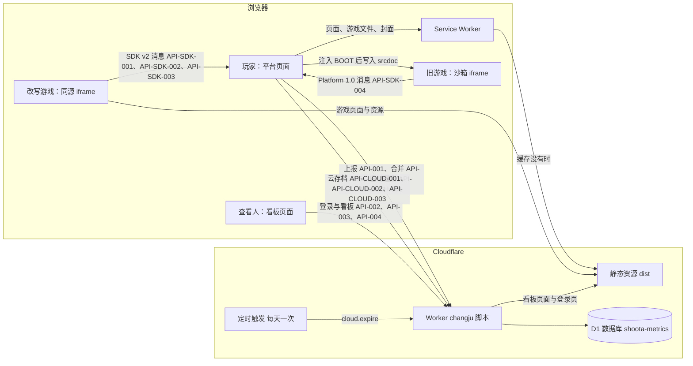

- 只有 `/api/*`、`/kanban` 与 `/kanban/*` 先进 Worker，其余请求直接由静态资源返回，不计入 Worker 调用次数。
- 构建用 Vite，产物在 `dist/`，`public/` 原样拷进去。
- 三个入口：平台 `index.html`、看板 `kanban/index.html`、改写后的游戏 `play/<游戏>/index.html`。
- 看板页面构建进静态资源的 `kanban/` 目录；`/kanban` 开头的请求都先进 Worker，Worker 验过会话才从静态资源取出页面返回，未登录拿不到
- 看板登录页 `kanban/login.html` 同样由 Worker 取出，把提示文字填进页内占位 `<!--MSG-->` 后返回。
- 旧游戏在沙箱 iframe 里运行，读写不到平台的存储，只能经平台消息存档；沙箱属性原样沿用，见 §9 旧游戏 iframe
- 沙箱允许游戏开新标签页，游戏里的外部链接在新标签页打开，见 `REQ-012`。
- 改写后的游戏放在同源的 `/play/<游戏>/`，不加沙箱，存档同样只经平台消息读写，见 `ADR-006`。
- `src/shared/` 放共享类型，`src/catalog/` 放游戏目录，见 §24 契约同步。
- 平台页面、Worker、Service Worker 都从这两处引用，不各自声明。
- http 请求只放行搬家页 `/move`，其余由 Cloudflare 跳转规则 301 到 https，见 `FLOW-SAVE-MOVE`、`ADR-004`。

## 7. 数据模型 / 领域实体

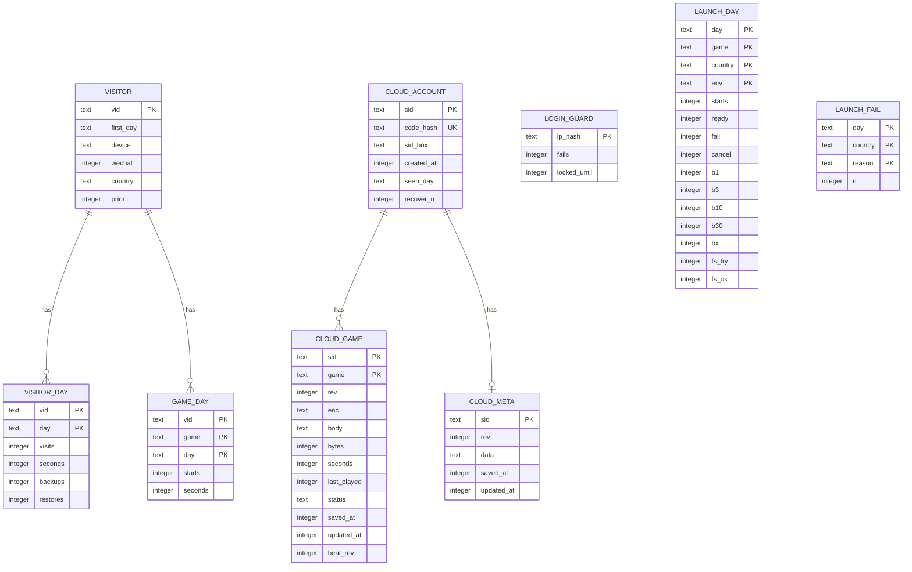

- `ENT-Visitor`：表 `visitors`，一个旅客一行，首次上报时写入，之后不改。
- `ENT-Visitor` 被合并掉时整行删除，见 `API-005`。
- 已签字：`visitors.prior` 列，用户 2026-10-21 签字，同日上线。
- `ENT-VisitorDay`：表 `visitor_days`，一个旅客一个北京日期一行，累加访问、时长、备份与恢复次数。
- `ENT-GameDay`：表 `game_days`，一个旅客一款游戏一个北京日期一行，累加开局与时长。
- `ENT-LoginGuard`：表 `login_guards`，一个 IP 摘要一行，记看板登录失败次数与锁定到期时间。
- `ENT-CloudAccount`：表 `cloud_accounts`，一个云存档一行，开通时写入，每次同步最多每天改一次最近同步日。
- `ENT-CloudGame`：表 `cloud_games`，一个云存档一款游戏一行，存最新一份存档与它的版本号，不留历史版本。
- `ENT-CloudMeta`：表 `cloud_meta`，一个云存档一行，存愿望单、成就解锁记录与成就定义。
- `ENT-LaunchDay`：表 `launch_days`，按北京日期、游戏、国家或地区、打开环境各一行，累加启动次数与就绪耗时分桶。
- `ENT-LaunchFail`：表 `launch_fails`，按北京日期、国家或地区、失败原因各一行，累加失败次数。
- `ENT-LaunchSession`：浏览器里的一次启动，只在内存里，不落库，状态见 §11 状态机。
- 待签字：后五张表由第 3 号迁移新建，与统计表同放 `shoota-metrics` 库；放进同一个库的容量风险见 §28 风险
- 云端三张表都以云存档编号的摘要 `sid` 为键；服务端拿不到编号原文，也就不能把云存档和旅客编号对上

## 8. 接口契约

契约文件：无，HTTP 接口 9 个、页面内消息 4 组，以本节为准；字段形状同时写在 `src/shared/api.ts`、`src/shared/protocol.ts`、`src/shared/telemetry.ts`，两处不一致时以本节为准并修代码。

- **`API-001` collect** — 实现 `REQ-001`、`REQ-002`、`REQ-003`、`REQ-009`
  - 方法/路径：`POST /api/e`
  - 鉴权/权限：匿名，见 §10 `ROLE-Visitor`
  - 请求：JSON，`v` 为旅客编号，`ev` 为事件数组，每项含类型 `t`，可带游戏 `g` 与秒数 `s`
  - 老玩家：请求可带 `o` 为 1，旅客首次写入时记为老玩家，之后的值不改记录
  - 请求限制：一次最多 20 个事件，正文不超过 8 KB
  - 响应：204 无正文；带内部标记 `sk_staff` 时同样 204，但不写库
  - 错误：400 `/errors/bad-event`
  - 幂等：不幂等，同一批重发会重复累加，前端不自动重试
  - 缓存与超时：不缓存，前端用 `fetch` 的 keepalive 或 `sendBeacon` 发送，失败丢弃
  - 兼容：校验顺序不变，先校验格式再看内部标记，内部浏览器发坏数据也是 400
  - 兼容：开局 `start` 照旧在点开始游戏时发，启动失败也算开局；启动成败另由 `API-LAUNCH-001` 记
- **`API-002` kanbanPage** — 实现 `REQ-004`、`REQ-005`、`REQ-006`、`REQ-007`、`REQ-008`
  - 方法/路径：`GET /kanban`
  - 鉴权/权限：会话 cookie `sk_session` 有效时返回看板页面，否则返回登录页
  - 响应：200 HTML，两种页面都带 `Cache-Control: no-store`；没配置密码时登录页提示联系管理员
  - 错误：无，未登录返回登录页而不是错误
  - 兼容：页面改由静态资源的 `kanban/index.html` 提供，地址、标题与会话规则不变
- **`API-003` kanbanLogin** — 实现 `REQ-004`、`REQ-009`
  - 方法/路径：`POST /kanban/login`
  - 请求：表单字段 `password`
  - 响应：密码正确时 303 跳回 `/kanban`，同时写会话 cookie 与内部标记 cookie
  - 错误：401、429、503 都返回登录页 HTML，页内显示提示，不返回错误码
  - 401：密码不对，页内写剩余次数
  - 429：已锁定，页内写解锁时间
  - 503：没配置密码
- **`API-004` kanbanData** — 实现 `REQ-005`、`REQ-006`、`REQ-007`、`REQ-008`、`REQ-LAUNCH-006`
  - 方法/路径：`GET /kanban/data`
  - 鉴权/权限：见 §10 `ROLE-Staff`
  - 响应：200 JSON，含概览、每日趋势、留存、游戏排行、来源与设备、启动六块
  - 启动块：近 7 天合计，按国家或地区前 10、按游戏、按打开环境的启动次数与就绪耗时分桶，以及失败原因
  - 错误：401 `/errors/not-logged-in`
  - 缓存与超时：不缓存，前端超时 15 秒，失败时显示重试按钮
  - 兼容：只新增启动块，旧的五块字段不改；游戏中文名改为直接读 `src/catalog/`
- **`API-005` mergeVisitor** — 实现 `REQ-014`
  - 方法/路径：`POST /api/merge`
  - 鉴权/权限：匿名，见 §10 `ROLE-Visitor`
  - 请求：JSON，`v` 为要保留的旧旅客编号，`from` 为要并进来的编号
  - 动作：`from` 的旅客日与游戏日逐行累加进 `v`，然后删掉 `from` 在三张表的行
  - 动作：`v` 在旅客表没有行时，先照抄 `from` 那一行
  - 响应：204 无正文；带内部标记 `sk_staff` 时同样 204，但不写库
  - 错误：400 `/errors/bad-merge`
  - 幂等：幂等，重发时 `from` 已经没有行，什么都不改
  - 已签字：用户 2026-10-21 签字，同日上线
- **`API-LAUNCH-001` launchEvents** — 实现 `REQ-LAUNCH-005`
  - 方法/路径：`POST /api/launch`
  - 鉴权/权限：匿名，见 §10 `ROLE-Visitor`；不带旅客编号与云存档编号
  - 请求：JSON `{ev}`，每项含阶段 `p`、游戏 `g`、运行层 `r`、打开环境 `e`，就绪与失败另带耗时 `ms`
  - 请求：失败带原因 `why`，就绪带是否来自缓存 `c` 与全屏结果 `fs`，见 §9 启动遥测字段
  - 请求限制：一次最多 10 个事件，正文不超过 4 KB
  - 动作：按北京日期、游戏、国家或地区、打开环境累加到 `launch_days`，失败原因累加到 `launch_fails`
  - 响应：204 无正文；带内部标记 `sk_staff` 时同样 204，但不写库
  - 错误：400 `/errors/bad-launch`
  - 幂等：不幂等，前端不重试；页面隐藏时用 `sendBeacon` 补发未发出的事件
  - 缓存与超时：不缓存，失败丢弃
- **`API-CLOUD-001` createCloud** — 实现 `REQ-CLOUD-001`
  - 方法/路径：`POST /api/cloud/account`
  - 鉴权/权限：请求头 `Authorization: Save <云存档编号>`，见 §10 `ROLE-Visitor`
  - 请求：JSON `{code}`，恢复码，16 位，不带连字符
  - 动作：存编号摘要、恢复码摘要，以及用恢复码加密的编号，见 §9 云存档字段
  - 响应：201 `{created:true}`；同一编号同一恢复码已存在时 200 `{created:false}`
  - 错误：400 `/errors/bad-cloud-request`、401 `/errors/cloud-auth`、409 `/errors/cloud-exists`
  - 幂等：同一编号同一恢复码幂等；前端失败后下一分钟重试
  - 缓存与超时：不缓存，前端超时 15 秒
- **`API-CLOUD-002` recoverCloud** — 实现 `REQ-CLOUD-003`
  - 方法/路径：`POST /api/cloud/recover`
  - 鉴权/权限：匿名，凭恢复码，见 §10 `ROLE-Visitor`
  - 请求：JSON `{code}`，前端已规整成 16 位大写
  - 响应：200 `{saveId, games}`，`games` 只列游戏、累计秒数与改档时间，不含存档正文
  - 动作：恢复次数 `recover_n` 加 1
  - 错误：400 `/errors/bad-cloud-request`、404 `/errors/recovery-code-unknown`
  - 幂等：读操作，只多记一次恢复次数，前端可以重试
  - 缓存与超时：不缓存，前端超时 15 秒
- **`API-CLOUD-003` syncCloud** — 实现 `REQ-CLOUD-002`、`REQ-CLOUD-004`、`REQ-CLOUD-005`
  - 关联 `REQ-CLOUD-006`：到期删除按这里写的最近同步日判断
  - 方法/路径：`POST /api/cloud/sync`
  - 鉴权/权限：请求头 `Authorization: Save <云存档编号>`，只读写这个云存档，见 §10 行级范围
  - 请求：`have` 是本机各游戏的云端版本号，`haveMeta` 是元数据版本号，`push` 是要推的游戏，`meta` 可选
  - 请求：`push` 每项含游戏、基于的版本号 `base`、编码、正文、原文字节数、秒数、最近游玩、进度文字、改档时间
  - 请求限制：正文不超过 2 MB，`push` 最多 14 项，每款按编码后的正文不超过 1 MB
  - 动作：逐款按 RULE-CLOUD-001 写入
  - 动作：同一款 10 秒内写过的，这次不写
  - 动作：内容与云端相同时不加版本号；推上来的秒数比云端多时，只更新秒数、最近游玩与进度文字
  - 动作：元数据版本号一致时整体替换，不一致时愿望单与成就取并集
  - 动作：最近同步日不是今天时改成今天，见 §11 `ENT-CloudAccount`
  - 响应：200，`results` 逐款给结果与版本号，`pull` 给云端比 `have` 新的游戏，`meta` 给更新的元数据
  - 错误：400 `/errors/bad-cloud-request`、401 `/errors/cloud-auth`、404 `/errors/cloud-not-found`、413 `/errors/cloud-too-large`
  - 幂等：同一份内容重推不加版本号，按成功返回；网络失败可以原样重推
  - 缓存与超时：不缓存，前端超时 20 秒；页面隐藏时只在正文不超过 60 KB 时用 keepalive 发
- **`API-SDK-001` sdkLifecycle** — 实现 `REQ-SDK-001`
  - 方法/路径：页面内 `postMessage`，游戏页 `/play/<游戏>/` 与平台页面之间
  - 鉴权/权限：双方都核对来源窗口与 origin，只认同源；信封 `{ns:'shoota', sdk:2, type}`
  - 消息：游戏载入后发 `hello`，平台读完存档回 `welcome`，含游戏、玩家、存档与游戏区环境
  - 消息：游戏画出可操作的首帧后发 `ready`
  - 消息：就绪前出错发 `error`，游戏要退出时发 `exit`
  - 消息：平台退出或页面隐藏前发 `suspend`，游戏存完档回 `suspended`，平台最多等 0.5 秒
  - 直接打开 `/play/<游戏>/` 而不在平台里时，SDK 1 秒内收不到 `welcome` 就显示「请从 shoota.ai 打开」
  - 错误：无，消息格式不对时收方直接丢弃
- **`API-SDK-002` sdkData** — 实现 `REQ-SDK-001`
  - 方法/路径：页面内 `postMessage`，游戏到平台
  - 消息：`storage` 带 `op` 为 set、del 或 clear，平台按 700 毫秒合并写入本机，和旧运行层同一份存档
  - 消息：`unlock` 解锁成就，`defs` 上报成就定义，`status` 上报进度文字，截断长度与旧运行层相同
  - 错误：无，消息格式不对时收方直接丢弃
- **`API-SDK-003` sdkEnv** — 实现 `REQ-SDK-002`、`REQ-PLAY-006`
  - 方法/路径：页面内 `postMessage`，双向
  - 消息：平台在方向、全屏或游戏区尺寸变化时发 `env`，含方向、全屏与否、宽高、安全区、打开环境
  - 消息：游戏运行中可发 `orientation` 改偏好方向，平台按它重新锁定方向或提示旋转
  - 错误：无，消息格式不对时收方直接丢弃
- **`API-SDK-004` legacyPlatform** — 实现 `REQ-022`
  - 方法/路径：页面内 `postMessage`，沙箱 iframe 到平台，消息带 `__cj` 为 1
  - 消息：沿用 Platform 1.0：ls-set、ls-del、ls-clear、status、defs、unlock、exit，字段与截断规则不变
  - 消息：平台注入的脚本另发 `boot-ready` 与 `boot-error`，游戏看不到这两条
  - 兼容：`window.Platform` 的成员、假 localStorage 与 sessionStorage 的行为逐条沿用，见 §41 对齐对照
  - 错误：无，消息格式不对时平台直接丢弃

演进与弃用：

- 版本方案：HTTP 接口不分版本，平台页面与 Worker 同一次部署；页面内消息靠信封区分，SDK 消息带 `sdk` 为 2，旧运行层带 `__cj` 为 1
- 弃用期：HTTP 接口 N/A，调用方只有本仓自己的页面；Platform 1.0 在旧游戏全部改写完之前不弃用
- 当前 deprecated 清单：无
- §14 不再列 `/errors/wrong-password` 与 `/errors/login-locked`，旧版从没输出过这两个错误码

## 9. 数据字典

| 字段 | API 名 | DB 名 | 类型 | 必填 | 枚举/约束 | 单位/精度 | PII |
| --- | --- | --- | --- | --- | --- | --- | --- |
| 旅客编号 | `v` | `visitors.vid` | text | 是 | 32 位小写十六进制 | — | 化名 |
| 事件类型 | `t` | — | text | 是 | visit、start、play、backup、restore，其他值整批拒绝 | — | 否 |
| 游戏 | `g` | `game_days.game` | text | start 与 play 必填 | 小写字母、数字、连字符，1 到 32 位 | — | 否 |
| 上报秒数 | `s` | — | integer | play 必填 | 1 到 300 | 秒 | 否 |
| 首访日期 | — | `visitors.first_day` | text | 是 | YYYY-MM-DD，北京日期 | 日 | 否 |
| 设备类型 | — | `visitors.device` | text | 是 | mobile、desktop，按首访请求的 UA 判断 | — | 否 |
| 微信内打开 | — | `visitors.wechat` | integer | 是 | 0、1，UA 含 MicroMessenger 为 1 | — | 否 |
| 国家或地区 | — | `visitors.country` | text | 是 | ISO 3166 两位代码，取不到写 XX | — | 否 |
| 老玩家 | `o` | `visitors.prior` | integer | 是 | 0、1，首次写入时请求带 `o` 为 1 则为 1，默认 0 | — | 否 |
| 合并来源 | `from` | — | text | 是 | 32 位小写十六进制，不能等于 `v` | — | 化名 |
| 日期 | — | `visitor_days.day` | text | 是 | YYYY-MM-DD，北京日期 | 日 | 否 |
| 访问次数 | — | `visitor_days.visits` | integer | 是 | ≥ 0 | 次 | 否 |
| 旅客日游玩秒数 | — | `visitor_days.seconds` | integer | 是 | ≥ 0，单次累加不超过 300 | 秒 | 否 |
| 备份次数 | — | `visitor_days.backups` | integer | 是 | ≥ 0 | 次 | 否 |
| 恢复次数 | — | `visitor_days.restores` | integer | 是 | ≥ 0 | 次 | 否 |
| 游戏日日期 | — | `game_days.day` | text | 是 | YYYY-MM-DD，北京日期 | 日 | 否 |
| 开局次数 | — | `game_days.starts` | integer | 是 | ≥ 0 | 次 | 否 |
| 游戏日游玩秒数 | — | `game_days.seconds` | integer | 是 | ≥ 0 | 秒 | 否 |
| IP 摘要 | — | `login_guards.ip_hash` | text | 是 | 加盐 SHA-256 的前 32 位，不存原始 IP | — | 化名 |
| 失败次数 | — | `login_guards.fails` | integer | 是 | 0 到 5 | 次 | 否 |
| 锁定到期 | — | `login_guards.locked_until` | integer | 否 | Unix 毫秒，未锁定为空 | 毫秒 | 否 |
| 会话 cookie | `sk_session` | — | text | — | 到期时间加 HMAC 签名，有效 7 天，HttpOnly | — | 否 |
| 内部标记 cookie | `sk_staff` | — | text | — | 值为 1，有效 1 年，HttpOnly | — | 否 |
| 启动阶段 | `p` | — | text | 是 | start、ready、fail、cancel，其他值整批拒绝 | — | 否 |
| 启动游戏 | `g` | `launch_days.game` | text | 是 | 同游戏标识规则 | — | 否 |
| 运行层 | `r` | — | text | 是 | legacy、play | — | 否 |
| 打开环境 | `e` | `launch_days.env` | text | 是 | browser、wechat、standalone | — | 否 |
| 启动耗时 | `ms` | — | integer | ready、fail、cancel 必填 | 0 到 600000 | 毫秒 | 否 |
| 失败原因 | `why` | `launch_fails.reason` | text | fail 必填 | 网络：offline、net-error、net-timeout、net-stall、net-slow，文件：http-404、http-error | — | 否 |
| 失败原因（续） | — | — | — | — | 存档：save-timeout、save-error，游戏：boot-timeout、boot-error | — | 否 |
| 尝试序号 | `n` | — | integer | 否 | 1、2，自动重试那次为 2 | — | 否 |
| 来自缓存 | `c` | — | integer | 否 | 0、1，ready 时填 | — | 否 |
| 全屏结果 | `fs` | `launch_days.fs_ok` | integer | 否 | 0 没试、1 试了没成、2 成了；1 与 2 计入 fs_try，2 计入 fs_ok | — | 否 |
| 启动次数 | — | `launch_days.starts` | integer | 是 | ≥ 0，另有 ready、fail、cancel 三列同口径 | 次 | 否 |
| 就绪耗时分桶 | — | `launch_days.b1` | integer | 是 | b1 ≤ 1 秒、b3 ≤ 3 秒、b10 ≤ 10 秒、b30 ≤ 30 秒、bx 更久，各列 ≥ 0 | 次 | 否 |
| 云存档编号 | `saveId` | — | text | 是 | 32 位小写十六进制，128 位随机；只在请求头里出现，不落库 | — | 化名 |
| 编号摘要 | — | `cloud_accounts.sid` | text | 是 | 云存档编号的 SHA-256，64 位十六进制 | — | 化名 |
| 恢复码 | `code` | — | text | 是 | 16 位 Crockford base32，80 位随机，显示为 XXXX-XXXX-XXXX-XXXX | — | 化名 |
| 恢复码规整 | — | — | — | — | 去掉空格与连字符，转大写，I 与 L 当 1，O 当 0，之后必须正好 16 位 | — | 否 |
| 恢复码摘要 | — | `cloud_accounts.code_hash` | text | 是 | 规整后恢复码的 SHA-256，唯一 | — | 化名 |
| 编号密文 | — | `cloud_accounts.sid_box` | text | 是 | 云存档编号经 AES-GCM 加密，密钥由恢复码经 HKDF-SHA256 派生，存随机数加密文的 base64 | — | 化名 |
| 开通时间 | — | `cloud_accounts.created_at` | integer | 是 | Unix 毫秒 | 毫秒 | 否 |
| 最近同步日 | — | `cloud_accounts.seen_day` | text | 是 | YYYY-MM-DD 北京日期，每天最多改一次 | 日 | 否 |
| 恢复次数累计 | — | `cloud_accounts.recover_n` | integer | 是 | ≥ 0 | 次 | 否 |
| 云端游戏 | `g` | `cloud_games.game` | text | 是 | 同游戏标识规则，必须在目录里 | — | 否 |
| 版本号 | `rev` | `cloud_games.rev` | integer | 是 | 从 1 起，每写入一份新内容加 1，只更新秒数时不加，只增不减 | — | 否 |
| 基于版本 | `base` | — | integer | 是 | 本机这份是在哪个版本上改的，没同步过为 0 | — | 否 |
| 存档编码 | `enc` | `cloud_games.enc` | text | 是 | json、gz64；原文超过 4 KB 时用 gz64，即 gzip 后 base64 | — | 否 |
| 存档正文 | `body` | `cloud_games.body` | text | 是 | 游戏的键值表 JSON，按编码存，长度 1 到 1048576 | 字节 | 否 |
| 原文字节数 | `bytes` | `cloud_games.bytes` | integer | 是 | ≥ 1，压缩前的大小，只用于统计与提示 | 字节 | 否 |
| 云端游玩秒数 | `s` | `cloud_games.seconds` | integer | 是 | ≥ 0，冲突时据此比较 | 秒 | 否 |
| 最近游玩 | `last` | `cloud_games.last_played` | integer | 是 | Unix 毫秒 | 毫秒 | 否 |
| 进度文字 | `status` | `cloud_games.status` | text | 否 | 最多 60 字 | — | 否 |
| 改档时间 | `at` | `cloud_games.saved_at` | integer | 是 | 本机最后改存档的时间，Unix 毫秒，平手时据此比较 | 毫秒 | 否 |
| 云端写入时间 | — | `cloud_games.updated_at` | integer | 是 | 服务端时间，Unix 毫秒，10 秒写入间隔据此判断 | 毫秒 | 否 |
| 被换掉的版本 | `beat` | `cloud_games.beat_rev` | integer | 否 | 冲突胜出或撤销强制写入时，被换掉的那个版本号 | — | 否 |
| 强制写入 | `force` | — | boolean | 否 | 只在撤销时为真，跳过比较 | — | 否 |
| 推送结果 | `r` | — | text | 是 | ok、kept-cloud、too-soon、too-big | — | 否 |
| 云端元数据 | `data` | `cloud_meta.data` | text | 是 | JSON：愿望单、各游戏成就解锁时间、成就定义 | — | 否 |
| 元数据版本号 | `rev` | `cloud_meta.rev` | integer | 是 | 同版本号规则 | — | 否 |
| 偏好方向 | `orientation` | `catalog.orientation` | text | 是 | portrait、landscape、any；薯光 landscape，一克之差 portrait，其余 any | — | 否 |
| 运行层取值 | `runtime` | `catalog.runtime` | text | 是 | legacy、play；13 款现在都是 legacy，一克之差改写验收后改 play | — | 否 |
| 平台元数据 | — | `changju.meta.v1` | JSON | 是 | localStorage；浅合并读，未知字段原样保留，含 sendLog | — | 否 |
| 搬家标记 | — | `changju.moved` | text | 否 | localStorage；1、2、3 或 done | — | 否 |
| 本机存档 | — | `local\|<游戏>` | JSON | 否 | IndexedDB `changju` 第 1 版的 `kv` 库；`games` 库保留不用，库不升版本 | — | 否 |
| 云存档本机状态 | — | `changju.cloud.v1` | JSON | 否 | localStorage 单独一个键：编号、恢复码、各游戏的版本号、内容摘要与上次对齐时的秒数、上次同步时间 | — | 化名 |
| 撤销槽 | — | `undo:<游戏>` | JSON | 否 | IndexedDB `kv` 库；被替换的存档、统计、时间与原因，30 天后删 | — | 否 |
| 悬浮按钮位置 | — | `changju.ui.v1` | JSON | 否 | localStorage；按游戏、按方向记左右边与高度比例，另记已提示旋转的游戏与引导弹出时间 | — | 否 |
| 存档码 | — | — | text | — | CJ1 加 gzip 后 base64，或 CJ0 加 base64；载荷第 1 版含存档、统计、愿望单、成就定义 | — | 否 |
| 旧游戏 iframe | — | — | — | — | 沙箱与权限属性逐字沿用旧版，取值见 `src/shared/protocol.ts` 的两个常量 | — | 否 |

## 10. 权限与角色

| 角色 \ 操作 | API-001 上报 | API-002 看板页面 | API-003 登录 | API-004 看板数据 | API-005 合并 | API-LAUNCH-001 启动遥测 | API-CLOUD-001 开通 | API-CLOUD-002 恢复 | API-CLOUD-003 同步 |
| --- | --- | --- | --- | --- | --- | --- | --- | --- | --- |
| ROLE-Visitor | ✓ | 只看到登录页 | ✓ | ✗ | ✓ | ✓ | ✓ | ✓ | ✓ |
| ROLE-Staff | ✓，但不写库 | ✓ | ✓ | ✓ | ✓，但不写库 | ✓，但不写库 | ✓ | ✓ | ✓ |

- `ROLE-Visitor`：任何打开平台的人，匿名。
- `ROLE-Staff`：浏览器持有有效会话 cookie 的看板查看人，只有一个共享密码。
- 内部浏览器的云存档照常读写，云存档不是统计数据。
- `API-SDK-001`、`API-SDK-002`、`API-SDK-003`、`API-SDK-004` 不经网络、没有登录主体，不进权限矩阵
- 这四组页面内消息，双方只认同源或当前 iframe 发来的
- 所有人可见的平台页面：`PAGE-STORE`、`PAGE-GAME`、`PAGE-LIBRARY`、`PAGE-BACKUP`、`PAGE-RECOVER`。
- 所有人可见的其他页面：`PAGE-PLAYER`、`PAGE-PLAY-FRAME`、`PAGE-MOVE`、`PAGE-KANBAN-LOGIN`。
- 仅 `ROLE-Staff` 可见的页面：`PAGE-KANBAN`。

行级范围：

| 接口 | 能读写的行 |
| --- | --- |
| API-CLOUD-001 | 只新建鉴权头编号对应的一行 |
| API-CLOUD-002 | 只读恢复码摘要对应的一行，返回编号与游戏清单 |
| API-CLOUD-003 | 只读写鉴权头编号对应的云存档与它的游戏、元数据 |

## 11. 状态机

看板登录防护（`ENT-LoginGuard`）有正常与锁定两个状态，锁定由失败次数与锁定到期时间决定。

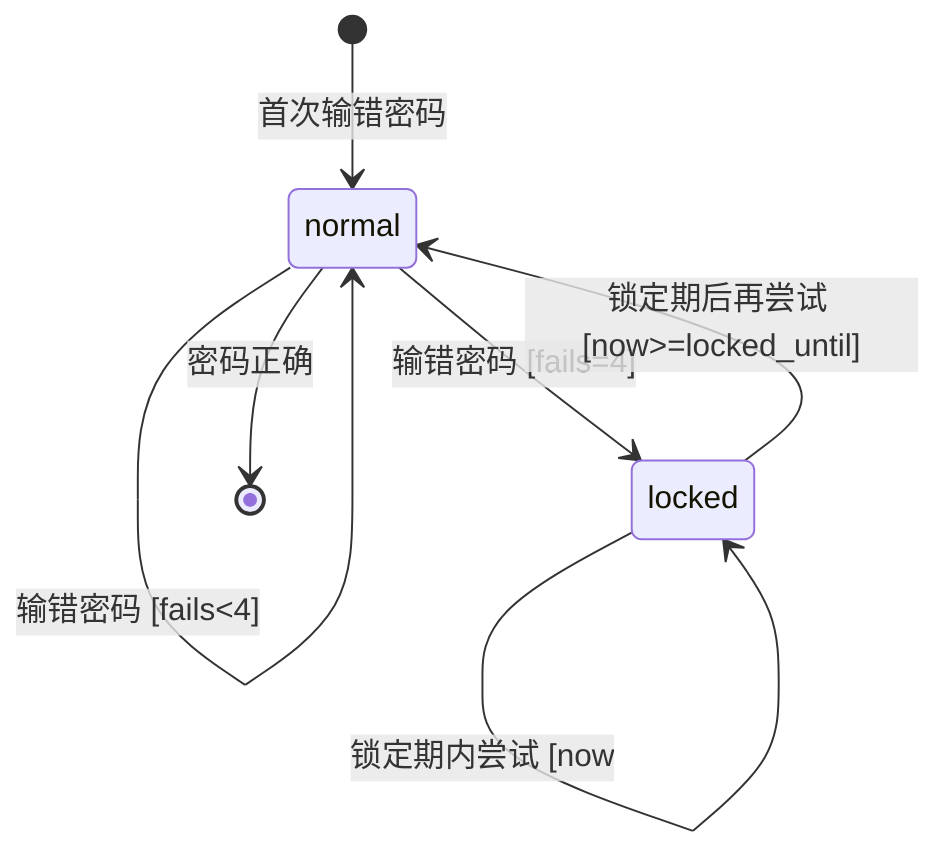

迁移表：

| 源 → 目标 | 事件 | 守卫(纯布尔) | 动作(副作用) | 谁触发 | 接口/事件 |
| --- | --- | --- | --- | --- | --- |
| [*] → normal | 首次输错密码 | — | 建记录，失败次数为 1，返回 401 | 查看人 | `API-003` |
| normal → normal | 输错密码 | fails < 4 | 失败次数加 1，返回 401 | 查看人 | `API-003` |
| normal → locked | 输错密码 | fails = 4 | 失败次数为 5，锁定到期为 15 分钟后，返回 429 | 查看人 | `API-003` |
| locked → locked | 锁定期内尝试 | now < locked_until | 不比对密码，返回 429 | 查看人 | `API-003` |
| locked → normal | 锁定期后再尝试 | now >= locked_until | 失败次数清零，再按本次密码对错处理 | 查看人 | `API-003` |
| normal → [*] | 密码正确 | — | 删除记录，写会话与内部标记 cookie | 查看人 | `API-003` |

旅客、旅客日、游戏日三张表没有状态字段，只做累加，不建状态机。浏览器本地的「查 http 旧数据」标记：跳去搬家页前记下这是第几次（1 到 3），带回后改成「查完了」；「查完了」或试满 3 次后不再跳，不建状态机。

一次启动（`ENT-LaunchSession`）只在浏览器内存里，从点开始游戏起，到就绪后退出、失败页退出或中途取消为止。

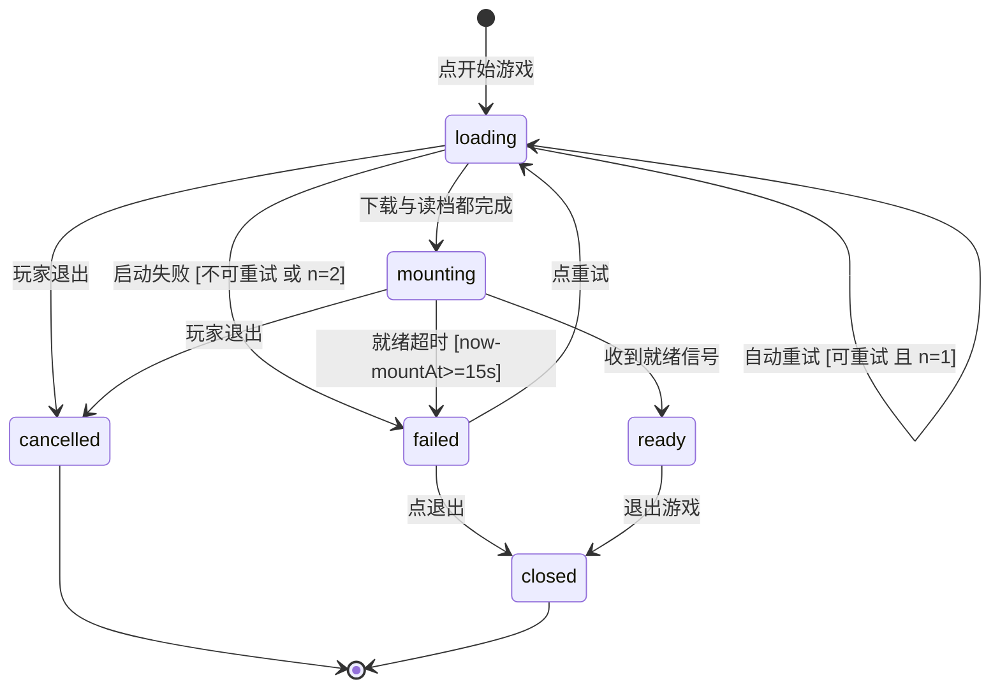

迁移表：

| 源 → 目标 | 事件 | 守卫(纯布尔) | 动作(副作用) | 谁触发 | 接口/事件 |
| --- | --- | --- | --- | --- | --- |
| [*] → loading | 点开始游戏 | 同一款不在启动或游玩中 | 取消别的启动，发开始上报，并行下载与读档，开始各段计时 | 玩家 | `API-LAUNCH-001` |
| loading → loading | 自动重试 | 原因可重试 且 n = 1 | n 改为 2，只重做失败的那一路 | 平台计时器 | 内部任务 `launch.retry`（无对外 API） |
| loading → mounting | 下载与读档都完成 | 文件已到 且 存档已读出 | 建 iframe；旧游戏注入脚本后写进 srcdoc，改写游戏等 hello 后回 welcome | 平台 | `API-SDK-001`、`API-SDK-004` |
| loading → failed | 启动失败 | 原因不可重试 或 n = 2 | 停掉两路，显示失败页，发失败上报 | 平台计时器 | `API-LAUNCH-001` |
| loading → cancelled | 玩家退出 | — | 中止下载，发取消上报，回详情页 | 玩家 | `API-LAUNCH-001` |
| mounting → ready | 收到就绪信号 | 消息来自当前 iframe | 关掉载入页，开始计时，发就绪上报 | 游戏 | `API-SDK-001`、`API-SDK-004`、`API-LAUNCH-001` |
| mounting → failed | 就绪超时 | now − mountAt ≥ 15 秒 | 移除 iframe，显示失败页，发失败上报 | 平台计时器 | `API-LAUNCH-001` |
| mounting → cancelled | 玩家退出 | — | 移除 iframe，发取消上报，回详情页 | 玩家 | `API-LAUNCH-001` |
| failed → loading | 点重试 | — | n 改为 1，发新的开始上报，重做两路 | 玩家 | `API-LAUNCH-001` |
| failed → closed | 点退出 | — | 回详情页 | 玩家 | N/A |
| ready → closed | 退出游戏 | — | 请游戏收尾，立刻写存档，报时长，退出全屏，触发一次云同步 | 玩家 | `API-SDK-001`、`API-001`、`API-CLOUD-003` |

- 可重试的原因：net-error、net-timeout、net-stall、http-error、save-timeout、save-error。
- 不自动重试的原因：offline、net-slow、boot-timeout、boot-error。
- http-404 先换固定地址下载一次，仍不行记为 http-404。
- 就绪超时时，就绪前收到过游戏报错记 boot-error，否则记 boot-timeout。
- 各段计时在页面隐藏时暂停，回到前台接着计，数值见 §15 启动各段超时。

云存档（`ENT-CloudAccount`）开通后一直是 active，365 天没同步时由定时任务删除。

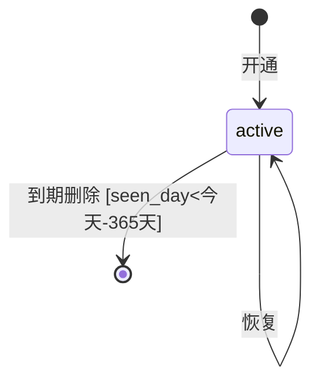

迁移表：

| 源 → 目标 | 事件 | 守卫(纯布尔) | 动作(副作用) | 谁触发 | 接口/事件 |
| --- | --- | --- | --- | --- | --- |
| [*] → active | 开通 | 这个编号摘要还没有行 | 写编号摘要、恢复码摘要与编号密文，最近同步日为今天 | 玩家的浏览器 | `API-CLOUD-001` |
| active → active | 同步 | seen_day < 今天 | 最近同步日改成今天 | 玩家的浏览器 | `API-CLOUD-003` |
| active → active | 恢复 | 恢复码摘要相同 | 恢复次数加 1 | 玩家的浏览器 | `API-CLOUD-002` |
| active → [*] | 到期删除 | seen_day < 今天 − 365 天 | 删掉这个云存档在三张云端表里的行 | 定时任务 | 内部任务 `cloud.expire`（无对外 API） |

不建状态机的实体与字段：

- `ENT-CloudGame` 云端游戏行与 `ENT-CloudMeta` 云端元数据只有版本号递增，没有状态字段，冲突取舍见 RULE-CLOUD-001。
- 目录的 `status`（ok、dev）是极简运营态，由上架的人在目录里手改，没有用户流程。
- 云端游戏行的 `status` 是游戏自报的进度文字，不是生命周期。
- 启动遥测的阶段 `p` 是事件类型，状态在 `ENT-LaunchSession` 上；启动日表与失败表只做累加

## 12. 关键流程时序

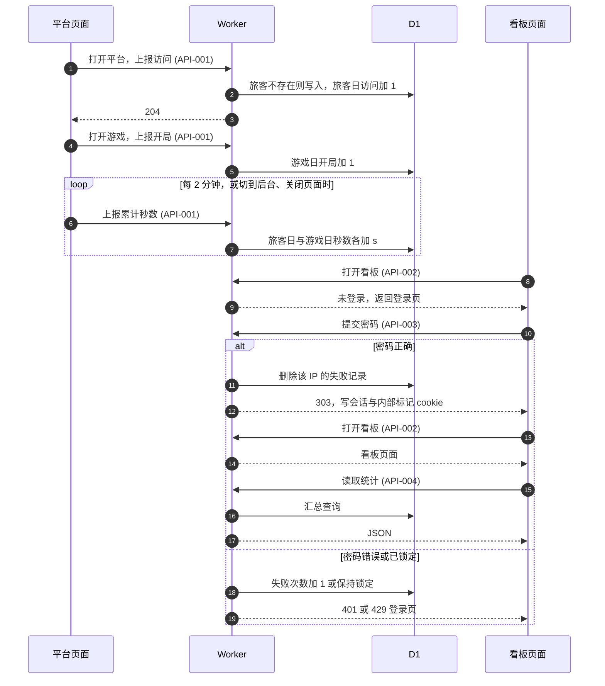

存档搬家（`FLOW-SAVE-MOVE`）：

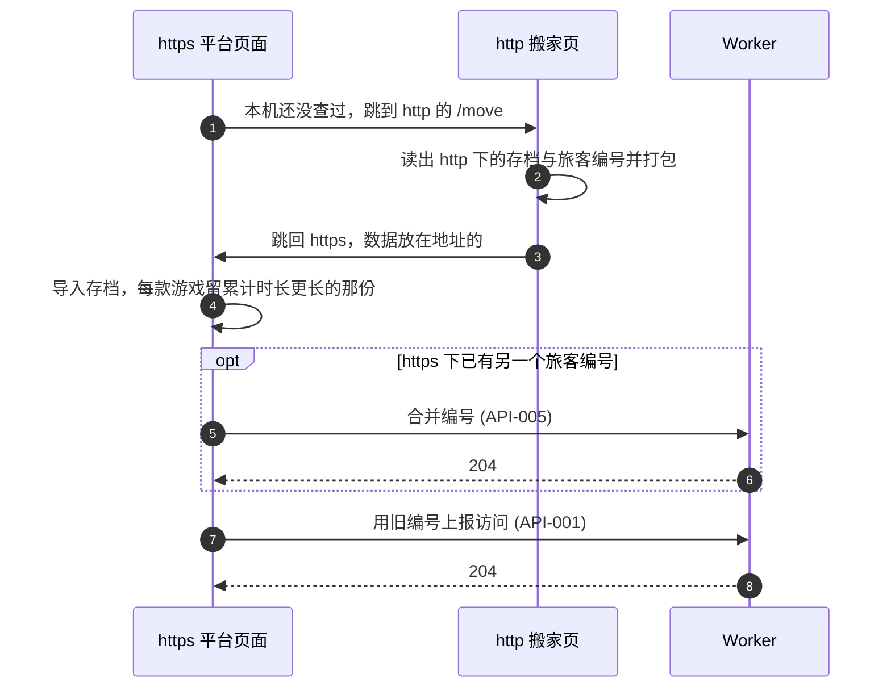

启动一款游戏（`FLOW-LAUNCH`），驱动 `ENT-LaunchSession` 从 loading 到 mounting 再到 ready 或 failed：

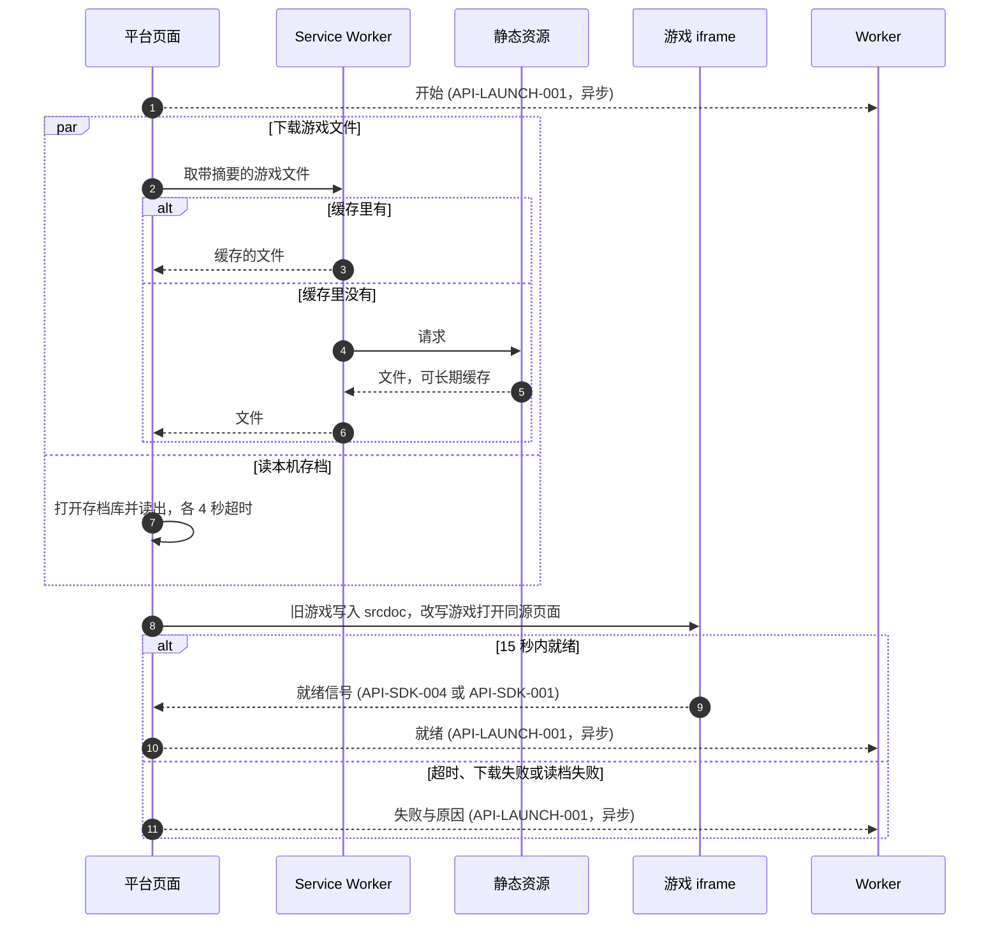

首次上云（`FLOW-CLOUD-FIRST`）与换设备恢复（`FLOW-RECOVER`），驱动 `ENT-CloudAccount` 的开通与恢复：

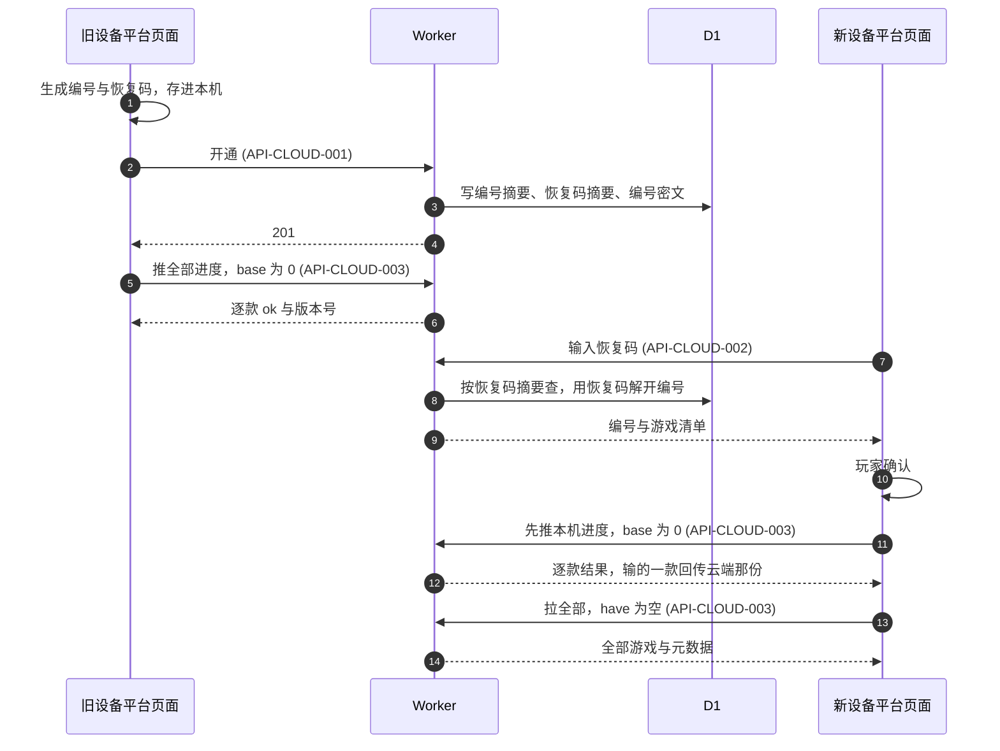

两台设备冲突（`FLOW-CLOUD-CONFLICT`）：

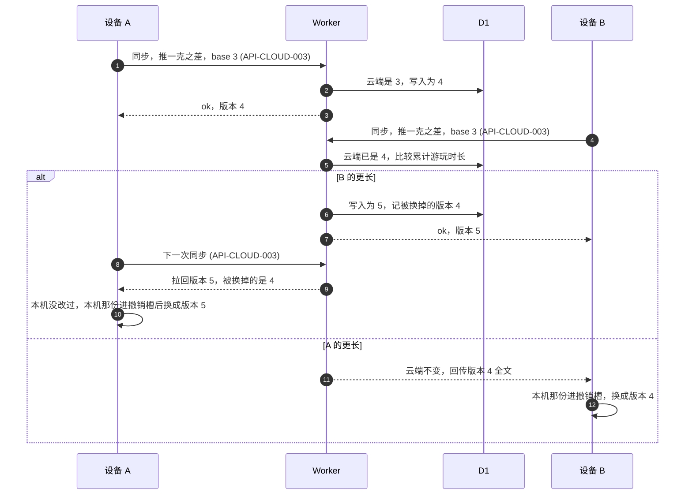

## 13. 页面与跳转地图

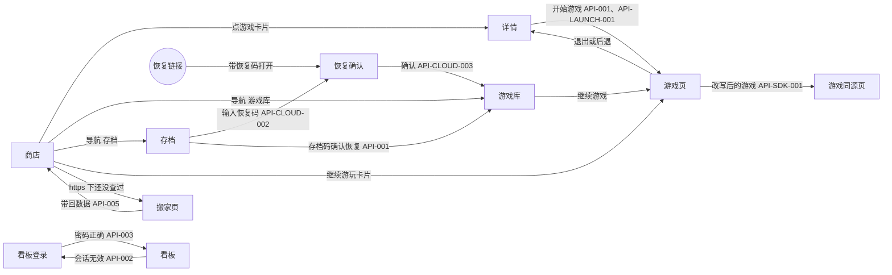

| 页面 | 路径 | 可见角色 | 调用接口 | 关键页态 |
| --- | --- | --- | --- | --- |
| `PAGE-STORE` | `/#store`、空 hash 与不认识的 hash | 所有人 | `API-001` | 精选、继续游玩、全部游戏、搜索无结果、首次上云提示 |
| `PAGE-GAME` | `/#game-<游戏>` | 所有人 | 无 | 找不到游戏的空态；玩过与没玩过两种开始卡 |
| `PAGE-LIBRARY` | `/#library` | 所有人 | `API-CLOUD-003` | 空态、列表加右侧详情，被替换的游戏显示撤销 |
| `PAGE-BACKUP` | `/#backup` | 所有人 | `API-001`、`API-CLOUD-003` | 云存档卡、存档码备份卡、存档码恢复两步确认 |
| `PAGE-RECOVER` | `/#recover=<恢复码>`，或存档页里的弹层 | 所有人 | `API-CLOUD-002`、`API-CLOUD-003` | 输入、确认、取回中、失败 |
| `PAGE-PLAYER` | `/#play-<游戏>` | 所有人 | `API-001`、`API-LAUNCH-001` | 载入中、失败页、游玩中、面板打开、旋转提示 |
| `PAGE-PLAY-FRAME` | `/play/<游戏>/` | 所有人 | `API-SDK-001`、`API-SDK-002`、`API-SDK-003` | 只在游戏页的 iframe 里用，直接打开时提示从 shoota.ai 打开 |
| `PAGE-MOVE` | `http://shoota.ai/move` | 所有人 | 无 | 没有可见内容，读完数据立刻跳回 https |
| `PAGE-KANBAN-LOGIN` | `/kanban` | 所有人 | `API-003` | 密码错误、已锁定、没配置密码三种提示 |
| `PAGE-KANBAN` | `/kanban` | `ROLE-Staff` | `API-004` | 加载中、无数据、读取失败三种页态，加启动成功率面板 |

视觉来源：品牌目录 `brand/`，规范见 `brand/DESIGN.md`；参考是用户 2026-10-21 提供的 shoota logo 图。组件形态参考 Apple 平台的分组列表、Sheet 与半透明材质，落在 `src/ui/` 与 `src/styles/semantic.css`。

### 路由与兼容

- 页面地址继续用 `#` 之后的部分，旧分享链接原样可用；`www.shoota.ai` 由 Cloudflare 规则 301 到根域，`#` 部分保留
- `#login` 用替换的方式改成 `#store`。
- `#move=` 只在启动时处理一次。
- `#recover=` 只弹确认，不自动取回。
- 进入任何不是游戏页的地址都先退出游戏，所以浏览器后退能退出游戏；每次换页滚到顶部
- 不认识的地址一律显示商店，导航高亮跟着显示的页面走。
- 平台页标题保持 `shoota 游戏平台`，部署后的健康检查按它认页面。

### 平台页面内容

- 商店、详情、游戏库与存档页的区块、顺序与文案和旧版一致，逐项见 §41 对齐对照。
- 点开始游戏时就记下最近游玩，打开过、没玩满 5 秒的游戏也进游戏库与继续游玩。
- 时长、多久前、文件大小三种格式逐条沿用旧版。
- 封面只用目录登记的图片，目录缺封面时检查脚本拦下，见 §28 开放问题。
- 提示条沿用旧版：右下角，普通 3.6 秒、成就 5.2 秒，以 polite 方式播报。
- 成就提示两行：「解锁成就 · 游戏名」加成就名，没有定义时显示成就键。
- 强制颜色模式下，图标与选中态加描边。

### 平台页面断点

| 视口条件（CSS 像素） | 导航 | 导航占用 |
| --- | --- | --- |
| 宽 < 760，且不是横屏高 ≤ 500 | 底部标签栏：商店、游戏库、存档 | 底部 48 加底部安全区 |
| 宽 760 到 1023，或横屏且高 ≤ 500 | 左侧窄栏，图标在上文字在下 | 左侧 80 加左侧安全区 |
| 宽 ≥ 1024 且高 > 500 | 分组侧栏加吸顶半透明顶栏 | 左侧 224 到 272，顶部 56 |

- 内容左右留白按宽度：< 760 为 16，760 到 1023 为 24，≥ 1024 为 40，且不小于对应一侧的安全区。
- 旧版顶栏的账号菜单不再保留，「存档自动保存在这台设备」与恢复码移到存档页。
- 搜索框：手机放在商店大标题下面，宽 ≥ 1024 放在顶栏；输入即筛选，不在商店时先跳回商店
- 平台页面跟随系统亮暗色，去掉旧版钉死的暗色；`theme-color` 按亮暗各给一个值
- 可点控件的点击区域不小于 44×44；平台正文与说明文字不小于 12 像素
- 平台文案逐字沿用旧版，集中在 `src/app/copy.ts`；云存档开通后改写的三处见本节「云存档文案」

### 游戏页布局

- 游戏页是一个固定定位、四边贴齐视口的层，高度用 `100dvh`，不认动态视口高度的浏览器用 `100%`，不用 `100vh`。
- 游戏区等于视口四边各扣掉安全区；iframe 铺满游戏区，安全区里的条带填页面背景色
- 游戏页没有常驻工具栏，平台控件只有悬浮按钮，它浮在游戏区上面，不占游戏区高度。
- 视口元信息为 `width=device-width,initial-scale=1,viewport-fit=cover`，不写禁止缩放；双击缩放靠触控规则关掉
- 测量与目标值按下表；「游戏区」是扣掉安全区后的宽×高，旧版数值是 2026-10-22 本机测量

| 视口与环境（CSS 像素） | 浏览器栏 | 平台控件占游戏区高度 | 游戏区 |
| --- | --- | --- | --- |
| 393×852 竖屏，测量基准 | 无 | 0，旧版 99.5 | 393×852 |
| 852×393 横屏，测量基准 | 无 | 0，旧版 50.3 | 852×393 |
| 402×874 竖屏，iOS 26.5 Safari | 展开，可见高 714 | 0 | 402×714 |
| 874×402 横屏，iOS 26.5 Safari 单标签 | 展开，可见高 338 | 0 | 750×318，左右各让 62、下让 20 |
| 402×874 竖屏，iOS 主屏幕应用 | 无，安全区上 62 下 34 | 0 | 402×778 |
| 874×402 横屏，iOS 主屏幕应用 | 无，安全区左右 62 下 20 | 0 | 750×382 |
| 412×915 竖屏，安卓 Chrome 未全屏 | 展开，可见高 783 | 0 | 412×783 |
| 412×915 竖屏，安卓 Chrome 全屏 | 隐藏，顶部开孔 52 | 0 | 412×863 |
| 915×412 横屏，安卓 Chrome 全屏 | 隐藏，开孔一侧 52 | 0 | 863×412 |
| 820×1180 平板竖屏 | 无 | 0，旧版 50.3 | 820×1180 |
| 1440×900 电脑 | 无 | 0，旧版 50.3 | 1440×900 |

核心区占比目标（旧游戏本身不改，只去掉平台栏；12 款按中位数，薯光自己全屏不计，电脑 13 款都计）：

| 视口（CSS 像素） | 旧版中位数 | 旧版最低 | 目标中位数 | 目标最低 |
| --- | --- | --- | --- | --- |
| 393×852 竖屏 | 66.1% | 58.3%，NBA-经理与 CBA-经理 | ≥ 77% | ≥ 70% |
| 852×393 横屏 | 48.3% | 14.0%，一克之差 | ≥ 60% | 一克之差改写后 ≥ 60% |
| 393×659 竖屏 Safari 可见区 | 56.2% | 46.1%，NBA-经理与 CBA-经理 | ≥ 71% | ≥ 61% |
| 734×343 横屏 Safari 可见区 | 42.0% | 13.5%，一克之差 | ≥ 56% | 一克之差改写后 ≥ 55% |
| 820×1180 平板竖屏 | 83.5% | 45.6%，一克之差 | ≥ 87% | ≥ 49% |
| 1440×900 电脑 | 79.4% | 22.9%，一克之差 | ≥ 84% | ≥ 28% |

- 竖屏 Safari 可见区的中位数换算到整块屏幕：旧版 43%，目标 ≥ 55%。
- 一克之差改写后单独验收：竖屏 393×852 ≥ 75%，横屏 852×393 ≥ 60%。
- 复测用同一个测量脚本、同一组视口，新版只换掉平台外壳。

### 安全区

- 游戏区四边各扣 `env(safe-area-inset-*)`；横屏 iPhone 左右各约 62 像素不放任何平台控件
- 悬浮按钮任何部分不进安全区，离安全区边缘 8 像素。
- 游戏面板从底部弹出时内容加底部安全区，从右侧滑出时加右侧安全区。
- 平台页面沿用应用壳的处理：顶部让出上安全区，底部标签栏加下安全区，窄栏加左安全区。
- 主屏幕应用用透明状态栏，内容画到屏幕最顶上，再按上安全区让开。

### 触控

- 游戏区 `touch-action: manipulation`，关掉双击缩放与点击延迟；游戏页的根元素 `overscroll-behavior: none`
- 平台控件关掉长按菜单、文字选中与点击高亮，只对平台控件拦截 contextmenu，不拦游戏内。
- 悬浮按钮用 Pointer Events 拖动，`touch-action: none`；按下后移动不到 8 像素算点击
- 不调用振动。

### 悬浮按钮

- 44×44，半透明材质底，图标为平台标志；默认贴右边缘、游戏区垂直居中，离安全区 8 像素
- 3 秒没有触碰后不透明度降到 40%，碰到即恢复；系统开了减弱动态效果时不做淡出动画，直接变淡
- 拖动中跟手，松手后贴到最近的左边或右边，高度保留在游戏区内。
- 位置按游戏、按方向记在 `changju.ui.v1`，松手时写一次；记住的位置超出当前游戏区时放回默认
- 存档写入时按钮上亮一个小点 2 秒。

### 游戏面板

- 手机竖屏：从底部弹出，最高为可见高度的 70%，393×852 下最高 596。
- 手机横屏（高 ≤ 500）：从右侧滑出，宽 320，高等于游戏区。
- 平板与电脑：在悬浮按钮旁弹出，宽 320。
- 内容按顺序：游戏名与进度文字、存档状态、云同步状态与上次同步时间、本次时长、全屏按钮或引导、旋转说明、恢复默认按钮位置、退出游戏。
- 存档状态沿用旧版四种：存档待写入、读取存档…、已读取存档或新存档、已存档 HH:MM，见 REQ-011。
- 点面板外、按 Esc 或点关闭都关掉面板；面板开着时游戏照常运行

### 载入页与失败页

- 载入页显示游戏封面、名称、进度条与「退出」；旧游戏的进度按已收字节除以目录登记的大小，改写游戏显示不定进度
- 自动重试时进度条下方显示「网络不太稳，正在重试…」。
- 失败页显示原因文案、「重试」与「退出」，原因文案按失败原因选，见 FLOW-LAUNCH 分支的提示。
- 旧版失败提示「游戏文件读取失败，请稍后再试，或重新上架这款游戏。」不再使用，「重新上架」不是玩家能做的事

### 全屏与引导

- 安卓手机：玩家点开始游戏的同一次点击里对页面根元素请求全屏并隐藏导航栏，再按偏好方向锁定；平台浮层都挂在页面根下，全屏后仍可见
- iPad：只在面板里给全屏按钮，不自动全屏，因为系统会叠一个下滑即退出的按钮。
- iPhone Safari：面板里不显示全屏，改为「添加到主屏幕，全屏玩」，点开后先显示恢复码与复制按钮，再显示添加步骤。
- 微信：面板里不显示全屏，改为「在浏览器打开」；第一次在微信里开游戏时自动弹一次，指向右上角菜单
- 电脑：面板里给全屏按钮。
- 游戏自己请求全屏时，游戏盖住悬浮按钮，玩家用游戏里的按钮或系统返回退出全屏。

### 旋转提示

- 方向与游戏偏好不符时，在游戏区顶部居中显示一条半透明提示「横过手机玩更舒服」或「竖过手机玩更舒服」，5 秒后自动收起。
- 提示上只有关闭按钮接收点击，可以提前关掉
- 提示盖住的地方照常点得到游戏。
- 同一款游戏只自动提示一次，之后只在面板里留说明；微信里另加一句：在微信的设置、通用里打开横屏模式

### 存档页

- 云存档卡：恢复码按四段显示并带复制按钮，下面是上次同步时间与「在这台设备输入恢复码」入口。
- 没开通云存档时，云存档卡显示「玩过之后会自动开通」。
- 云存档卡标题下面一行跟着云存档状态：开通后在同步时写「存档自动保存在这台设备并同步到云端」，没开通或暂停同步时写「存档自动保存在这台设备」。
- 存档码备份卡与恢复卡的文案、两步确认与错误提示逐字沿用旧版，见 §41 对齐对照。

### 云存档文案

- 商店底部说明带改为：进度自动存到云端，换手机或换浏览器时在存档页输入恢复码就能接着玩。
- 游戏库「关于存档」改为：《名称》的存档保存在这台设备并同步到云端，换设备时输入恢复码就能接着玩。
- 存档页说明改为：进度自动同步到云端，记下恢复码，换手机、换浏览器或清理缓存后都能找回。
- 没开通云存档时这三处显示旧版文案。

### 减弱动态效果

- 系统开了减弱动态效果时，悬浮按钮不做淡出动画，面板与弹层不做滑入动画，载入页进度条不做闪光动画。

## 14. 错误处理与错误码

| 错误码(type) | HTTP | 语义 | FE 处理 |
| --- | --- | --- | --- |
| `/errors/bad-event` | 400 | 上报格式不对，整批丢弃 | 平台页面不提示、不重试 |
| `/errors/bad-merge` | 400 | 合并请求的编号格式不对或两个编号相同 | 平台页面不提示、不重试 |
| `/errors/not-logged-in` | 401 | 看板会话不存在或已过期 | 看板页面跳回登录页 |
| `/errors/bad-launch` | 400 | 启动上报格式不对，整批丢弃 | 平台页面不提示、不重试 |
| `/errors/bad-cloud-request` | 400 | 云存档请求的正文格式不对，或一次推了超过 14 款 | 这次作废，不提示；下一分钟按正确格式再发 |
| `/errors/cloud-auth` | 401 | 鉴权头缺失，或云存档编号格式不对 | 停止同步，存档页显示云存档不可用 |
| `/errors/cloud-not-found` | 404 | 云端没有这个云存档，多半已到期删除 | 用本机编号与恢复码重新开通，再整份上传 |
| `/errors/cloud-exists` | 409 | 这个编号已开通，但恢复码不同 | 重新生成一对编号与恢复码再开通 |
| `/errors/cloud-too-large` | 413 | 请求正文超过 2 MB | 拆成几批再推 |
| `/errors/recovery-code-unknown` | 404 | 恢复码没有对应的云存档 | 输入框标红，提示核对后再试 |

- 错误信封：JSON 接口返回 `application/problem+json`，含 `type`、`title`、`status`、`instance`。
- 错误信封的字段形状见 `src/shared/api.ts`。
- 看板登录的 401、429、503 直接渲染进登录页 HTML，不返回错误码，见 `API-003`。
- 排障关联：用 Cloudflare 自带的 `cf-ray` 请求头作关联 ID，写进错误信封的 `instance` 与 Worker 日志。
- 页面内消息（`API-SDK-001` 到 `API-SDK-004`）没有错误码，格式不对的消息收方直接丢弃。

## 15. 非功能需求

| 维度 | 场景 | 目标 |
| --- | --- | --- |
| 延迟 | `API-001` 上报，Worker 内处理 | P99 < 300 ms，不阻塞游戏 |
| 延迟 | `API-004` 读取 30 天统计与 7 天启动数据 | P99 < 2 s，数据量按 §2 规模画像 |
| 延迟 | `API-CLOUD-003` 同步，Worker 内处理 | P99 < 1 s，前端超时 20 秒 |
| 启动 | 启动各段超时 | 首字节 15 秒，下载停滞 10 秒，下载总长 120 秒，打开与读存档库各 4 秒，就绪 15 秒 |
| 启动 | 启动各段超时的计法 | 页面隐藏时暂停，回到前台接着计；每次启动最多自动重试一次 |
| 启动 | 弱网首次打开：延迟 400 ms、50 KB/s，从商店点开到就绪 | ≤ 30 秒，旧版薯光 79.9 秒、首富 82.9 秒、斗罗 71.0 秒 |
| 启动 | 弱网再次打开：同上网络，游戏文件没变 | ≤ 2 秒，旧版薯光 19.4 秒、首富 22.6 秒、斗罗 11.0 秒 |
| 缓存 | 游戏文件缓存 | 文件名带内容摘要 `/g/<游戏>-<摘要前 8 位>`，缓存一年，内容变了才换地址 |
| 缓存 | 游戏文件地址 | 直接请求不带 `.html` 的地址，不经 307 跳转 |
| 缓存 | 旧地址 `/games/<游戏>` | 保留，带摘要的地址 404 时改用它下一次 |
| 缓存 | 平台脚本与样式 `/assets/*` | 文件名带摘要，缓存一年 |
| 缓存 | 平台页面 `/` | 不长期缓存；Service Worker 先给缓存的那份，后台取新版，下次打开生效 |
| 缓存 | Service Worker 范围 | 只缓存平台页面、`/assets/*`、游戏文件与封面，接口一律直连 |
| 缓存 | Service Worker 与搬家 | 缓存的平台页面必须含搬家检查脚本，不改写地址里 # 之后的部分 |
| 缓存 | 封面 | 懒加载，下载优先级低于游戏文件 |
| 缓存 | 静态资源路径规则 | 不改 Cloudflare 静态资源的 html 路径规则，搬家页 `/move` 照旧可达 |
| 布局 | 平台控件占游戏区高度 | 0，旧版竖屏 99.5 像素、横屏 50.3 像素 |
| 布局 | 核心区占比 | 按 §13 核心区占比目标表，同一测量脚本复测 |
| 存档 | 本机存档写入 | 改动后 700 毫秒合并写一次，页面隐藏与退出游戏时立刻写 |
| 容量 | Worker 调用次数 | 每天约 4 万次，免费额度 10 万次；超过 7 万次按 `RB-002` 处理 |
| 容量 | D1 写入行数 | 每个活跃玩家每天约 102 行：统计 50、云同步 46、启动 6；500 人约 5.1 万行 |
| 容量 | D1 写入额度 | 每天 10 万行，超过 7 万行按 `RB-002` 处理 |
| 容量 | D1 库大小 | 免费版单库 500 MB；按每个云存档 25 KB 原文估，约 6 个月写满，压缩后的实际值未测 |
| 限流 | `API-003` 按 IP | 连错 5 次锁 15 分钟，返回 429 登录页 |
| 限流 | `API-001` 单次请求 | 最多 20 个事件、8 KB，超出返回 400 |
| 限流 | `API-LAUNCH-001` 单次请求 | 最多 10 个事件、4 KB，超出返回 400 |
| 限流 | 一次同步最多 14 款 | 正文不超过 2 MB，单款按编码后的正文不超过 1 MB，超出时分批推 |
| 限流 | 同一款 10 秒内只写一次 | 按云端写入时间判断，这次回 too-soon，下次同步再推 |
| 限流 | 页面隐藏时只推 60 KB 以内 | keepalive 请求正文上限 64 KB，其余等下次打开再推 |
| 限流 | `API-CLOUD-002` 输错恢复码 | 不限次数，靠 80 位随机恢复码防猜 |
| 数据增长 | 三张统计表 12 个月 | 约 55 万行、60 MB，无需清理 |
| 数据增长 | 启动两张表 12 个月 | 约 11 万行、10 MB，无需清理 |
| 数据增长 | 撤销槽保留 30 天 | 每款游戏一份，过期的在下次打开平台时删掉 |
| 数据增长 | 云存档 365 天没同步 | 定时任务删除，见 §17 内部任务 |
| 数据增长 | 重估阈值 | 库超过 300 MB、日活超过 500 或每天新开通云存档超过 200 个时重估 |
| 兼容性 | 浏览器 | 支持 `fetch` keepalive 或 `sendBeacon` 的浏览器，含微信内置浏览器 |
| 兼容性 | 搬家数据放在地址里 | 不超过 190 万字符，Edge 与 WebKit 实测可用 |
| 容错 | 离线且缓存里没有这款游戏 | 直接进失败页，原因记 offline，不等超时 |
| 容错 | 固定地址也取不到游戏文件 | 服务器出错时先自动重试一次，仍不行或 404 就进失败页 |
| 容错 | 恢复码不是 16 位 | 不发请求，输入框提示检查有没有漏输 |
| 容错 | 搬家数据读不出来 | 不导入，平台照常打开 |
| 容错 | 搬家页打不开 | 每个浏览器最多试 3 次，之后直接打开平台 |
| 容错 | 搬家页读存档没回应 | 5 秒后不带存档跳回 |
| 容错 | 锁定方向失败时不报错 | 照常开局，方向不符时改为提示旋转 |
| 容错 | 不认动态视口高度时用页面高度 | 游戏区高度取 100%，地址栏收起时下方可能留白 |
| 容错 | 悬浮按钮位置超出游戏区时放回默认 | 转屏或窗口变小后按钮仍在可点的位置 |
| 容错 | 全屏请求被拒时停在原样 | 开局自动全屏被拒不提示，面板里点全屏被拒时提示「这个窗口不支持全屏。」 |
| 容错 | 写不了本地存储时不开通云存档 | 存不住编号的浏览器不开通，免得每次打开都新开一个 |
| 容错 | 离线时跳过同步 | 改动留在本机，联网后立刻补一次 |
| 容错 | 写本机存档库失败时不更新版本号 | 下次同步按旧版本号重新拉回 |
| 首屏 | 游戏引用的 Google Fonts 连不上 | 游戏正文不等字体，iframe 载入后 1 秒内显示 |
| 首屏 | 游戏文件入库 | 外部字体样式表一律异步加载，`scripts/check.mjs` 拦下阻塞写法 |

## 16. 并发与一致性

| 竞态场景 | 参与方 | 期望结果 | 依据(约束/守卫) |
| --- | --- | --- | --- |
| 同一旅客两个标签页同时首访 | `API-001` × 2 | 旅客表只有一行，访问次数各加 1 | `visitors.vid` 主键，插入用 INSERT OR IGNORE |
| 同一旅客两个标签页同时上报时长 | `API-001` × 2 | 两份秒数都累加，两个标签页都在玩就都算 | 累加用 ON CONFLICT DO UPDATE |
| 同一 IP 同时提交多次错误密码 | `API-003` × N | 失败次数逐次累加，第 5 次起锁定 | 单条 UPSERT 更新 `login_guards.fails` |
| 两个标签页同时搬家 | `API-005` × 2 | 只并一次，第二次时 `from` 已没有行，什么都不改 | 合并在一个 D1 批处理里完成 |
| 合并时 `from` 还有上报在路上 | `API-005`、`API-001` | 晚到的上报给 `from` 重新建一行，只有这一次的数字 | 接受，搬家后页面只用旧编号 |
| 搬家时还开着上线前加载的页面 | 本机 `changju.meta.v1` | 旧页面下次保存时把导入前的数据写回 | 接受，只影响上线那一刻开着页面的人 |
| 启动上报没送到 | `API-LAUNCH-001` | 游戏照常，看板少记一次开始或就绪 | 接受，开始减去就绪、失败、取消的差额算作没回音 |
| 发布时开着旧页面 | 旧平台页面、新静态资源 | 旧页面取旧摘要的游戏文件 404，改取 `/games/<游戏>` 一次，拿到新版 | 带摘要的地址 404 时换固定地址，见 `ADR-009` |
| 启动时云同步正在写同一款 | 启动读档、云同步写入 | 读档等这一款写完再读，不读到写了一半的存档 | 同一款的本机读写排在同一个队列里 |
| 两个标签页同时开通云存档 | 两个平台页面 | 只开通一个，另一个改用它的编号与恢复码 | 开通前用 Web Locks 的 `shoota-cloud` 锁，拿到锁后先重读本机键 |
| 同步请求没送到 | `API-CLOUD-003` | 本机不变，下次原样重推，不会多加版本号 | 内容与云端相同时不加版本号，按成功返回 |
| 两个标签页同时同步 | 两个平台页面 | 一次只跑一个，另一个这次跳过 | Web Locks 的 `shoota-cloud` 锁，拿不到就跳过 |
| 同步拉回正在玩的游戏 | 云同步、游戏页 | 先不写本机，退出那款游戏后再写 | 同步跳过当前在玩的那一款，下次再拉 |
| 两台设备同时推同一款 | `API-CLOUD-003` × 2 | 先到的按规则写入，后到的再按规则比一次，版本号只增不减 | 写入用 `WHERE rev = base` 条件更新，未命中再按 RULE-CLOUD-001 比较 |

一致性承诺：

- read-after-write：上报写入后，看板下一次读取即可见，没有缓存。
- 异步投递：上报最多一次，网络失败的批次直接丢弃，不重试，不会重复累加。
- 启动遥测与上报相同，最多一次，失败丢弃。
- 云同步至少一次：网络失败就原样重推，靠「内容相同不加版本号」做到重推无副作用。
- 云端写入后，同一云存档的下一次同步即可拉到，没有缓存。

## 17. 依赖与外部系统 / SLA

| 依赖 | 用途 | SLA | 超时/重试 | 失败影响 | 降级 |
| --- | --- | --- | --- | --- | --- |
| Cloudflare Workers | 跑上报、云存档与看板接口 | 免费版无 SLA | 单次请求 CPU 10 ms 上限 | 上报丢失，看板与云同步不可用 | 游戏照常可玩，存档留在本机 |
| Cloudflare 静态资源 | 平台页面、游戏文件、封面 | 免费版无 SLA | 按 §15 启动各段超时 | 打不开平台或游戏 | Service Worker 缓存过的游戏照常打开 |
| Cloudflare D1 | 存统计、启动遥测与云存档 | 免费版无 SLA | 单条查询失败不重试 | 这一批上报或这次同步丢失 | 云同步下一分钟重推 |
| Cloudflare 定时触发 | 每天跑一次到期删除 | 免费版无 SLA | 单次 CPU 10 ms，按批删除 | 这一天没删 | 下一天补删 |
| 每天额度 | Worker 10 万次请求，D1 10 万行写入 | 超额当天 429 | 不重试 | 当天剩余时间上报与同步失败 | 游戏与本机存档不受影响 |
| 浏览器 Service Worker | 缓存平台页面与游戏文件 | — | 安装失败不重试 | 每次打开都走网络 | 与旧版相同，不影响功能 |
| 浏览器 Web Locks | 两个标签页不同时开通或同步 | — | 拿不到锁就跳过 | 不支持的浏览器可能同时同步 | 靠服务端条件更新兜底 |
| 浏览器全屏与方向锁定 | 安卓手机开局全屏 | — | 被拒不重试 | 停在不全屏 | 游戏区等于浏览器可见区 |

内部后台任务：

| 任务 | 触发 | 批量/互斥 | 超时 | 失败策略 | 对应告警 |
| --- | --- | --- | --- | --- | --- |
| `cloud.expire` | 定时触发，每天北京时间 04:00 一次 | 每次最多删 200 个云存档，单个定时触发天然只有一个实例 | Worker 单次 CPU 10 ms | 删不完的留到第二天，删除幂等 | 见 `RB-CLOUD-001` |
| `launch.retry` | 浏览器里的计时器，启动某段超时或失败时 | 每次启动最多一次，只重做失败的那一路 | 按 §15 启动各段超时 | 再失败就进失败页 | 见 `RB-LAUNCH-001` |

## 18. ADR 决策记录

- **`ADR-001` 只存按天汇总的表，不存原始事件** — Status: Proposed
  - Context：免费额度每天 10 万行写入，看板只需要按天的数字。
  - Decision：上报直接累加到旅客日与游戏日表，不留逐条事件。
  - Alternatives：存原始事件，写入行数多几十倍，还要定期清理
  - Alternatives：Workers Analytics Engine，要另配查询 token，数据只留 3 个月
  - Consequences：以后想按小时或按单次游戏分析，只能从改版那天起积累。
- **`ADR-002` 旅客按浏览器本地随机编号识别** — Status: Proposed
  - Context：平台没有账号，产品要求不加账号。
  - Decision：首次打开时生成随机编号存在浏览器本地，随每次上报发送。
  - Alternatives：按 IP 加 UA 识别，同一 Wi-Fi 下的人会被并成一个，也更像个人信息。
  - Consequences：清缓存、换浏览器会被算成新旅客，留存会偏低。
- **`ADR-003` 登录过看板的浏览器靠 cookie 排除** — Status: Proposed
  - Context：老板和协作者自己玩会抬高数字。
  - Decision：登录成功时写一个有效 1 年的内部标记 cookie，带它的上报不写库。
  - Alternatives：按 IP 排除，家里和公司换网络就失效。
  - Consequences：登录看板之前的历史数据仍算在内，没登录过看板的内部人员也会被算进去。
- **`ADR-004` http 旧存档经地址 # 之后的部分带到 https** — Status: Proposed
  - Context：http 与 https 在浏览器里是两份存储，强制 https 后 http 下玩过的人看不到存档。
  - Context：Chrome 从 115 起会把 http 导航先改成 https，Edge 155 实测相同，这类浏览器的存档本来就在 https 下。
  - Context：存档留在 http 下的是不自动升级 https 的浏览器。
  - Decision：https 页面跳到 http 搬家页，搬家页把数据压缩后放在跳回地址的 # 之后，不经服务器。
  - Alternatives：搬家页把数据表单提交给 Worker 再写回页面，没有长度上限，但存档要经过服务器。
  - Alternatives：让玩家自己去 http 页面复制存档码，大多数人不会发现存档还在。
  - Alternatives：https 下的 `/move` 再跳回 http，但 Chrome 154、155 起默认在这种回退前弹「连接不安全」警告。
  - Consequences：每个浏览器第一次在 https 下打开时多跳一次。
  - Consequences：自动升级的浏览器跳到的是 https 下的搬家页，带回「无数据」，不弹警告。
  - Consequences：数据超过 190 万字符时只搬编号，存档留在 http 那份。
  - Consequences：地址里的数据谁都能伪造，平台只在本机发起了搬家时导入。
- **`ADR-005` 平台用 Vite、React、TypeScript 重写** — Status: Proposed
  - Context：旧平台是 1,140 行的 `public/index.html` 加 280 行的 `src/worker.js`，页面、目录、运行层与样式写在一起。
  - Context：这轮要加启动状态机、沉浸式游戏页与云存档，平台页面、Worker、Service Worker 要共用同一批类型。
  - Decision：前端用 Vite 8 多入口、React 19、TypeScript 7。
  - Decision：`tsc -b` 分 app、worker、sw、node 四个子工程检查。
  - Decision：共享类型放 `src/shared/`，游戏目录放 `src/catalog/`，三端都从这里引用。
  - Alternatives：在旧 `index.html` 上继续加，改动最小，但三块新功能都没有类型约束，回归只能靠手点。
  - Alternatives：Next.js 一类服务端渲染框架，平台用不上服务端渲染，每次打开还要进 Worker 计费。
  - Consequences：CI 要先跑类型检查与测试再构建，静态资源目录从 `public/` 改为 `dist/`。
  - Consequences：旧游戏文件不进打包，原样拷贝，见 `ADR-006`。
- **`ADR-006` 旧游戏沿用沙箱运行层，改写后的游戏走 SDK v2 同源页** — Status: Accepted
  - Context：13 款旧游戏是单文件 HTML，靠平台注入的 Platform 1.0 存档，逐款改写要按款排期。
  - Context：旧游戏横屏核心区占比最低 14%，只去掉平台栏解决不了，要改游戏自己的排版。
  - Decision：目录每款加 `runtime`：legacy 走旧沙箱 iframe，play 走 `/play/<游戏>/` 同源页与 SDK v2。
  - Decision：两种运行层读写同一份本机存档，改写前后存档接着用。
  - Decision：改写后的游戏用 GameShell 排版，横屏且游戏区高不到 500 像素时顶部信息区收成一行。
  - Alternatives：一次改写全部 13 款，工期长，平台重写要等它们一起上线。
  - Alternatives：改写游戏也放进沙箱 srcdoc，但这种页面不受 Service Worker 控制，资源不能分文件缓存。
  - Consequences：平台要同时维护两套消息协议，直到最后一款旧游戏改写完。
  - Consequences：同源页不加沙箱，改写游戏只经 SDK 读写存档这一条靠代码评审保证。
- **`ADR-007` 云存档用浏览器编号加恢复码，不建账号** — Status: Proposed
  - Context：进度只在本机，Safari 7 天不访问会清空，主屏幕应用与 Safari 存储不相通。
  - Context：产品不做注册登录，见 §2 非目标。
  - Decision：浏览器生成 128 位编号作云存档凭据，另生成 80 位恢复码，服务端只存两者的摘要与加密后的编号。
  - Decision：每款游戏只存最新一份与版本号，冲突按累计游玩时长取舍，见 `RULE-CLOUD-001`。
  - Decision：三张云端表与统计表同放 `shoota-metrics` 库。
  - Alternatives：手机号或微信登录，要做账号体系与合规，和非目标冲突。
  - Alternatives：只靠存档码手动搬，旧版就是这样，要玩家记得先复制再粘贴。
  - Alternatives：云端表单独放进 `shoota-saves` 库，容量各算各的，但要多绑一个库、多一套迁移。
  - Consequences：恢复码泄露等于存档泄露，见 §28 风险。
  - Consequences：同库时 500 MB 上限按 §15 估算约 6 个月写满，到 300 MB 按 `RB-CLOUD-001` 处理。
- **`ADR-008` 游戏页铺满屏幕，能全屏的环境开局即全屏** — Status: Accepted
  - Context：旧版游戏页常驻平台栏，竖屏占 99.5 像素、横屏占 50.3 像素。
  - Context：iPhone 没有网页全屏接口，iOS 26.5 竖屏 Safari 可见高 714，屏幕高 874。
  - Context：微信不能隐藏顶栏；安卓 Chrome 只在点击里允许全屏，全屏后才能锁定方向
  - Decision：游戏页去掉常驻栏，只留可拖动的 44 像素悬浮按钮，其余控件收进游戏面板。
  - Decision：安卓手机在点开始游戏的同一次点击里全屏并锁定方向，iPad 与电脑只在面板里给全屏按钮。
  - Decision：iPhone 引导添加到主屏幕，微信引导在浏览器打开。
  - Alternatives：保留平台栏但做薄，仍占游戏区高度，横屏的问题还在游戏自己的排版。
  - Alternatives：iPhone 上靠滚动收起地址栏，游戏页要能滚动，会和游戏里的拖动冲突。
  - Consequences：主屏幕应用与 Safari 存储分开，引导添加前先显示恢复码，见 `ADR-007`。
  - Consequences：游戏自己请求全屏时会盖住悬浮按钮。
- **`ADR-009` 启动分段超时、自动重试一次，并上报启动结果** — Status: Proposed
  - Context：本地复现了三种卡住：下载挂起、存档库不回调、下载中途停滞，旧版都没有超时。
  - Context：旧版存档库打开失败会一直缓存到刷新页面，退出再进也没用。
  - Context：旧版游戏文件每次都要回源确认，弱网再次打开仍要 11 到 23 秒。
  - Decision：启动拆成下载、读档、就绪三段，各有超时，见 §15 启动各段超时。
  - Decision：网络与读档失败自动重试一次，就绪超时与总时长超时不自动重试，失败页给重试。
  - Decision：游戏文件按内容摘要命名并缓存一年，Service Worker 缓存优先。
  - Decision：每次启动上报开始、就绪、失败或取消，按天汇总进 `launch_days` 与 `launch_fails`。
  - Alternatives：只加一个 30 秒总超时，弱网下 3 MB 的薯光会被误判失败，也分不出卡在哪一段。
  - Alternatives：把游戏文件拆小，要改 13 款旧游戏，不在本轮范围。
  - Consequences：每次启动多 2 次上报请求，计入 Worker 每天 10 万次额度，见 §15 容量。
  - Consequences：Service Worker 装上后撤不干净，回滚时它仍留在玩家浏览器里，见 §23 发布。
- **`ADR-010` Worker 改用 Hono 路由与 Drizzle 查询** — Status: Proposed
  - Context：旧 `src/worker.js` 手写路由与 SQL 字符串，这轮要再加 4 个接口与一个定时任务。
  - Decision：Worker 用 Hono 4.13 做路由与请求校验，Drizzle 0.45 写 D1 查询，表结构定义与迁移同源。
  - Decision：Worker 只接 `/api/*`、`/kanban` 与 `/kanban/*`，另接每天一次的定时触发。
  - Alternatives：继续手写，依赖最少，但请求校验与类型要各写一遍。
  - Alternatives：itty-router，体积更小，请求校验要自己接。
  - Consequences：单次请求 CPU 仍受免费版 10 ms 限制，多条写入要放进 D1 批处理。
  - Consequences：旧接口的路径、状态码与响应形状逐条对齐，见 §41 对齐对照。

## 19. 验收 / 测试

```gherkin
场景: 首次打开平台记一次访问 (REQ-001)
  Given 一个从没打开过平台的浏览器
  When 打开 shoota.ai
  Then 旅客表新增一行，当天旅客日的访问次数为 1

场景: 开局并游玩 3 分钟 (REQ-002)
  Given 一个已打开平台的旅客
  When 打开一款游戏并保持在前台 3 分钟后退出
  Then 该游戏当天开局数加 1，游玩秒数累计约 180

场景: 单次上报超过 300 秒 (REQ-002)
  Given 一个旅客
  When 上报一次 play 事件，秒数为 900
  Then 返回 400，统计表不变

场景: 复制存档码和恢复进度 (REQ-003)
  Given 一个有进度的旅客
  When 复制存档码，再在另一个浏览器恢复成功
  Then 前者当天备份次数加 1，后者当天恢复次数加 1

场景: 连续输错密码被锁定 (REQ-004)
  Given 同一 IP 已经输错 4 次
  When 第 5 次输错，随后立刻输入正确密码
  Then 第 5 次返回 429，正确密码也返回 429，15 分钟后才能登录

场景: 未登录读取统计 (REQ-005)
  Given 一个没有会话 cookie 的请求
  When 请求看板数据
  Then 返回 401 并且不含任何统计数字

场景: 看板显示概览与趋势 (REQ-005)
  Given 近 30 天有上报数据
  When 登录后打开看板
  Then 显示今日、近 7 天、近 30 天的活跃、新增、时长，以及每日趋势

场景: 峰值落在趋势图边上 (REQ-005)
  Given 近 30 天里今天的游玩时长最高
  When 在电脑或 390 宽的手机上打开看板
  Then 「最高」标注完整显示在图表卡片内，页面不出现横向滚动

场景: 留存表 (REQ-006)
  Given 某天有 10 个新旅客，其中 3 个次日又来
  When 查看留存表
  Then 该天次日留存为 30%，7 日与 30 日未到期的格显示为空

场景: 游戏排行 (REQ-007)
  Given 两款游戏都有人玩
  When 查看游戏排行
  Then 每款游戏显示中文名、玩家数、开局数、总时长、人均时长、次日回访率

场景: 来源与设备 (REQ-008)
  Given 有微信内和电脑浏览器两类旅客
  When 查看来源与设备
  Then 显示微信内打开占比、手机与电脑占比、地区前 10

场景: 登录过看板的浏览器不计入 (REQ-009)
  Given 一个登录过看板的浏览器
  When 用它打开平台并玩一款游戏
  Then 统计表与启动表都没有任何新增或变化

场景: 找到并开局一款新游戏 (REQ-010)
  Given 商店上架了 F1-Driver、篮球巨星、我要当首富
  When 搜索其中一款的名称，进详情后点开始游戏
  Then 详情与游戏库显示同一张专属封面，游戏画面出现

场景: 新游戏刷新后接着玩 (REQ-010)
  Given 玩家在一款新游戏里创建了人物
  When 刷新页面后再进这款游戏
  Then 游戏读到之前的人物与进度，其他游戏的存档不受影响

场景: 重开游戏只读不写 (REQ-011)
  Given 一款游戏已有存档
  When 重新打开它，游戏启动时把存档原样写回，或写入后又删掉
  Then 游戏面板里一直显示「已读取存档」，不显示「已存档」，悬浮按钮不亮小点

场景: 存档变化后显示时间 (REQ-011)
  Given 玩家正在玩一款游戏
  When 游戏里的进度发生变化
  Then 不到 1 秒悬浮按钮亮小点，游戏面板里显示「已存档」加当前时分

场景: 打开时自己改存档的游戏 (REQ-011)
  Given 一克之差已有存档，它每次打开都给第 1 关记一次尝试
  When 重新打开它
  Then 游戏面板里显示「已存档」加当前时分

场景: 斗罗换版后接着玩 (REQ-013)
  Given 玩家用上一版斗罗建了人物并做过剧情选择
  When 平台换成本版斗罗后，玩家再进斗罗点继续
  Then 人物名、出身、名望与已选剧情都保留

场景: 打开游戏里的外部链接 (REQ-012)
  Given 篮球巨星里有指向 NBA 规则的链接
  When 玩家点这个链接
  Then 浏览器开出新标签页打开该网址，游戏页保持原样

场景: http 下玩过的浏览器在 https 下接着玩 (REQ-014)
  Given 一个浏览器在 http 下玩过一克之差，有旅客编号
  When 它在 https 下打开平台
  Then 跳一次搬家页后回到商店，游戏库有一克之差，统计里只有原来那个旅客编号

场景: 全新浏览器只跳一次 (REQ-014)
  Given 一个从没打开过平台的浏览器
  When 在 https 下打开备份页地址，然后刷新
  Then 第一次经过一次搬家页后回到备份页，刷新时不再跳

场景: 搬家页在 https 下打开 (REQ-014)
  Given 浏览器把搬家页地址升级成了 https
  When 搬家页在 https 下运行
  Then 直接带着「无数据」跳回平台

场景: 两边都有同一款游戏的进度 (REQ-014)
  Given http 下一克之差累计玩了 10 分钟，https 下玩了不到 1 分钟，两边各有旅客编号
  When 在 https 下打开平台完成搬家
  Then 一克之差留 http 那份，统计只剩 http 的编号，https 编号的访问次数并进它

场景: 统计前就玩过的浏览器 (REQ-015)
  Given 一个浏览器有平台数据，但没有旅客编号
  When 它打开平台
  Then 旅客表新增一行并记为老玩家，看板当天的新旅客不算它，活跃旅客算它

场景: 留存表注明统计首日 (REQ-015)
  Given 留存表里有统计首日到老玩家识别上线日之间首访的行
  When 查看留存表
  Then 表下注明统计首日，并注明这段日期首访的新旅客含统计上线前就玩过的人

场景: 商店首页三块 (REQ-016)
  Given 玩家玩过 4 款游戏
  When 打开商店
  Then 依次显示精选与推荐、最近玩的 3 款、全部 13 款，顺序与目录一致

场景: 按名称搜索 (REQ-017)
  Given 玩家在游戏库页
  When 在搜索框输入「首富」
  Then 跳回商店，只列出我要当首富，精选与继续游玩隐藏

场景: 详情页记录与成就 (REQ-018)
  Given 篮球巨星上报过 5 条成就定义，玩家解锁了 2 条
  When 打开篮球巨星的详情页
  Then 显示「已解锁 2 / 5」与游玩时间、上次游玩，点愿望单按钮后提示已加入

场景: 游戏库排序 (REQ-019)
  Given 玩家先玩了斗罗，后玩了一克之差，又把 F1-Driver 加入愿望单
  When 打开游戏库
  Then 依次列出一克之差、斗罗、F1-Driver，F1-Driver 显示「愿望单」

场景: 存档码两步恢复 (REQ-020)
  Given 这台设备已有一克之差的进度，粘贴的存档码也含一克之差
  When 第一次点恢复进度
  Then 只显示导出时间、包含的游戏与会被替换的提示，再点确认恢复才写入并跳到游戏库

场景: 旧分享链接 (REQ-021)
  Given 一条旧版分享的 https://www.shoota.ai/#game-f1 链接
  When 在新版打开它，再打开 #login 与 #play-不存在的游戏
  Then 先到 F1-Team Principal 详情页，#login 换成商店，不存在的游戏回到商店

场景: 同一款游戏不重开 (REQ-LAUNCH-001)
  Given 一克之差正在载入
  When 玩家再点一次开始游戏
  Then 不重新下载，开始上报只有一条

场景: 下载中途卡住后自动重试 (REQ-LAUNCH-001)
  Given 斗罗下载到一半后 10 秒没有新字节
  When 平台判定下载停滞
  Then 自动重下一次，载入页显示「网络不太稳，正在重试…」，成功后进入游戏

场景: 重试后仍失败显示失败页 (REQ-LAUNCH-002)
  Given 斗罗下载两次都在中途停滞
  When 第二次停滞满 10 秒
  Then 显示失败页与重试、退出两个按钮，并上报一次 net-stall 失败

场景: 游戏迟迟不就绪 (REQ-LAUNCH-002)
  Given 游戏文件已下载，但 15 秒内没有就绪信号
  When 就绪计时到期
  Then 显示失败页，不自动重试，上报 boot-timeout

场景: 本机存档读不出来 (REQ-LAUNCH-003)
  Given 浏览器的存档库打开后一直不回调
  When 玩家点开始游戏
  Then 4 秒后重开一次存档库，仍不行就显示失败页，不开局，也不写回空存档

场景: 第二次打开不重新下载 (REQ-LAUNCH-004)
  Given 玩家打开过薯光，之后游戏文件没有变化
  When 在弱网下再次打开薯光
  Then 不发起游戏文件的网络请求，2 秒内就绪

场景: 启动上报开始与就绪 (REQ-LAUNCH-005)
  Given 一个普通浏览器
  When 打开一克之差直到就绪
  Then 启动表当天这款游戏的开始与就绪各加 1，就绪耗时落进对应分桶

场景: 看板查看启动成功率 (REQ-LAUNCH-006)
  Given 近 7 天中国大陆有 100 次开始、97 次就绪、2 次 net-stall 失败
  When 登录后打开看板
  Then 启动面板显示中国大陆成功率 97%，失败原因列出网络中途卡住 2 次

场景: 游戏页没有常驻工具栏 (REQ-PLAY-001)
  Given 393×852 的竖屏手机
  When 打开任意一款旧游戏
  Then iframe 宽高等于视口减安全区，屏幕上的平台控件只有一个 44×44 的悬浮按钮

场景: 拖动悬浮按钮 (REQ-PLAY-001)
  Given 悬浮按钮在右侧中间
  When 把它拖到左侧上方松手，再按下后移动不到 8 像素就松开
  Then 按钮贴到左边，退出再进同一款时仍在左边，第二次操作打开面板

场景: 打开游戏面板 (REQ-PLAY-002)
  Given 玩家正在竖屏手机上玩一克之差
  When 点悬浮按钮
  Then 面板从底部弹出，显示存档状态、本次时长与退出游戏，点面板外即关掉

场景: 安卓手机开局全屏 (REQ-PLAY-003)
  Given 安卓手机上的 Chrome
  When 点薯光的开始游戏
  Then 进入全屏并锁定横屏，就绪上报的全屏结果为成功

场景: iPhone 引导添加到主屏幕 (REQ-PLAY-004)
  Given iPhone 上的 Safari
  When 在游戏面板里点「添加到主屏幕，全屏玩」
  Then 先显示恢复码与复制按钮，再显示添加步骤，面板里没有全屏按钮

场景: 微信引导在浏览器打开 (REQ-PLAY-004)
  Given 第一次在微信里打开平台
  When 点开始游戏
  Then 自动弹一次指向右上角菜单的说明，之后只在面板里显示

场景: 横屏时避开刘海 (REQ-PLAY-005)
  Given 横屏的 iPhone 主屏幕应用，左右安全区各 62 像素
  When 打开任意一款游戏
  Then 游戏区左右各让出 62 像素，悬浮按钮离安全区边缘 8 像素

场景: 横屏打开竖屏游戏 (REQ-PLAY-006)
  Given 手机横着拿
  When 打开偏好竖屏的一克之差
  Then 游戏区顶部显示一条「竖过手机玩更舒服」，游戏照常能点，5 秒后自动收起，同一款不再自动提示

场景: 第一次存下进度后开通云存档 (REQ-CLOUD-001)
  Given 一个本机没有云存档的浏览器
  When 玩家第一次在一克之差里存下进度
  Then 浏览器开通云存档并上传这款，回商店时提示一次恢复码在存档页

场景: 同一份内容重推 (REQ-CLOUD-002)
  Given 云端一克之差是版本 3
  When 同一份内容以 base 3 再推一次
  Then 返回 ok，版本号仍是 3，本机不进撤销槽

场景: 换设备用恢复码取回 (REQ-CLOUD-003)
  Given 手机 A 已开通云存档并同步了两款游戏
  When 在电脑 B 的存档页输入 A 的恢复码并确认
  Then B 的游戏库出现这两款，进度与 A 相同，之后 B 的改动同步到同一个云存档

场景: 两台设备进度冲突 (REQ-CLOUD-004)
  Given 设备 A 与 B 都基于版本 3 玩了一克之差，B 的累计游玩时长更长
  When A 先同步、B 后同步，A 再同步一次
  Then 云端留 B 的那份，A 的那份进撤销槽，游戏库里这款旁边显示可撤销

场景: 撤销被替换的存档 (REQ-CLOUD-004)
  Given 一克之差在撤销槽里有一份 3 天前被替换的存档
  When 在游戏库点撤销
  Then 本机换回撤销槽那份，并强制推到云端成为新版本

场景: 存档超过 1 MB (REQ-CLOUD-005)
  Given 某款游戏的存档 gzip 后 base64 为 1.2 MB
  When 平台同步
  Then 这款不上云，面板里标出只存在这台设备，其他游戏照常同步

场景: 365 天没同步的云存档 (REQ-CLOUD-006)
  Given 一个云存档的最近同步日是 366 天前
  When 当天的到期删除任务跑完
  Then 三张云端表里都没有它的行，之后它的同步返回 404 并重新开通

场景: 旧游戏接口不变 (REQ-022)
  Given 篮球巨星调用 Platform.setStatus 与 Platform.unlock
  When 在新版平台里玩到解锁一条成就
  Then 进度文字与成就提示与旧版一致，sessionStorage 每次打开都是空的

场景: 跟随系统亮暗 (REQ-023)
  Given 系统设为浅色
  When 打开商店，再把系统切到深色
  Then 页面先是浅色，切换后变深色，可点控件的点击区域都不小于 44×44

场景: SDK 游戏握手与存档 (REQ-SDK-001)
  Given 一款 runtime 为 play 的游戏
  When 打开它并改动进度
  Then 依次收发 hello、welcome、ready，改动 700 毫秒内写进与旧运行层同一份本机存档

场景: GameShell 横屏折叠信息区 (REQ-SDK-002)
  Given 改写后的一克之差，横屏游戏区高 393 像素
  When 打开它
  Then 顶部信息区收成一行，点开可展开，核心区占比不低于 60%

场景: 一克之差改写后接着玩 (REQ-SDK-003)
  Given 玩家在旧版一克之差里打到第 5 关
  When 目录把一克之差的 runtime 改成 play 后再打开
  Then 从第 5 关接着玩，竖屏核心区占比不低于 75%
```

测试策略：

- Worker 接口用 vitest 在 Workers 测试环境跑全部 HTTP 场景，共享类型由 `tsc -b` 把关。
- 平台页面用 Playwright 在 Microsoft Edge 跑商店、启动、游戏页与云存档场景，弱网与卡住用请求拦截模拟。
- 核心区占比用同一个测量脚本在 §13 的六组视口复测。
- iPhone、安卓手机与微信的全屏与引导场景在真机上人工执行，结果登记进 `docs/TEST.md`。
- 用例与执行记录见 `docs/TEST.md`，旧用例照跑，读数位置从顶栏改到游戏面板。

## 20. 埋点 / 分析事件

| 事件(ID=事件名) | 触发时机 | 关键属性 | 对应指标 |
| --- | --- | --- | --- |
| `EVT:visit` | 平台页面每次加载 | vid、老玩家标记 | 日活旅客、次日留存 |
| `EVT:game_start` | 打开一款游戏 | vid、game | 游戏排行 |
| `EVT:play_time` | 每 2 分钟，或切到后台、关闭页面 | vid、game、seconds | 人均游玩时长、时长上报完整率 |
| `EVT:backup_copy` | 复制存档码或下载存档文件 | vid | 看板概览 |
| `EVT:restore_done` | 存档恢复成功 | vid | 看板概览 |
| `EVT:launch_start` | 点开始游戏，失败页点重试也算一次 | game、runtime、env | 启动成功率、启动没回音率 |
| `EVT:launch_ready` | 收到就绪信号 | game、runtime、env、ms、cache、fullscreen | 启动成功率、3 秒内就绪占比、安卓全屏成功率 |
| `EVT:launch_fail` | 进失败页 | game、runtime、env、ms、reason、attempt | 启动没回音率、失败原因 |
| `EVT:launch_cancel` | 载入中玩家退出 | game、runtime、env、ms | 启动没回音率 |
| `EVT:cloud_create` | 服务端开通云存档成功 | 无，按开通时间计数 | 云存档开通数 |
| `EVT:cloud_recover` | 服务端按恢复码取回成功 | 无，按恢复次数累计 | 恢复码使用次数 |

- 前五个事件在接口里的类型值依次是 visit、start、play、backup、restore，见 §9 事件类型。
- 启动四个事件在接口里的阶段值依次是 start、ready、fail、cancel，属性名见 §9 启动遥测字段。
- 云存档两个事件不另发请求，由 `API-CLOUD-001`、`API-CLOUD-002` 成功时写进 `cloud_accounts`，不带旅客编号。

## 21. 可观测性

| SLI | SLO | 告警阈值 | 对应 Runbook |
| --- | --- | --- | --- |
| 上报接口成功率 | 99% 返回 204 | 无自动告警，每周一看 Cloudflare 面板，错误率 > 5% 处理 | 见 `RB-001` |
| D1 每日写入行数与 Worker 调用次数 | 低于免费额度 10 万 | 每周一看，连续 3 天超过 7 万处理 | 见 `RB-002` |
| 看板登录锁定次数 | 无 | 看板无法登录时处理 | 见 `RB-003` |
| 启动成功率 | ≥ 99% | 每天看看板启动面板，连续 2 天低于 97% 处理 | 见 `RB-LAUNCH-001` |
| 启动没回音率 | ≤ 0.5% | 同上，连续 2 天超过 2% 处理 | 见 `RB-LAUNCH-001` |
| D1 库大小 | < 300 MB | 每周一看 Cloudflare 面板，到 300 MB 处理 | 见 `RB-CLOUD-001` |
| 云同步成功率 | 99% 返回 200 | 每周一看 Worker 日志，错误率 > 2% 处理 | 见 `RB-CLOUD-002` |

日志：Worker 日志带 `cf-ray`，只记错误，不记旅客编号、云存档编号与恢复码。

## 22. 运维 Runbook

| ID | 告警 | owner | 影响 | 诊断 | 处置 | 回滚 | 升级 | 恢复验证 |
| --- | --- | --- | --- | --- | --- | --- | --- | --- |
| `RB-001` | 上报错误率 > 5% | Bearisbug | 统计缺数据，游戏不受影响 | Cloudflare 面板看 Worker 错误日志 | 按日志修复后 push | 按 `docs/DEPLOY.md` 第 4 节回滚到上一版本 | 连续 2 天未修复，暂停统计 | 错误率回到 1% 以下 |
| `RB-002` | D1 写入或 Worker 调用接近免费额度 | Bearisbug | 超额后当天上报、启动遥测与云同步失败 | 面板看每日写入行数与调用次数 | 把上报间隔从 2 分钟改为 5 分钟，云同步从每分钟改为每 5 分钟，或升级 Workers 付费版 | N/A | 超额当天告知老板 | 次日写入与调用回落到 7 万以下 |
| `RB-003` | 看板登录不上 | Bearisbug | 看不到数据 | 确认是否被锁，查 `login_guards` | 等 15 分钟，或删掉该 IP 的记录 | N/A | 忘记密码时换密码，见 `docs/DEPLOY.md` | 能正常登录 |
| `RB-LAUNCH-001` | 启动成功率连续 2 天低于 97% | Bearisbug | 玩家进不了游戏 | 看板启动面板按失败原因、游戏、国家与打开环境拆开看 | 网络类调超时，存档类查存档库，就绪类查游戏文件 | 出问题的改写游戏把 `runtime` 改回 legacy，其余回滚到上一版本 | 连续 4 天低于 97% 时回滚并告知老板 | 次日成功率回到 99% 以上 |
| `RB-CLOUD-001` | 数据库到 300 MB | Bearisbug | 写满 500 MB 后统计与云存档都写不进 | 面板看库大小，查 `cloud_games` 的行数与 `bytes` 合计 | 缩短云存档保留天数，或把云端三张表搬到单独的库，或升级付费版 | N/A | 到 450 MB 时告知老板，并暂停开通新云存档 | 库大小回落到 300 MB 以下 |
| `RB-CLOUD-002` | 云同步错误率 > 2% | Bearisbug | 换设备取不回最新进度，本机存档不受影响 | Worker 日志按错误码分 401、404、413 与 5xx | 按日志修复后 push | 按 `docs/DEPLOY.md` 第 4 节回滚到上一版本 | 连续 2 天未修复时告知老板 | 错误率回到 1% 以下 |

## 23. 发布: Feature Flag / 灰度 / 回滚

- Feature flag：目录每款游戏的 `runtime`，legacy 走旧运行层，play 走改写版；改写游戏出问题时改回 legacy 再发布
- 启动状态机、沉浸式游戏页与云存档不设开关，出问题时用 `wrangler rollback` 回到上一版本。
- 灰度：平台直接全量；一克之差改写版先以 legacy 随平台上线，按 §19 验收后再改成 play
- 应用层回滚：按 `docs/DEPLOY.md` 第 4 节回滚到上一版本。
- Service Worker：回滚到不带它的旧版后，已装上的 Service Worker 仍按规则转发请求，玩家第二次打开即看到旧版页面。
- 要彻底撤掉 Service Worker 时，发一版只做注销的 `sw.js`。
- 数据层回滚：第 3 号迁移只新增表，应用回滚后新表闲置不删；要清掉时用 D1 的时间点恢复回到迁移之前

| 环 | 放量 | 进入门槛(指标) | 回滚动作 |
| --- | --- | --- | --- |
| 全量 | 100% | 本地全部用例通过，线上冒烟通过 | `wrangler rollback` 到上一版本 |
| 一克之差改写版 | 目录里一款 | §19 一克之差相关场景通过，核心区占比达到 §13 目标 | `runtime` 改回 legacy 再发布 |

上线前检查单：

| 检查项 | 状态(过 / N-A + 证据) |
| --- | --- |
| 验收用例全量通过 | 未做：重写版尚未实现，用例见 `docs/TEST.md` |
| 告警 ↔ Runbook 双向就绪 | 过：§21 七条各指向 §22 的一条 RB，靠每天或每周人工巡检 |
| 容量按 §15 验证 | 未压测：按 §15 估算，上线后按 §21 每周看用量 |
| 回滚演练 | 未做：重写版上线前演练 `wrangler rollback` 与 Service Worker 留存的情形 |
| 用户文档同步 | N-A，站内没有帮助文档，云存档说明写在存档页 |
| 第 3 号迁移在本地库跑通 | 未做 |
| 核心区占比复测达到 §13 目标 | 未做 |
| 强制 https 换成放行搬家页的跳转规则 | 过：2026-10-21 先改规则，确认 `/move` 不再跳 https 后推送 2a1ea03，见 DEPLOY.md 第 10 节 |

## 24. 契约同步与防漂移机制

- 共享契约：HTTP 请求与响应、页面内消息、启动遥测、本机存储键与存档格式的类型住 `src/shared/`。
- 平台页面、Worker、Service Worker 只从 `src/shared/` 引用这些类型，不各自声明。
- 类型检查：`tsc -b` 分 app、worker、sw、node 四个子工程，CI 在构建前跑，一端改了共享类型而另一端没跟上就失败。
- 接口测试：vitest 在 Workers 测试环境逐个请求 §8 的 HTTP 接口，断言状态码、错误码与响应形状。
- 游戏目录：`scripts/check.mjs` 改为读 `src/catalog/`，照旧查 id 唯一、封面存在、`size` 等于文件字节数。
- 游戏目录另查 `orientation` 与 `runtime` 的取值。
- 品牌文件：`public/brand/` 与 `brand/` 逐字节一致的检查照旧保留。
- 没有 OpenAPI 契约文件，HTTP 接口只有本仓的页面在调；本节与 §8 不一致时以 §8 为准，改 `src/shared/` 后重跑上面三步

## 25. 迁移 / 数据回填

- 迁移文件放在 `migrations/`，首个文件建四张表。
- CI 在部署前执行 `wrangler d1 migrations apply`，迁移只新增表或列，不删不改。
- 回滚：D1 时间点恢复到迁移前，免费版可回溯 7 天。
- 第二个文件给旅客表加 `prior` 列，默认 0，已有的行都是 0。
- 待签字：第 3 号文件新建五张表，不改旧表。
- 五张表：`cloud_accounts`、`cloud_games`、`cloud_meta`、`launch_days`、`launch_fails`。
- 第 3 号文件的唯一索引：`cloud_accounts.code_hash`。
- 第 3 号文件的普通索引：`cloud_accounts.seen_day`、`launch_days.day`、`launch_fails.day`。
- 次序：先迁移再部署 Worker，CI 已按这个顺序；应用回滚后五张表闲置，不删
- 本机存储：IndexedDB 不升版本；新增本机键 `changju.cloud.v1`、`changju.ui.v1` 与撤销槽，旧版页面不读它们
- 数据回填：无。老玩家第一次打开新版时，本机已有进度就开通云存档并整份上传，见 `FLOW-CLOUD-FIRST`
- 统计首日到老玩家识别上线日回来的老玩家认不出来，只在留存表注明。
- 启动遥测从新版上线那一刻开始，之前的启动没有记录。

## 26. 里程碑

| 里程碑 | 产出 | 退出条件 | 状态 |
| --- | --- | --- | --- |
| M1 设计与共享契约 | 本文档、`src/shared/`、`src/catalog/` | 待签字项签完，`tsc -b` 通过 | 进行中 |
| M2 平台页面与旧运行层对齐 | 商店、详情、游戏库、存档页、搬家、看板 | §41 对齐对照逐项通过，旧用例照跑通过 | 未开始 |
| M3 启动状态机与启动遥测 | `FLOW-LAUNCH`、`API-LAUNCH-001`、看板启动面板 | 本地复现的三种卡住都在 120 秒内进失败页 | 未开始 |
| M4 沉浸式游戏页与全屏 | `FLOW-IMMERSIVE`、`FLOW-ROTATE` | 核心区占比复测达到 §13 目标 | 未开始 |
| M5 云存档 | `FLOW-CLOUD-FIRST`、`FLOW-CLOUD-SYNC`、`FLOW-CLOUD-CONFLICT`、`FLOW-RECOVER` | 换设备取回、冲突与撤销场景通过 | 未开始 |
| M6 一克之差改写试点 | `/play/yike/`、GameShell | 竖屏核心区 ≥ 75%、横屏 ≥ 60%，旧存档接着玩 | 未开始 |

## 27. 上线后度量与复盘

N/A — 重写版尚未上线。上线 7 天后按 §3 补启动成功率、启动没回音率与 3 秒内就绪占比的实际值，14 天后补云存档开通数与恢复码使用次数。

## 28. 风险与开放问题

| 类型 | 描述 | 负责人 | 何时需拍板 | 谁定 | 卡住 |
| --- | --- | --- | --- | --- | --- |
| 风险 | 上报接口匿名可调，有人伪造请求能刷高数字 | Bearisbug | — | — | — |
| 风险 | 看板密码较弱，靠连错锁定挡暴力尝试 | Bearisbug | — | — | — |
| 风险 | 有仓库写权限的人能改代码绕过密码 | Bearisbug | — | — | — |
| 风险 | 站内不告知匿名统计，按个人信息相关法规有合规风险；云存档把进度存到服务端，同样没有告知 | 老板 | — | — | — |
| 风险 | 斗罗、后宫、F1、NBA、峡谷经理用了他人作品或商标，没有取得授权；详情页已不对玩家显示这条备注 | 老板 | — | — | — |
| 风险 | Safari 会清掉 7 天没访问的网站数据，http 旧存档越晚越难搬回来 | Bearisbug | — | — | — |
| 风险 | 免费版单个数据库上限 500 MB，统计与云存档同库，按 §15 估算约 6 个月写满 | Bearisbug | — | — | — |
| 风险 | 免费版 Worker 每天 10 万次请求，按 §2 估算每天约 4 万次，日活约 1,250 时用满 | Bearisbug | — | — | — |
| 风险 | 恢复码泄露等于存档泄露，拿到恢复码的人能读写这份云存档 | Bearisbug | — | — | — |
| 风险 | 安卓微信能否全屏没有实测，按不能全屏处理 | Bearisbug | — | — | — |
| 风险 | 改写游戏的同源页不加沙箱，能读平台的本机存储，只靠代码评审约束 | Bearisbug | — | — | — |
| 风险 | Service Worker 装上后撤不干净，回滚旧版后它仍留在玩家浏览器里 | Bearisbug | — | — | — |
| 开放问题 | 搬家跳转保留到 2026-11-21，届时按搬家页访问量决定是否撤掉 | Bearisbug | 2026-11-21 | 技术 | 不卡 |
| 开放问题 | 云存档放进现有统计库，还是单独建一个库；默认同库，库到 300 MB 再搬 | Bearisbug | 云存档上线前 | 技术 | 上线 |
| 开放问题 | 旧游戏引用的外部字体，要不要在注入时改到本站托管；默认不改，游戏文件与运行层都原样 | Bearisbug | 一克之差改写验收前 | 技术 | 不卡 |
| 开放问题 | 旧游戏的沙箱要不要放行下载与剪贴板；默认不放行，逐字沿用旧版属性 | Bearisbug | 重写版上线前 | 技术 | 不卡 |
| 开放问题 | 目录缺封面时用画布临时画一张，还是由检查脚本拦下；默认拦下，画布代码不移植 | Bearisbug | 重写版上线前 | 技术 | 不卡 |
| 开放问题 | 开通云存档后，商店、游戏库和存档页三处说明文字改成新写法，措辞需要确认 | 老板 | 云存档上线前 | 产品 | 不卡 |

## 29. 斗罗游戏文件更新（2026-10-21）

对应 `REQ-013`。本次发布将《斗罗·万相》替换为本地优化版，继续使用游戏标识 `douluo`、入口 `games/douluo.html` 与存档键 `douluo-wanxiang-v2`。已有玩家仍从原入口继续游戏，旧存档由新版游戏读取；不新增游戏、不变更平台存档协议、匿名统计或看板。商店登记的文件大小同步为实际字节数，回合说明同步为新版的一年四季。入库时外部字体改为异步加载（见 §15 首屏要求），其余内容与批准版一致。验收见 `docs/TEST.md` 的 TC-020。

## 30. 三款生涯游戏上架 — REQ-010 / FLOW-GAME-CATALOG

| 名称 | 独立游戏标识 | 内容与简介边界 |
| --- | --- | --- |
| F1-Driver | `f1-driver` | 以车手身份创建人物、签约、训练、排位、逐圈比赛、处理无线电与转会；与原 F1 车队经理分开 |
| 我要当首富 | `wealth-reborn` | 从 2004 年、18 岁、3,000 元开始，按周摆摊开店、雇用管理团队、扩张公司和进行模拟投资；不承诺保证收益 |
| 篮球巨星 | `basketball-star` | 从 17 岁 CBA 成年队球员开始，训练、竞争出场、参与比赛、谈合同并争取 NBA 选秀与国家队机会；与原 CBA/NBA 经理分开 |

玩家从商店卡片或搜索进入详情，再从原有“开始游戏”入口进入平台沙箱。商店及精选的顺序为：F1-Driver、F1-Team Principal、篮球巨星、我要当首富、斗罗·万相、重生之我是夜宵摊摊主、后宫生死簿、NBA-经理、CBA-经理、lol电竞经理、一克之差。两个 F1 游戏的平台名称按此显示，游戏标识、路径和存档保持不变；游戏库仍按玩家最近游玩排序。

商店、详情、游戏库共用游戏名称、AI 生成的摄影风格封面（柔和光线、降低高光与反光）与实际玩法简介；图片不带文字，名称由页面显示，适配窄屏且可访问。封面静态文件随仓库部署，原游戏继续沿用现有封面。

发布文件使用当前已完成的三个本地单文件版本，只对页面标题和品牌显示作命名调整，不改游戏规则、原存档键或格式。平台以不同游戏标识隔离存档；篮球的手动存档在沙箱数据库不可用时回退到平台接管的本地存储。已有统计按新标识自动记录，后台从商店目录读取名称，不新增数据库迁移或运行时密钥。

篮球巨星的外部字体改为异步加载（见 §15 首屏要求），游戏里的规则链接在新标签页打开（见 `REQ-012`）。

验收：TC-018（目录、封面、搜索与实际开始游玩）、TC-019（自动/手动存档、刷新恢复及跨游戏隔离），连同原有游戏加载冒烟和发布健康检查。


## 31. 我要当首富 HTML 更新（2026-10-21）

使用工作区当天 13:38 更新的 `财源滚滚.html`，沿用平台名称“我要当首富”、`wealth-reborn` 标识、封面及商店顺序。新版包含公司账户与股权操作界面、股东增资协商和分店人员安排等调整；发布文件只做既有名称替换，不再修改作者游戏规则。登记字节数同步更新，验收覆盖静态质量门、作者相关回归及旧进度加载和保存。


## 32. 三款经理游戏与斗罗封面更新 — REQ-010

`f1`、`nba`、`cba` 的平台名称分别改为 F1-Team Principal、NBA-经理、CBA-经理。沿用 F1-Driver 已确认的低高光摄影风格，分别以维修区指挥台、职业篮球场边决策、中国职业篮球训练场边为主题，强调领队与经理视角。三张本地 JPG 在商店、精选、详情与游戏库共用，标题由页面叠加。简介按各游戏已有的研发、预算、交易、选秀、轮换与战术玩法重写，不增加功能承诺。游戏顺序、标识、HTML 和存档不变。验收检查名称、搜索、图片加载与标题可读性，并验证原游玩入口可用。

斗罗封面同步替换为写实山谷石台场景中的九个完整同心魂环，采用柔和自然光与克制光效；仍使用“斗罗·万相”名称与现有简介。


## 33. 其余四款游戏摄影封面更新 — REQ-010

夜宵摊、后宫生死簿、电竞经理和一克之差分别使用夜市街头烹饪、宫廷回廊人物、战队训练室和药铺称药的本地摄影风格封面。沿用低高光、柔和光线及主体靠右的构图，左侧为页面标题留出可读空间；商店、精选、详情和游戏库共用图片。`lol` 的平台名称由“峡谷经理 2027”改为“lol电竞经理”。其余标题、各游戏简介、顺序、标识、游戏 HTML 与存档保持不变。验收检查四张图片、标题可读性、新名称搜索与原入口。


## 34. 斗罗、首富换版与杀穿娱乐圈上架 — REQ-010、REQ-013

更新用户 2026-10-21 提供的斗罗（18:55）与首富（19:38）单文件版本，保留既有游戏标识、封面、名称和顺序。斗罗继续沿用外部字体异步加载，首富继续将“财源滚滚”显示为“我要当首富”。新版验收包括作者回归、现有存档读取、推进与刷新恢复。

用户确认《平行星途.html》（19:29）是本次新游戏，平台及发布文件显示名称改为“杀穿娱乐圈”，以 `entertainment-career` 独立标识追加到原 11 款之后。内容是穿越平行世界的文娱生涯经营：选择音乐、文学或影视起点，制作发行作品，安排每周行动，发展人脉与工作室、处理舆论，并参加比赛与海外发行。简介仅描述现有玩法，不承诺必然成功。封面为写实片场幕后人物与摄影设备，柔光、低高光，标题由页面叠加；与商店、详情、游戏库共用。沿用游戏原有本地存档键，平台按新标识隔离保存。


## 35. 斗罗 20:45 单文件换版 — REQ-013

发布用户 2026-10-21 20:45 导出的《斗罗·万相-优化版.html》，与 douluo/index.html 内容一致。平台只沿用外部字体异步加载适配和更新登记大小，名称、封面、顺序与存档标识保持。验收采用 TC-020，涵盖作者龙骨续程等相关回归、旧角色读取、行动与刷新保存。


## 36. 首富 23:00 单文件换版 — REQ-010

发布用户 2026-10-21 23:00 更新的《财源滚滚.html》，沿用“我要当首富”显示名称、原有标识、顺序、封面和存档接入。新版包含自动经营与暂停控制。仅做既有名称替换、同步目录大小和与新操作相符的介绍；按 TC-025 验证旧档读取与保存，并检查自动推进、暂停及作者现有回归。


## 37. 薯光独立游戏上架 — REQ-010

从用户提供的 spud-dawn-standalone.zip 提取唯一的 index.html，原样发布为 games/spud-dawn.html。所有程序、样式和资源均内嵌，不需要安装或后端。平台名称使用“薯光 · Spud Dawn”，标识 spud-dawn。按用户最新要求置于首页精选默认首项及全部游戏首位，其余 12 款保持相对顺序。简介说明白天采集、夜间守营、黎明锻造附魔及营建的十日生存循环，明确每个黎明自动存档，当天中途退出不会保留当日进度。沿用平台的独立游戏存档接入。

封面使用方块森林、营火与持镐薯角色的写实微缩场景，柔光低高光，标题由平台叠加。检查独立资源完整性、搜索与详情、平台内开局和操作、黎明存档与刷新恢复，并以部署健康检查确认发布文件一致。


## 38. 杀穿娱乐圈同页创作与舆论交锋 — REQ-010

基于 10 月 22 日的创作成长版本改进：主工作台使用稳定的创作区和公开讨论区。选类型、搜索作品、查看已发行作品、制作发行及撰写感言在同页完成；发行结果留在页面内，不自动弹出浮窗或隐藏创作区。发文草稿保留，失败不清空；发布成功防止旧按钮重复扣费。完整剧情及其他经营入口仍可使用。

公司和玩家的帖子保存各自点赞、评论、点踩；交锋列表支持对照查看，并展示支持玩家、支持公司、观望三个比例，总和为 100%。评论量仅表示讨论量，不等于支持。比例由不同已发行作品的完成度、公众信任、行业口碑、受众和已完成的回应共同决定，并标注是游戏估算。公司拥有较大的初始传播规模，玩家需以不同的优质作品积累可信度；重复发帖不增加作品资历。新作品与有依据的回应可以扭转倾向，但不能代替旧案的独立核验。

互动数量为发文时的持久化快照，旧帖不随刷新重新计算；旧存档保留既有点赞、评论和转发，缺少的点踩及估算状态只迁入一次。验证新手/成熟创作者对照、低质量作品、重复回应与发布、失败回滚、读档稳定以及桌面和窄屏连续操作。


## 39. 演艺圈与首富最新单文件同步 — REQ-010

采用 2026-10-22 02:47 的《平行星途.html》和 02:43 的《财源滚滚.html》，分别发布为“杀穿娱乐圈”和“我要当首富”。只替换既有显示名称并同步目录大小，不重建或改写用户源文件。演艺圈新版将能力成长、作品、下一步行动和旧案核验整合到主工作台；首富新版补充经理预算、经营业绩和季度考核。保留游戏标识、封面、顺序与原存档入口。

验收采用作者当前版本的成长主线、舆论规则与经营回归，并在平台内读取旧档、执行一次实际行动、刷新确认保存。发布由既有主分支流程执行，并以线上逐文件校验收口。


## 40. F1 领队版更新发布 — REQ-010

原样发布用户已更新的 F1 领队版（2026-10-22 10:50，495,632 字节）。新开局默认11支车队，玩家勾选“同意比亚迪加入围场”后加入虚构BYD车队及车手，可担任其领队。此选项仅影响新游戏，继续游戏沿用存档阵容。平台保持 F1-Team Principal 名称、原入口、封面和顺序；同步登记大小。验证默认与可选阵容、开局和刷新读取，沿用既有自动发布及线上逐文件核验。

## 41. 旧版功能对齐对照

重写版逐项对照 `dd731d6` 的旧版。「沿用」指行为、文案与格式不变；「改」与「不移植」都写明去向。

| 对齐项 | 旧版位置 | 本文档位置 | 处理 |
| --- | --- | --- | --- |
| hash 路由、`#login`、`#move=`、后退退出游戏 | `public/index.html` 的 route | §13 路由与兼容；REQ-021 | 沿用 |
| `www` 带 # 跳转到根域 | Cloudflare 跳转规则 | §13 路由与兼容 | 沿用，不在仓库里 |
| 非 hash 路径与 Worker 先接的路径 | `wrangler.jsonc`、`src/worker.js` | §6 总体架构 | 沿用，静态资源目录改为 `dist/` |
| 平台页标题 | `public/index.html` | §13 路由与兼容 | 沿用，健康检查按它认页面 |
| 钉死暗色与单一 `theme-color` | `public/index.html` | REQ-023；§13 平台页面断点 | 改为跟随系统，亮暗各一个 `theme-color` |
| 无功能的 `claude:viewport-fit-sides` meta | `public/index.html` | — | 不移植 |
| 顶栏的 logo、导航、搜索框 | `public/index.html` | §13 平台页面断点 | 改为底部标签栏、窄栏或侧栏 |
| 账号菜单 | `public/index.html` | §13 平台页面断点；`PAGE-BACKUP` | 不再保留，文字移到存档页 |
| 本机玩家 `users`、`session` | `changju.meta.v1` | §9 平台元数据 | 沿用，字段照写 |
| 搜索规则 | `public/index.html` | REQ-017；`FLOW-BROWSE` | 沿用 |
| 提示条与成就提示 | `public/index.html` | §13 平台页面内容 | 沿用 |
| 安全区与无障碍 | `public/index.html` | §13 安全区；§13 减弱动态效果 | 沿用并扩到游戏页 |
| 商店精选、继续游玩、全部游戏、空态、标签 | `renderStore` | REQ-016；`PAGE-STORE` | 沿用 |
| 商店底部说明带 | `renderStore` | §13 云存档文案 | 开通云存档后改写，没开通时沿用 |
| 详情页各区块 | `renderGame` | REQ-018；`PAGE-GAME` | 沿用 |
| 游戏库收录、排序、空态与右侧详情 | `renderLibrary` | REQ-019；`PAGE-LIBRARY` | 沿用，被替换的游戏另显示撤销 |
| 游戏库「关于存档」 | `renderLibrary` | §13 云存档文案 | 开通云存档后改写 |
| 存档页标题、备份卡、恢复卡与两步确认 | `renderBackup` | REQ-020；§13 存档页 | 沿用，另加云存档卡 |
| 存档页错误文案与错误态 | `renderBackup` | REQ-020；`FLOW-BACKUP` | 沿用 |
| 游戏页常驻平台栏 | `#player` | REQ-PLAY-001；§13 游戏页布局 | 去掉，改为悬浮按钮加游戏面板 |
| 存档提示四种状态 | 平台栏 | REQ-011；§13 游戏面板 | 沿用文字，位置移到面板与悬浮按钮 |
| 载入中提示 | 游戏区 | §13 载入页与失败页 | 改为载入页带进度 |
| 载入失败提示 | 游戏区 | `FLOW-LAUNCH`；§13 载入页与失败页 | 改为失败页，按原因给文案与重试 |
| 退出游戏与 `Platform.exit()` | 平台栏、消息 | `ENT-LaunchSession`；`API-SDK-004` | 沿用，都回详情页 |
| 全屏按钮 | 平台栏 | `ADR-008`；§13 全屏与引导 | 移进面板，安卓手机开局自动全屏 |
| 本次时长 | 平台栏 | §13 游戏面板 | 移进面板，每 5 秒刷新 |
| 时长、多久前、文件大小三种格式 | `fmtPlay`、`fmtWhen`、`fmtSize` | §13 平台页面内容 | 沿用 |
| 封面图片与标题叠加 | `public/index.html` | §13 平台页面内容 | 沿用 |
| 缺封面时画布画封面 | `public/index.html` | §28 开放问题 | 默认不移植，检查脚本拦下 |
| `changju.meta.v1` 浅合并与未知字段 | `public/index.html` | §9 平台元数据 | 沿用，含不读写的 `sendLog` |
| `changju.moved` | `public/index.html` | §9 搬家标记 | 沿用到 2026-11-21 |
| IndexedDB `changju` 第 1 版两个库 | `public/index.html`、`public/move.html` | §9 本机存档 | 沿用，不升版本 |
| 存档库打不开时落到内存 | `public/index.html` | RULE-LAUNCH-001；REQ-LAUNCH-003 | 改为重试一次，仍不行进失败页 |
| 存档码 CJ1 与 CJ0 | `public/index.html` | §9 存档码 | 沿用编码、解码与载荷 |
| 存档码导入直接替换 | `applySaves` | REQ-020 | 沿用 |
| 会话与内部标记 cookie | `src/worker.js` | §9 会话 cookie；§9 内部标记 cookie | 沿用 |
| 各游戏自己的存档键 | 游戏文件 | REQ-SDK-003 | 不动，一克之差改写后沿用它的键 |
| 旧运行层打开流程 | `openPlayer` | `FLOW-LAUNCH`；§11 状态机 | 沿用顺序，各段加超时与重试 |
| 开局上报在载入之前 | `openPlayer` | `API-001` | 沿用，启动失败也算开局 |
| 内嵌单文件版 `__CJ_GAMES__` | `getHtml` | — | 不移植，没有入口 |
| 注入位置与 init 内容 | `inject` | `API-SDK-004` | 沿用，用户编号仍按本机玩家算 |
| iframe 沙箱与 `allow` | `public/index.html` | §9 旧游戏 iframe；`src/shared/protocol.ts` | 沿用 |
| 平台注入脚本与 Platform 1.0 | BOOT | `API-SDK-004` | 沿用，另加就绪与报错两条消息 |
| 平台收消息与截断规则 | `public/index.html` | `API-SDK-004`；`src/shared/limits.ts` | 沿用 |
| 700 毫秒合并写、隐藏与退出时立刻写 | `public/index.html` | §15 本机存档写入；`API-SDK-002` | 沿用，改写游戏同样适用 |
| 计时与时长上报时机 | `public/index.html` | `FLOW-COLLECT`；`API-001` | 沿用 |
| 旧游戏对字体、外链、下载、剪贴板的依赖 | 游戏文件 | §28 开放问题；REQ-012 | 外链沿用，其余按开放问题默认不改 |
| 薯光自己全屏并锁横屏 | 游戏文件 | §13 全屏与引导 | 沿用，盖住悬浮按钮属已知 |
| 搬家检查、搬家页、导入 | `public/index.html`、`public/move.html` | `FLOW-SAVE-MOVE`；`ADR-004` | 沿用到 2026-11-21 |
| 搬家检查必须是首段同步脚本 | `public/index.html` | `FLOW-SAVE-MOVE` | 沿用，放在 `index.html` 的 head 里 |
| 客户端统计上报 | `public/index.html` | `FLOW-COLLECT`；`API-001` | 沿用，每批都带老玩家标记 |
| Worker 常量、错误信封、cookie 解析 | `src/worker.js` | §8 接口契约；§14 错误码 | 沿用 |
| 上报接口校验顺序 | `src/worker.js` | `API-001` | 沿用，先校验格式再看内部标记 |
| 合并接口 | `src/worker.js` | `API-005` | 沿用 |
| 看板页面与登录页 | `src/worker.js`、`src/kanban.html` | `API-002`；`API-003` | 沿用文案，页面改为静态资源由 Worker 取出 |
| 看板数据与游戏中文名 | `src/worker.js` | `API-004` | 沿用五块，中文名改读 `src/catalog/` |
| 四张统计表 | `migrations/` | §7 数据模型；§25 迁移 | 沿用，第 3 号迁移只新增 |
| 看板各面板、空态、格式 | `src/kanban.html` | `FLOW-KANBAN-VIEW`；`PAGE-KANBAN` | 沿用，另加启动面板 |
| 检查脚本 14 条 | `scripts/check.mjs` | §24 防漂移 | 沿用，目录来源改为 `src/catalog/` |
| CI 检查、迁移、部署、健康检查、回滚 | `.github/workflows/deploy.yml` | §23 发布；§24 防漂移 | 沿用，加类型检查、测试与构建 |
| 健康检查的路径映射 | `.github/workflows/deploy.yml` | §24 防漂移 | 改为对 `dist/` 逐文件比对，排除不对外的文件 |
| 13 款目录条目与字段 | `public/index.html` | `src/catalog/`；§9 偏好方向 | 逐字沿用，只加 `orientation` 与 `runtime` |
| 目录运行时字段 `playable` | `public/index.html` | — | 不移植，没有人读 |
| 旧文档 ID 与代码位置 | 旧版 DESIGN.md | 本文档各节 | 沿用 ID，位置按新文件 |
| 旧测试用例 | `docs/TEST.md` | §19 验收 | 照跑，读数位置从顶栏改到面板 |
| §14 两个从未输出的错误码 | 旧版 §14 | §14 错误码 | 删除，登录错误照旧渲染进 HTML |
| §30 商店顺序写 11 款 | §30 | `src/catalog/` | §30 保留历史原文，现行顺序以目录为准 |
| 旧页面表缺详情与游戏库 | 旧版 §13 | §13 页面表 | 补上 `PAGE-GAME` 与 `PAGE-LIBRARY` |
| 2026-10-22 反馈的现状证据 | 本地复现与测量 | §2 背景、`ADR-008`、`ADR-009` | 作为本轮改动的依据 |
